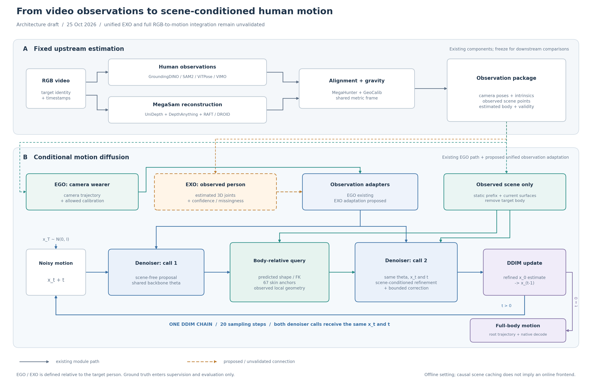

# CVPR 2027 投稿计划：详细依据与协议参考

日常查看以 [简版实验计划](CVPR2027_PLAN_zh.md) 为准。本文保留实验依据、比较协议及原细分时间安排，供需要时查阅；原时间表不作为逐日新增任务清单。

制定日期：2026-10-25，北京时间。本文是投稿前的讨论与执行依据；实验日期为建议安排，不代表已开训或已取得结果。当前状态以 `runs/scene_ego128_residual_checks/PIPELINE_STATUS.json`、`docs/PAPER_MODEL_zh.md` 和具体 run 的最终报告为准。本次仅新增计划和图稿。

## 1. 投稿时间与内部截止

已核对 [CVPR 2027 官方日期](https://cvpr.thecvf.com/Conferences/2027/Dates) 与 [Call for Papers](https://cvpr.thecvf.com/Conferences/2027/CallForPapers)。AoE 为 UTC−12，比北京时间晚 20 小时；以下统一按当天 23:59 AoE 换算。

| 事项 | 官方日期（AoE） | 北京时间截止 | 建议内部完成时间（北京时间） |
| --- | --- | --- | --- |
| 论文注册／摘要登记 | 2026-11-10 23:59 | **2026-11-11 19:59** | **11-09 18:00** 完成注册、作者名单与 enrollment |
| 全文投稿 | 2026-11-16 23:59 | **2026-11-17 19:59** | **11-15 18:00** 上传可提交终稿，预留约两天 |
| 补充材料 | 2026-11-23 23:59 | **2026-11-24 19:59** | **11-23 18:00** 上传终版 |
| Reviews released | 2027-01-25 AoE | 按系统实际发布时刻查看 | 提前整理回复所需证据 |
| Rebuttal | 2027-01-25 至 02-01 AoE | 截止 **2027-02-02 19:59** | 01-31 完成内部回复稿 |
| Final decisions | 2027-02-25 AoE | 按系统实际发布时间查看 | 接收后另排 camera-ready／报告 |

从 10 月 25 日到全文截止约 23 天，不能把补充材料的一周当成继续补正文核心证据的时间。所有支撑摘要和正文主结论的实验，内部目标在 **11 月 8 日** 前齐备。

按当前 [Author Guidelines](https://cvpr.thecvf.com/Conferences/2027/AuthorGuidelines)，正文限 8 页，图表计入；参考文献及必需的 **LLM Usage Statement** 另计。所有作者须在登记截止前完成 OpenReview profile 和 enrollment，之后不能增删作者。没有机构邮箱的新账号审核可能需要两周，应现在处理。本项目使用 AI 辅助规划、代码和图稿，后续应按实际使用范围填写声明。投稿前再次核对官方模板、匿名要求和政策更新。

## 2. 当前已经有什么，缺什么

| 项目 | 已完成的证据 | 论文边界 |
| --- | --- | --- |
| AMASS EGO/EXO 统一无场景先验 | train-only 55k 已完成 | 不是当前 EGO 场景候选的统一能力证明 |
| AMASS EGO-only 先验 | 从零 55k；全验证选 50k；固定 344 窗口测试 MPJPE 150.18 mm、标准 PA 96.30 mm | 官方外部基线的同窗口、同传感器实测仍缺失 |
| 三数据集 EGO-only 无场景适配 | EgoBody／TRUMANS／GRAIL，30k，1416 验证窗口 MPJPE **113.7933 mm** | 已使用场景数据集的动作监督，不能说全部先验仅由 AMASS 训练 |
| 原联合场景＋局部反馈 | 30k 中选 27k，验证 **119.5375 mm** | 比独立无场景差，保留负结果 |
| 冻结先验场景候选 | 从无场景 30k 出发，探索 8k、选 3k；验证 **111.7758 mm** | 改善 2.0174 mm；家族重采样范围 **[−0.9168, 5.1939] mm**，包含零；GRAIL 未改善；未独立测试 |
| 新关系监督试验 | 固定 500 步，176 窗口 112.1088，对父模型 112.0542 mm | 未超过父模型，不扩大此失败方案 |
| 额外无场景更新 | 保留原优化器和 5e−6 LR、额外固定 3k，1416 窗口 **124.2720 mm** | 只检查一种续训设置；不是同容量修正器对照，也未匹配 8k 选模搜索 |
| VideoMimic 前置 | 三段 EgoBody 视频已完成重建、MegaHunter、评测及视频 | 尚未接入当前 SceneMI 候选；三段是开发验证，不构成最终测试集 |
| 当前 SceneMI 后续任务 | 状态为 `awaiting_direction`，列出的任务已完成、`active_jobs=[]` | 此状态不代表整台机器没有其他任务；本咨询不启动训练 |

验证 1416 窗口覆盖 679 个来源家族，不是独立测试。AMASS 的 344 窗口测试与上述场景验证是不同任务，不能互相补足。当前场景数据加载器只开放 `train/validation`，独立 test 的成员清单和入口仍须建设。

主要依据：[候选与证据要求](PAPER_MODEL_zh.md)、[冻结修复报告](../runs/scene_ego128_residual/evaluation/REPORT_zh.md)、[无场景续训报告](../runs/scene_ego128_noscene_low_lr/evaluation/REPORT_zh.md)、[AMASS EGO-only](AMASS_EGO_ONLY_zh.md)、[前置完整报告](../../VideoMimic/real2sim/benchmark_runs/egobody_val3_v1/REPORT_zh.md)。历史文档中“正在训练”的旧段落可能滞后，以上述最终记录为准。

## 3. 论文问题与贡献应怎样收敛

建议保留的研究目标：**在 EGO 与 EXO 两种不完整观测下，利用实际可获得的场景几何，恢复空间位置合理、动作连续的人体运动。**

待验证的三个贡献假设：

1. **观测适配**：共享动作先验，通过不同的 EGO 相机适配器／EXO 估计关节适配器，处理置信度、连续缺失与坐标误差，而不是把外部相机当头部轨迹。
2. **可观测几何反馈**：用预测人体查询已观测表面；对空观测、稀疏或退化邻域显式表达不确定性，再进行受限修正。具体模块须由匹配训练消融支持。
3. **真实前置误差下的增益**：固定前置模型，证明相同估计输入经过本方法后，在补全、轨迹或可靠几何接触方面改善，而非仅在 GT 派生的理想输入上有效。

这些目前都是研究假设。冻结、cross-attention、扩散、EGO/EXO 任务标记本身都不足以构成论文贡献。可用的暂定英文题目为：*Observation-Aware Human Motion Reconstruction with Body-Relative Scene Feedback*。只有统一模型验收通过后，题目或摘要才加入 *Egocentric and Exocentric*。

### 近邻方法与区别证据

已核对下列原论文摘要；这属于相关工作初查，尚未完成全文级新颖性审计。

| 近邻方法 | 已覆盖的方向 | 本文需要额外证明的区别 |
| --- | --- | --- |
| [SceneMI，ICCV 2025](https://arxiv.org/abs/2503.16289) | 全局／局部场景描述、扩散处理含噪关键帧、单目应用 | 从已知关键帧到实际不完整观测的任务差别；可观测性与动态人体查询的新增机制及消融 |
| [COIN，ECCV 2024](https://arxiv.org/abs/2408.16426) | 可控扩散先验、人体／相机估计、人体场景关系损失 | 与优化式场景关系约束的技术差别；相同输入下的质量、速度或缺失恢复证据 |
| [UniEgoMotion，ICCV 2025](https://arxiv.org/abs/2508.01126) | 第一人称视觉条件的统一运动重建／预测／生成 | EGO/EXO 指不同观测对象，不等于其多任务统一；显式可观测几何带来的具体收益 |
| [RESELF，2026-09-01](https://arxiv.org/abs/2609.01276) | 度量几何重建＋几何条件扩散＋运动学闭环 | 这是直接近邻；必须细读输入、几何耦合、反馈对象及实验，不能把两阶段组合称为首次 |

10 月 27 日前形成一页“输入／是否全场景／缺失建模／反馈对象／推理优化／训练数据”的全文证据表。代码或权重不可得时记录查证日期和阻碍，先保证讨论充分，不能虚构复现。本文是在原始 SceneMI 代码上发展的工作，应明确引用和说明继承部分。

## 4. 模型训练方向建议

**分阶段训练、共享动作主干、分别处理观测，再适配场景。** 这与“一套推理模型”兼容；统一不要求所有参数从头联合优化。

1. **A：动作先验。** 复用已有 AMASS 与三数据集无场景模型。正式披露 AMASS 50k 选模、三数据集无场景 30k，以及后续场景 8k 搜索。保留独立 EGO 基线。
2. **B：EXO 观测适配。** 先在无场景下接通真实估计 3D 关节、置信度、连续缺失、尺度／根轨迹误差；保留 EGO 回放。先尝试冻结动作主干、训练观测／体形适配器。若不足，在 10 月 29 日前最多比较一种小型任务适配层，避免同时展开多个架构。完全冻结 EGO-only 基座能否适配 EXO 尚未证明。
3. **C：共享场景适配。** 仅在 B 通过后评估共享场景路径，保留 EGO/EXO 分项和各自无场景对照。当前候选可作为 EGO 参考，但不能直接移植一个 EXO 标记就宣称统一。优先保留已有预测皮肤查询与有界修正；若新增平面方向／可靠性特征，需单独验收和匹配消融，不能沿用旧权重的结论。
4. **D：冻结选择与测试。** 先固定模型 SHA、推理链、噪声种子、test 家族和评分，再运行独立测试。冻结基座＋适配器共同定义模型，必须一起记录／发布身份。

有场景时，每个 DDIM 时间步先调用共享主干得到 proposal，再查询预测人体附近场景，第二次调用同一主干细化；外层是一条 DDIM 链。当前无场景是一次调用，有场景通常是两次。不能画成“先完整生成一次，再运行第二个独立扩散模型”。训练 1000 个噪声时刻、推理 DDIM 20，不等于只训练 20 步。

### 必须固定的前置契约

- 当前可复用实现为 **GroundingDINO＋SAM2 → ViTPose／VIMO；MegaSam → 相机、深度、点图；MegaHunter → 人体／尺度对齐；GeoCalib → 重力**。这些均属于前置部分，不能归为本文新模型。
- EGO/EXO 按“目标人体与相机”的关系定义：眼镜 RGB 对佩戴者是 EGO，对被摄的 interactee 可是 EXO。现有三段 VideoMimic 人体结果不能直接当成佩戴者的 EGO 动作输出。
- EGO 推理不输入佩戴者 GT 关节／个人形状；EXO 允许估计人体，保留实际检测有效性。上游补出的人体不是直接可见观测。
- 相机、人体和场景共用米制尺度、重力和时间轴；GT 仅在评测端使用。同一世界变换必须应用到三者。主设定不允许各方法分别利用 GT 重拟合尺度来改善结果。
- 当前 VideoMimic 三段在尺度恢复后，预测背景到 GT 扫描的中位距离约 **1.69–3.58 m**；这是单向表面距离且不衡量完整度，但已提示场景质量须单独审计。不能直接假定这些几何足以提供厘米级接触修正。
- 场景缓存采用历史前缀和当前观测，也不能据此把系统称为在线／因果：MegaSam 的整段优化及 128 帧动作窗口可能使用未来信息。正文应按真实设定写离线重建；若声明因果，需另行限制并验证前置和时序模型。
- GRAIL 完整椅子仅为带来源标记的训练增强，真实验证／测试不补椅子；TRUMANS／GRAIL 的 GT 派生虚拟观测是受控协议，不能全部称为真实 RGB 端到端测试。

## 5. 必补实验：按论文问题排队

P0 为支撑主结论所必需；P1 在对应贡献进入主文时必需；P2 可削减。下表是计划，不代表授权启动。

| ID／优先级 | 实验与最小对照 | 需要交付的证据 | 内部截止 |
| --- | --- | --- | --- |
| E0／P0 | test 划分与读取入口：原生官方划分优先；核对源录制、人物／物体家族、镜像及跨模式成员 | train/val/test 清单与哈希、重叠审计、test 只读评测接口；发现已看过的样本标成开发数据 | **10-27** |
| E1／P0 | 同冻结基座的**无具体几何、容量相近的动作修正器** vs 完整场景修正器；不能只推理时清零 | 同训练样本／优化策略／更新上限／checkpoint 搜索，报告实际可训练参数、denoiser 调用数和计算预算 | **10-30** 首轮，**11-04** 定稿 |
| E2／P0 | 正确／空／同类错配场景；局部几何差异与输出变化联动 | 使用实际有差异的几何，既报动作又报几何指标；空观测回退；没有反事实 GT 时不按原动作 MPJPE 宣判替代动作错误 | **10-30**，最终模型 **11-06** |
| E3／P0 | 同前置：VIMO 初始化、MegaHunter 输出、MegaHunter＋无场景扩散、MegaHunter＋场景扩散 | 相同视频／人物／相机／场景／对齐；报告完整及可见／不可见关节、根轨迹、覆盖率和失败比例；不能只给三个展示片段 | **11-02** 开发批次，**11-08** 正式表 |
| E4／P0 | EGO 基线重跑：EgoAllo 优先，其次 EgoGVAE；SceneMI／COIN 等按输入兼容性确定比较方式 | 同窗口、同传感器／允许标定、同单位和标准 PA；公开权重训练划分差异单列；论文引用值与本机实测分表 | **11-04** |
| E5／P0 | 几何与时序：支撑距离、GT 接触期足滑、座面支撑、可验证穿透、MPJVE／jerk | 分数据集、动作和可评率；只在可靠几何上计算穿透，非封闭点云不强称有符号穿透；不确定项 N/A；保留总体 MPJPE／PA/root/head | **11-04** 开发，**11-08** 正式 |
| E6／P1 | 最终架构的训练消融：完整；无几何同容量；仅全局／无人体局部路径；有局部但无显式反馈 | 同父权重、同选择预算；固定权重开关另列诊断，不能替代重训；至少回答所有正文声称必要的模块 | **11-06** |
| E7／统一目标必需 | EGO 单任务／EXO 适配／统一 EGO+EXO；统一各自有／无场景 | 分模式、分数据集；EGO 回归与 EXO 缺失恢复；分别说明 EGO 曝光量、总步数、可训练参数，避免将预算差异叫负迁移 | **11-01** 可行性，**11-06** 正式 |
| E8／P1 | EXO 真实遮挡＋预定连续缺失长度；相机／根轨迹与深度误差鲁棒性 | 预先固定如 0/25/50/75% 缺失、连续 0/0.5/1/2 s，结合原始缺失分布；合成扰动与真实误差分开 | **11-06** |
| E9／P0 核心对照 | 最终主方法与关键对照的采样随机性／训练重复 | 主表单样本，不择优；先预定 3 个采样 seed；有容量时关键对照各 3 个训练 seed，至少各补 1 次；家族 bootstrap 不能代替训练重复 | **11-08** |
| E10／P1 | 长序列／窗口拼接与效率 | 至少预定 30–60 s 或数据集可用连续长度；接缝速度、足滑、轨迹漂移；前置与扩散耗时分列、峰值显存、失败处理 | **11-08** |
| E11／P2 | 全程 EXO-only 从零；BSTRO 接触教师；第二前置模型；新增数据集或大规模用户研究 | 仅在核心证据完成且不挤占写作时；BSTRO 不作测试接触真值；公开 SMPL 与 SMPL-X 拓扑差异须处理 | **11-04** 决定做否 |

E0 中若某个数据集没有可用且未污染的 test，不得把反复调参的 validation 改名成 test。明确报告该数据集只有开发结果，在已有真正未见的另一数据集／官方测试上做最终评估；能否支撑论文主张由覆盖范围决定。

E1 与 E6 可以合并为四个训练设置。共同预算应在开训前锁定，例如上限 8k、每 1k 快评、同规则复评前三候选及 final；此处只是与现有搜索对齐的建议。不能让完整模型搜索 8k 却只给对照固定 3k，再称公平选模。数据和更新匹配之外，还须披露算力差异；双调用也可能是收益来源，可用共享主干两次调用、但不输入具体场景的修正器控制。

E9 不要求所有消融都做三种子，但最终核心优势若只有约 2 mm，重复验证应优先于扩展新模块。若重复不支持优势，降低结论强度，不通过挑种子或更换平均方式制造稳定性。未做足训练重复时如实报告单种子及限制。

### 主表与图表最小集合

| 图表 | 内容 |
| --- | --- |
| Fig. 1 | 实际输入与典型问题：看不到的身体、被遮挡的 EXO 关节、可见的支撑表面 |
| Fig. 2 | 前置模型＋本文扩散模型的完整 pipeline，见下方图稿 |
| Table 1 | EGO／EXO 各自实测主结果；AMASS 与场景任务分区；不混不同输入的引用数字 |
| Table 2 | 固定真实前置下的原输出／无场景扩散／场景扩散 |
| Table 3 | 容量匹配、局部查询、显式反馈、统一适配消融，可依版面拆分 |
| Fig. 3 | 遮挡长度／几何可靠性对性能的曲线，附样本数与覆盖率 |
| Fig. 4 | 输入、前置、无场景、完整模型、GT 对照；同时展示失败例 |

## 6. 时间表：训练与写作同时推进

各阶段的日期是交付目标，不是可用 GPU 的保证。若共享机器拒绝准入，顺延重计算并先做文稿、数据审计和只读分析；不干预其他发行版任务。

| 北京时间 | 实验／模型应完成 | 论文／投稿应完成 | 阶段验收 |
| --- | --- | --- | --- |
| **10-25 晚** | 汇总当前候选、失败方案和前置结果 | 本计划、初版 pipeline；启动作者账号整理 | 当前证据和待验证项可追溯 |
| **10-26 10:00** | 交付现有 EGO 结果说明；不是承诺新模型正增益 | 一页问题定义＋贡献假设＋现有数字 | 对齐既有“可评估结果”时间点，明确旧任务已完成 |
| **10-26～10-27** | E0、前置尺度／时间／对象接口审计；确定 E1；完成小规模运行计时 | 细读近邻；Introduction／Related Work 提纲；方法公式与训练阶段草稿 | **G1：10-27 20:00** 冻结主架构、主任务、比较协议 |
| **10-28～10-30** | E1／E2 首轮；EXO 无场景接口及可行性试验；测试入口用开发样本验收 | Method 初稿＋输入表＋实验设置；图 2 v2；表格结构固定 | 阶段 B 能否保持主干冻结有明确结果，最多一次受控架构修订 |
| **10-31～11-01** | EXO 真实输入与 EGO 回归；前置处理固定开发批次 | **11-01 完成全文 v0**：结果空位标 TBD，不等待全部实验 | **G2：11-01 20:00** 决定统一是否进入主结论 |
| **11-02～11-04** | E3／E4／E5；完整模型与核心匹配消融 | 首轮主表；方法与 Related Work 定稿，决定删除 P2 | **G3：11-04 20:00** 核心优势是否有证据，确定投稿范围 |
| **11-05～11-06** | E6／E7／E8 结束；固定所有最终权重与 test 协议，随后开启正式测试 | **11-06 完成全文 v1**，供导师／合作者实质审阅 | 后续不据 test 继续调参；任何新增开发使用须披露 |
| **11-07～11-08** | 独立测试、E9 核心重复、长序列与效率；逐表独立复算 | 主文核心图表与结论完成；失败案例和限制写入 | **11-08 20:00 冻结正文核心证据** |
| **11-09 18:00** | 只修复会影响结果可信度的问题，保留修正记录 | **完成 OpenReview 注册、作者名单／profile／enrollment**；上传题目摘要 | 不等官方 11-11 北京时间截止 |
| **11-10～11-12** | 对已有结果做复现、缺失项核查 | 全文 v2、内部模拟评审；核对图注、单位、贡献与证据逐条对应 | **11-12 20:00** 消除论文论证缺口 |
| **11-13～11-14** | 重计算仅限必要纠错；不新增方向 | 8 页排版、匿名、引用、LLM 声明、PDF／表格一致性；补充材料 v0 | 11-14 完成最终合作者审阅 |
| **11-15 18:00** | 最终模型／数据／结果身份归档 | **上传可提交终稿并检查下载后的 PDF** | 内部全文截止 |
| **11-16～11-17 19:59** | 处理必要勘误并重核相关表格 | 缓冲与官方全文提交；确认 OpenReview 状态 | 禁止依赖最后一小时上传 |
| **11-18～11-20** | 整理已完成的额外分析和完整逐类结果 | 补充 PDF、3–5 分钟匿名视频、复现说明／精简代码包 | 核心论证已存在于正文 |
| **11-21～11-23 18:00** | 核对视频与表格对应模型、缺帧和失败例 | 补充终版上传；不以外部视频链接代替附件 | 内部补充截止 |
| **11-24 19:59** | 无新的核心训练安排 | 官方补充截止，检查提交状态 | 完成投稿归档 |

### 三个方向决策点

- **G1／10-27：** 若前置几何的单位／尺度仍不一致，优先修复输入契约；不靠新的损失拟合错误世界。可保留可信传感器条件的受控实验，但真实 RGB 结论须另外证明。
- **G2／11-01：** 若 EXO 适配没有同时通过真实观测与 EGO 回归，保留统一为研究目标，本次主文收敛为有完整证据的 EGO 场景方法。若统一是本次论文不可放弃的核心，则按未达标处理，不能默认改成 EGO 就足以投稿。
- **G3／11-04：** 若容量匹配后场景优势消失，或有效接触／缺失恢复没有支撑，停止扩展模块。只有已有证据足以回答另一个明确研究问题，才调整论文范围；否则评估延期。11 月 8 日最终测试若推翻核心假设，也应如实调整／停止，而不是隐藏负结果。

局部条件有增益但全体 MPJPE 不改善时，可以研究更清晰的任务结论，例如遮挡恢复或可靠观测下的支撑一致性，但任务及分层必须提前声明，同时公开全体表现，不能事后只挑好看的椅子／楼梯。

## 7. 计算预算与削减顺序

本地历史速度约为：无场景 0.485 更新/s，原场景＋反馈 0.323 更新/s；场景修复 176 窗口一次快评约 408 s，即 2.32 s/窗口。这些是历史测量，当前新任务、并发及外部方法速度须重新短测。

按这些速度，8k 场景更新约 6.9 小时，1416 窗口一次推理粗估 0.9 小时；若每 1k 快评、末尾复核 3–4 候选，一条分支应按 **约 11–13 GPU 小时**量级规划，而不是只计算训练。四个核心设置约 44–52 小时；新增 EXO 适配、核心训练重复、外部基线和前置处理还需另计。初步为研究安排 **80–120 GPU 小时**工作预算，并留出故障与资源等待余量；这不是已经获得的 GPU 配额，也不是完成承诺。

10 月 27 日前用实际短测更新：`总耗时 = 更新数/更新速度 + 验证候选数×窗口数×每窗耗时 + 前置处理 + 基线 + 重复实验`。CPU 前置优化时间与 GPU 时间分别排，不把并发相加误当可以无成本并行。根据实际可用时段检查能否赶上 G2/G3。

时间不足时按顺序削减：**新增数据集／BSTRO／第二前置 → 全程 EXO-only 从零 → 非核心额外消融 → 统一能力扩展范围**。保留输入公平性、容量匹配、最终独立评估、核心比较及写作缓冲；这些缺失时应缩小论文主张或延期。

未来重计算沿用项目资源准入、cgroup／CPU／分配器预算；不绕过拒绝，不重启 WSL，不更改其他用户任务。每次保留一个原子 `last.pt`、当前选中模型及配置／逐例指标／哈希；拒绝分支按既有依赖审计规则清理，不删除复现依赖。本文不变更运行源码、训练配置、权重或状态看板。

## 8. 初版 pipeline 图与图注

可编辑矢量版：[SVG](figures/cvpr2027_pipeline_v1.svg)；排版版：[PDF](figures/cvpr2027_pipeline_v1.pdf)；结构源：[Mermaid](figures/cvpr2027_pipeline_v1.mmd)。图中实线表示已有模块路径，虚线表示尚待实现／验收的连接，包括前置输出与当前扩散模型的接入及统一 EXO 适配；组件存在不代表组合系统已通过独立测试。

**中文图注草稿：** 系统分为固定前置估计与条件扩散两部分。前置从 RGB 恢复共享坐标中的相机、可见场景及被摄人体估计，并保留有效性和置信度。EGO 输入为目标佩戴者的相机观测；EXO 输入为目标被摄人的估计关节，两者通过不同观测适配器进入共享动作主干。每个 DDIM 时间步先生成动作提案，由预测体形解码人体并查询已观测表面，再以局部几何条件细化动作和施加有界修正。完整方法使用一条 DDIM 链，空几何不提供可靠支撑证据。GT 仅进入监督和评测，不进入推理条件。当前 EXO 统一接入仍为拟议路线。

**English caption draft:** *The system separates fixed upstream estimation from conditional motion diffusion. Upstream models provide cameras, observed scene surfaces, and estimated target-body observations in a common coordinate frame. EGO and EXO observations use distinct adapters. At each DDIM timestep, a shared denoiser first proposes motion; the predicted body then queries observed geometry for scene-conditioned refinement and bounded correction. The process uses a single diffusion chain. Dashed connections indicate proposed or unvalidated integration, including upstream-to-diffusion interfaces and EXO adaptation. Ground truth is used only for supervision and evaluation.*

图中“预测体形／FK”可复用已有实现，EXO 观测和体形适配须另外验证；不能将图中的共享方案当作现有统一场景模型的性能结果。待架构和输入协议在 G1 固定，再升级成正式论文图。

## 9. 写作分工与后续咨询入口

建议主研究者负责模型选择、训练与结果解读；合作者提前处理近邻全文比较、账号和文稿审阅。11 月 1 日起即使实验未齐，也应有整篇可读稿，用明确的 TBD 表格占位。8 页初步分配：Introduction 1 页、Related Work 0.75 页、Method 2.25 页、Experiments 3.5 页、Limitations／Conclusion 0.5 页；版面按贡献和证据调整。

后续在此会话讨论方向时，维护四项即可：**当前科学问题、候选模型身份、还缺的关键证据、下一个日期关口**。新结果先更新证据表和决策，不因一张好看截图立即增加训练分支。计划变更写明原因，既有结果和负结果保留。
