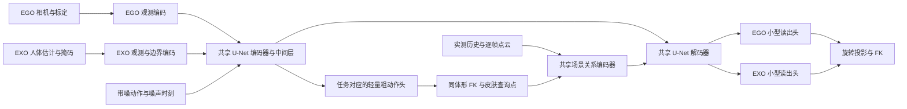

# Method v2：共享运动主干与共享场景关系编码

2026-10-29，供架构与可行性审阅；已按本轮讨论修订 EGO 观测噪声、来源配比、EXO 时序目标与单尺度参考。**这是拟议方法，尚未实现、测速或训练。** 实验配置见 [METHOD_V2_EXPERIMENTS_zh.md](METHOD_V2_EXPERIMENTS_zh.md)，机器可读的审阅参数见 [method_v2_proposal.yaml](../configs/method_v2_proposal.yaml)。后者不是现有 trainer 的可执行配置，讨论的主要交付在对话中。

## 1. 本版的明确选择

模型用不同观测重建同一种人体运动。EGO 根据相机/头部轨迹补足未观测人体；EXO 根据已有估计去噪并补全遮挡。两者共享时序运动主干和场景关系编码，保留各自的观测编码与小型动作读出头。

本版选择一次条件前向预测干净动作，不计算 adapted-reference、不按可靠性反复回填采样状态，也不把低置信度等同于只能修改某个固定范围。保留 EXO 的参考轨迹 A，但用单一5帧参考替代原来的多尺度固定混合。EXO 小头直接预测相对 A 的根平移和旋转，不需要两次完整网络相减；两模式经读出后仍返回相同语义的 clean motion。

保留边界上下文，但将原先 150 维整帧描述改为逐关节的左右有效端点编码，复用关节 token 的结构。场景参数真正共用一个实例；同一次 U-Net 前向内部产生粗人体、查询几何、再解码精细动作。粗人体只提供查询位置；参考 A 也不设最终修正的硬半径。

**正式主模型建议重新从 AMASS 随机初始化训练。** 原因是条件接口、输出读出和 EXO 学习目标都改变了，继续使用旧 joint 权重会继承旧训练行为，难以评估新结构本身。既有模型继续作历史对照；数据、人体模型、坐标处理和已核验的输入资产可以复用。先实现并进行短预算可行性检查，完整训练的执行在审阅之后决定。

## 2. 任务、输入与输出

每个窗口 T=128、30 Hz、J=22，采用米制、重力对齐的共同序列坐标。窗口原点和朝向只从输入观测定义，禁止用目标人体定位。沿用现有 y-up、6D 旋转前两列、共同 pelvis 参考约定，详见 [COORDINATES_zh.md](COORDINATES_zh.md)。

| 模式 | 模型输入 | 需要恢复的内容 |
|---|---|---|
| EGO | 相机位姿、availability/confidence、固定设备标定、人体格式；可选实测场景 | 整个人体的根轨迹与姿态，以及由观测估计的体形 |
| EXO | 前置估计的 root/pose/shape、逐帧与逐关节有效性、可见性、置信度；可选外部相机及实测场景 | 观测误差修复、遮挡关节和缺失区间补全 |

EXO 当前范围明确为 **pose-and-shape 前置估计**，不将仅有稀疏 3D joints 写成已支持的等价接口。外部相机是 observer，不能替换为目标头部轨迹。AMASS 阶段无真实外部相机，相关输入标为不可用。

EGO 由观测预测体形，使用相应人体格式的解码器得到 estimated rest skeleton；EXO 使用前置估计的 shape/template 解码骨架。本版不增加 EXO 体形修复网络。最终 FK、粗人体和场景皮肤查询必须使用同一份估计体形；目标体形只用于监督。固定错误骨长带来的误差属于本版明确限制。

扩散状态保留现有 201D 布局，减少坐标/数据迁移：

\[
X=[(p-s_0)/2;\,\gamma(R_{0:21});\,P_{0:21}/2].
\]

网络只读出 135 个独立运动学量（3 root + 22×6 rotation），正交化旋转后经 FK 补出 66 个位置通道，构成 clean prediction。因而没有第二套独立的关节位置输出，也不再为它叠加 raw-position consistency 损失。

## 3. 一次前向的网络结构

### 3.1 观测编码

两类观测各自编码为 [B,128,128] 的逐帧特征；分别使用三层 k=5、dilation=1/2/4 的时间卷积，hidden=128。观测特征投影到 U-Net 条件输入，噪声时刻使用独立 embedding。模式由显式枚举选择编码器和读出头，不从相机缺失或数值符号猜测。

EGO 特征包括输入位姿、基于有效相邻帧计算的线/角速度、可用性、置信度和标定信息。头显相机到头部的变换由该样本的设备标定与估计体形定义，不将个体真实体形输入网络。

EGO 增加轻量观测噪声训练：初始建议50%窗口保持原观测，50%施加时间连续的 SE(3) 测量扰动；位置控制点标准差 U[1,5] mm、旋转 U[0.1,0.5] 度、控制点间隔 U[0.2,0.5] s，作为未标定的 pilot 初值。扰动旋转在 SO(3) 上复合，不逐元素噪声化旋转矩阵；随后重新计算条件速度、窗口坐标与置信度，避免留下干净派生特征。标签不随测量噪声改变；纯坐标增强则须同时变换人体、相机和场景。若点云与相机共享 SLAM 误差，须保持其误差来源一致。相机 dropout/长时漂移先作独立压力测试，实际误差范围由训练侧传感器记录校准，不声称上述初值已代表真实设备。

EXO 将每个关节构成一个 token：原始估计全局位置 3、局部旋转 6、位置/旋转置信度 2、估计有效性 1、可见性 1，再附参考 A 的全局位置3与局部旋转6，共22维；加16D关节ID，由 MLP 38→64→32 编码，22 个关节 token 经投影得到128D帧特征。root的位置和朝向由joint 0提供，不额外复制一套root token。原始位置/旋转有效性不一致时，分别清零对应分量并清零其置信度；参考的有限填充值不改变原始掩码。

参考 A 只采用一档对称5帧三角核 [1,2,3,2,1]/9：根位置和各局部旋转按前置估计有效性/置信度分别归一化滤波；旋转均值必须投影回合法 SO(3)，不能直接把矩阵平均值当旋转。缺失区间在有效参考端点间根线性插值、旋转 SLERP，端部保持最近估计；无端点使用中性有限值与 null。A的全局关节位置只由同体形 FK 得到。原始 I、参考 A 与掩码一起进入同一个 EXO 编码器，保留快速动作的原始信息；均不会触发第二次主干前向。

填充帧有效性保持零。A 不承诺是真值，不提供修正半径，也不混入 clean target。5帧只是候选，需与原始参考及旧多尺度参考比较；旧锚点的效果不能直接归功于新参考。

可选 EXO observer 位姿/内参与有效性使用一个小 MLP，与人体帧特征相加；AMASS 中该项严格为零。EGO/EXO 使用同一坐标合同，不要求两种相机承担相同角色。

### 3.2 逐关节边界上下文

对每个关节 j，在时间上检索左右最近的实际有效且可见估计；root 按实际可用的 root 轨迹检索。用于检索的掩码由输入定义，不从填充值或真值推断。局部旋转与位置分别检索，若其有效帧集合不同，分别构建端点 token，不能把一个模态有效当成两者都有效。

一个端点 token 包含：位置 3、局部旋转 6、根/关节位置的有效差分速度 3、位置/旋转置信度 2、带方向时间距离 1、端点有效性 1，再附关节 ID 16。速度仅用同关节实际有效的位置估计计算，并除以实际帧间隔/30；无另一有效点时置零，不能对填充轨迹差分。缺失模态清零并通过置信度/有效性标识。MLP 32→64→32 的权重在关节和左右方向之间共享；两种模态的端点分别产生 token。

以当前关节 token 为 query，对左右位置端点、左右旋转端点及一个固定零 null token 做单头 attention。无效端点不参与 softmax。得到的 32D 上下文仅加入当前缺失/不可见的对应关节 token；边界输出投影零初始化。若所有端点都无效，结果为零。

这样把长间隔信息显式带到当前帧，同时避免 150D 整帧大拼接和另一套独立时间网络。它仍是 offline 双侧条件，不能称为因果/实时方法。旧边界结构的约 5.5 mm gap 改善只支持“保留边界信息值得研究”；**不证明这套新 token 结构已经更好**。

### 3.3 共享运动主干与任务读出

保留 SceneMI 来源的 1D temporal U-Net：基础宽度 256、倍率 [1,2,4]，时间分辨率 128→64→32，归一化使用 GroupNorm/AdaGN，不使用跨样本 BatchNorm。观测特征、体形特征和噪声时刻进入明确的条件路径，不保留旧代码里未启用但暗中参与的场景路径。

编码器和 decoder 全部共享。最终 hidden feature 上，EGO 与 EXO 各有一个 1×1 Conv，256→135；每个头约 34,695 个参数。EGO 读出 absolute root/rotation；EXO 读出无硬限幅的根位移 delta_p 与6D相对旋转 delta_R，经合法旋转投影后得到 p_hat=p_A+delta_p、R_hat_j=delta_R_j R_A_j，再 FK。此处修订了首稿的两模式 absolute 读出选择；差异仅在小头的参数化，扩散状态、clean-motion target 和最终监督语义相同。

这使任务差异在观测入口与小型输出映射中有位置表达；共享主干承担大部分人体运动建模。它不保证共享梯度永远同向，必须用独立任务对照检查。首版不叠加 task decoder、LoRA、梯度投影或动态 loss 网络。

### 3.4 粗人体与单次场景查询

中间层特征 [B,1024,32] 通过任务对应的 1×1 粗动作头 1024→135，时间插值至 128 帧，再进行旋转投影、FK 与原生稀疏蒙皮，得到 67 个查询点及其 body-region 标签。每个粗头约 138,375 个参数。

粗头沿用对应模式的读出规则，EXO 相对同一 A 解码；不在 coarse 与 final 之间重新生成另一份参考。

粗动作头在 AMASS/原生无场景阶段由动作监督训练，因此场景阶段开始时已有可用查询提议。粗头输出不作为 final 输出的残差基座，也不限制 final 输出与其距离。

场景查询以 detached 粗人体为坐标；不对离散邻居选择反传。粗头有自己的监督，不靠不连续的近邻搜索学习位置。查询完成后，剩余 decoder 在同一次 U-Net forward 中接收几何特征，输出最终动作。

这是本版新增、需要先验收的结构。低分辨率粗人体可能漏掉快速动作，高噪声时也可能定位不准；必须报告 coarse root/MPJPE、查询命中率和按噪声等级的几何覆盖。若粗人体不足以支撑查询，先判断这一步可行性，不自动添加第二轮主干、第三个修正器或扩大半径掩盖问题。

## 4. 场景编码为什么可以共用

共用的对象是“人体相对实测几何的关系”，不是把 EGO 与 EXO 的原始点云当作完全相同的分布。相同的人体表面位置面对同一表面，应使用相同的距离、方向和可见性语义；点云视角、射线起点、缺点模式则由各自输入保留。

### 4.1 点云与关系

输入包括窗口起点之前的已观测静态历史（上限 8192 点），以及各帧真实 first-hit 点（上限 512 点/帧）。历史以 5 cm voxel 采样，当前点保留 owner/时间对应。动态表面不堆进静态历史，不用未来帧补当前隐藏几何。

对每个查询点 q 和其人体全局旋转 Q，在半径 0.6 m 内取最近 K=8 点。每个邻点的关系为 12D：

\[
r=[Q^\top(p-q)/r_q;\ d/r_q;\ Q^\top n;\ m_n;\ \eta_s;\ m_s;\ m_f;\ m_u].
\]

其中 n 为有效局部平面法向，m_n 为法向有效性，eta_s 为表面可靠度，m_s/m_f/m_u 分别表示邻近实测表面、测得自由空间、未知证据。前三者不简单强制成互斥 one-hot；unknown 只在没有表面与自由证据时为一。法向无效时数值为零，但表面点仍可用。邻域平面拟合沿用现有有效性检查，不把局部平面当成封闭网格 SDF。

法向先在观测层按射线来源统一方向，然后转到人体局部系。历史点缺少射线来源时不虚构法向朝向或 free-space；其法向可用性需显式标记。owner 只用于拒绝混合物体平面和时间对齐，不把数据集特定物体 ID 当成共享语义标签。

若无近邻但存在测得自由证据，构造一个仅携带 free 标记的关系 token；其余无效几何分量为零。完全未知则使用 null token，并强制最终注入为零。

### 4.2 唯一的一套共享参数

12D 关系与 12D 粗人体状态（相对 pelvis 位置 3、速度 3、朝向前两列 6）、8D body-region embedding 拼接，MLP 32→64→64。人体位置除以 2 m、速度除以 1 m/s；邻点按有效性归一化平均，再按 body region 聚合为 22×64。投影至 128D 后通过两层 k=3 时间卷积。只在两个 decoder 分辨率投影注入；投影层零初始化。保留人体状态也使等参数 motion-only 控制具有随动作变化的输入，而非只接收常数零。

\[
H_k\leftarrow H_k+g_\tau\,\operatorname{Resize}_k(m^{evidence})\,
W_k\operatorname{Resize}_k(E_{scene}(r)),\qquad
g_\tau=\sqrt{\bar\alpha_\tau}.
\]

高噪声时降低几何影响，以减少粗人体位置不确定的后果。m_evidence 表示有实测 surface/free 证据；没有证据时，最后一次乘法严格置零。scene encoder、region embedding、时间层和注入投影在两任务间都是**同一组参数**；任务读出头仍分别处理最终映射。

本版不加单独的接触预测器、无符号穿透惩罚、额外 head/root 保持损失或输出限幅。几何是否有效，通过相同人体监督下的 matched scene/motion-only 控制及正确/错配几何检查回答。

## 5. 统一 clean-motion 学习

两个模式都使用同一标准前向扩散：

\[
X_\tau=\sqrt{\bar\alpha_\tau}X_0+
\sqrt{1-\bar\alpha_\tau}\epsilon,\quad
\tau\sim U\{0,\ldots,999\},\quad\epsilon\sim\mathcal N(0,I).
\]

1000步cosine schedule，预测clean motion。EXO参考I用于观测编码，其简化参考A用于读出参数化；二者都不混入前向clean target，不把训练tau限在0–200。保留标准clean target便于共享主干学习相同输出语义。

训练用两个模式的平均目标：

\[
\mathcal L=\tfrac12\mathbb E[\mathcal L_E]+
\tfrac12\mathbb E[\mathcal L_X].
\]

0.5/0.5 是任务权重，不是梯度平衡的保证。loss 的物理尺度、梯度范数和共享梯度余弦同时记录；不因为 EXO 任务更容易就默认增大 EGO loss，也不把两个 loss 数值接近当成能力平衡。

### 5.1 动作损失

定义 h 为逐元素 Huber，阈值为 1；以下先在单个样本内归约，再按模式/来源归约。估计位置与目标位置分别通过各自 estimated/target rest 计算。

\[
\begin{aligned}
L_{root}&=\langle h((\hat p-p^*)/0.1\,m)\rangle,\\
L_{pose}&=\langle h(((\hat P_j-\hat p)-(P_j^*-p^*))/0.1\,m)\rangle_{j>0},\\
L_{rot}&=\left\langle\|\hat R_j-R_j^*\|_F^2/6\right\rangle,\\
L_{vel}&=\langle h((30\,\Delta\hat P-30\,\Delta P^*)/(1\,m/s))\rangle,\\
L_{motion}&=L_{root}+L_{pose}+0.5L_{rot}
+0.1\bar\alpha_\tau L_{vel}.
\end{aligned}
\]

root 与 root-relative pose 分开，避免同时在全局位置、root、head 位置里重复加重根误差。L_rot 在 22 个关节局部旋转上计算；转成全局位置后的父链效应由 FK pose loss 监督。针对已经观察到的 EXO 根轨迹和局部姿态残余抖动，增加一项 EXO-only 加速度误差 L_acc=mean Huber((30² delta² P_hat-30² delta² P*)/(2 m/s²))，系数0.05×alpha_bar；这是相对 GT 的导数误差，不是让预测加速度趋于零。不再叠 jerk、turning、neck、foot-velocity、planting 等项。0.05与2 m/s²均为待验证初值，需检查快速动作和相位保持，并做无此项对照。

EXO不再另设hidden/root-gap等重复loss。为了避免小块遮挡被全身平均淹没，EXO的pose/rot/vel/acc在有可见与隐藏两组时分别归约并各占一半；只存在一组时使用该组均值。位置组按位置有效可见性，旋转组按旋转有效可见性定义；velocity只有相邻两帧均可见才归为可见组，acceleration要求三帧。root始终单独监督。

粗头的辅助项为上述 root+pose+0.5rot，不含 velocity、观测或 shape；系数 0.25。它既用于学会查询位置，也在无场景和 motion-only 控制中保留，避免把额外粗头监督误算成几何收益。

### 5.2 观测与体形损失

观测损失统一表达为 predicted body 经对应传感器映射后与实际输入的鲁棒误差：

\[
L_{obs}=\frac{\sum_i m_i c_i\,ell(\mathcal H_m(\hat X)_i,O_i)}
{\max(\sum_i m_i c_i,1)}.
\]

位置使用 Huber(误差/0.02 m)，旋转使用旋转矩阵 Frobenius 误差除以 6，再除以 (0.1 rad)^2 作为近单位尺度。位置/旋转两组分别归一化后等权平均；无效组不参与。

EGO 的 H_E 是头到相机的标定映射，EXO 的 H_X 是前置估计定义的 root/joint 表示。EXO 遮挡估计仍可以作为带低置信度的条件输入，但其未实测部分不施加观测保持损失。EGO 相机与 EXO 人体证据不共用错误的测量方程。

最终单模式目标为：

\[
L_m=L_{motion}+0.1\bar\alpha_\tau L_{obs}
+0.1L_{shape}+0.25L_{coarse}
+\mathbf 1_{m=EXO}\,0.05\bar\alpha_\tau L_{acc}.
\]

L_shape 仅对 EGO 预测体形计算，包括 rest error（尺度 0.05 m）、原生 beta error（尺度 1 个标准化系数单位），需要模板类别时另含 0.1×模板交叉熵；三部分相加后乘外部 0.1。G1 固定模板无 beta/template 学习项。EXO 的 L_shape=0。beta 的归一化统计只由训练集计算并固定。

这些系数是供审阅的初始设置，不是从文献抄来的最优值，也尚未调参。若短试验显示某项梯度压倒其他项，先报告量级并修订草案，不通过新增补偿损失掩盖。

## 6. 三阶段训练及任务干扰控制

| 阶段 | 数据与任务 | 更新参数 | 目的 |
|---|---|---|---|
| A：AMASS 联合从头训练 | EGO+EXO，无场景 | 两观测编码、边界、共享主干、粗/最终任务头、EGO AMASS 体形头 | 用相同 clean-motion 目标建立共享运动表示 |
| B：原生观测适配 | AMASS replay + EgoBody/TRUMANS/GRAIL，两模式 | 冻结共享运动主干；各自观测编码、各自粗/最终头、EGO 原生体形头 | 适配真实相机、人体格式和 EXO 输入分布，减少后续任务间改写主干 |
| C：共享场景训练 | 三个原生来源，两模式 | 冻结 A/B 所有参数，只训练一套共享 scene encoder 与注入投影 | 单独验证几何能否帮助两种任务 |

阶段 B 的两套任务参数分开裁剪梯度，避免共享一个全局 clip 又造成更新幅度互相影响。阶段 C 场景参数仍收到两任务梯度，因此不能宣称消除了任务干扰；需要同时通过两任务门槛。共享场景没有稳定收益时，不自动复制第二套场景网络使主张变成另一件事。

阶段 A 的共享梯度冲突不能靠分头彻底解决。必须在同 motion 曝光量下比较 EGO-only、EXO-only 与 joint；否则“促进”仅是设计愿望。梯度余弦只是诊断量，不能代替验证性能。

## 7. 推理与代价

两个模式默认从 Gaussian noise 开始，使用相同的 20 步 deterministic DDIM，CFG 默认关闭。每个时刻执行一次完整共享主干；场景在该次前向内部查询。只调用当前任务的粗头和最终头，不同时计算另一个任务输出。

缺少场景或 scene 关闭时完全跳过几何构建/注入，返回同一无场景模型。完全未知几何的输出应与 scene 关闭逐值一致。EXO 不在每步复制高置信度通道；由条件和观测一致性控制保持程度。零噪声 identity 因此衡量实际重建误差，不能再声称 0.001 mm 的结构性精确复制。

训练过程中 stage A/B 还计算粗头监督；stage C 即使主干冻结，也需允许 decoder 对注入特征求导，不能把整个 frozen decoder 放在 no_grad 中切断 scene 梯度。粗头、体形和离散查询可以 no_grad。

与旧版相比，EXO 从 8×2 次主干调用变为 20×1 次，调用数实际增加；EGO 场景从每步两次主干变为一次。新方案是否更快必须实测，不能只凭“一次前向”宣称端到端加速。场景 KD-tree 构建应每窗口缓存并在多个 diffusion steps 复用，当前帧动态点保持时间对应。

长序列采用 128 帧窗口、64 帧 overlap。先转回共同世界坐标，对 root 用重叠权重平均、旋转用合法 SO(3) 插值/平均，再以窗口一致的估计体形 FK；禁止直接平均旋转矩阵或独立拼接各窗口局部坐标。窗口指标与拼接后指标分开报告。体形跨窗口以观测聚合后固定，不能每窗变化造成肢体尺度跳变。

## 8. 可行性与论文边界

本版最需优先验证的是：一次前向内的粗人体能否定位查询；冻结主干后的原生适配是否足够；共享场景在两类观测分布上能否同时受益。这三项失败都应促成结构取舍，不默认靠增加模块补齐。

当前数据合同的 `exo_payload_adapter_ready=false` 仍需真实接入与验收，输入索引通过不代表新模型接口完成。EXO 主要由标注加扰动模拟，真实前置输出必须另行固定接口并评估；新稿不把模拟成功写成真实视频泛化。

方法来源与区别：

- [SceneMI](https://arxiv.org/html/2503.16289v2)：时序 U-Net、条件去噪与人体场景关系的架构背景。
- [RoHM](https://arxiv.org/html/2401.08570v2)：带噪/遮挡观测条件下的 clean-motion 重建；它采用 global/local 分解，不等于本版 EGO/EXO 分头。
- [EgoAllo](https://arxiv.org/html/2410.03665v3)、[官方 network.py](https://github.com/brentyi/egoallo/blob/main/src/egoallo/network.py)：明确表示/条件、直接读出运动学量的参考；不能把其头部对齐直接用于 EXO。
- [UniEgoMotion](https://arxiv.org/html/2508.01126v2)：通过条件差异组织统一模型，任务范围与本版不同。
- [MTAN, CVPR 2019](https://openaccess.thecvf.com/content_CVPR_2019/html/Liu_End-To-End_Multi-Task_Learning_With_Attention_CVPR_2019_paper.html)：共享表示与任务专用路径的一般依据；本版没有直接采用其 attention 网络。
- [Gradient Surgery](https://arxiv.org/abs/2001.06782)：说明共享梯度冲突是需实测的优化问题。本版首版不启用 PCGrad，也不把它列为必要模块。

共享主干、分任务头、端点 attention、点云局部查询和零初始化注入都不是单独的新颖性证明。投稿贡献能否成立，要由统一观测下的重建质量、几何证据的实际作用及必要消融决定。
