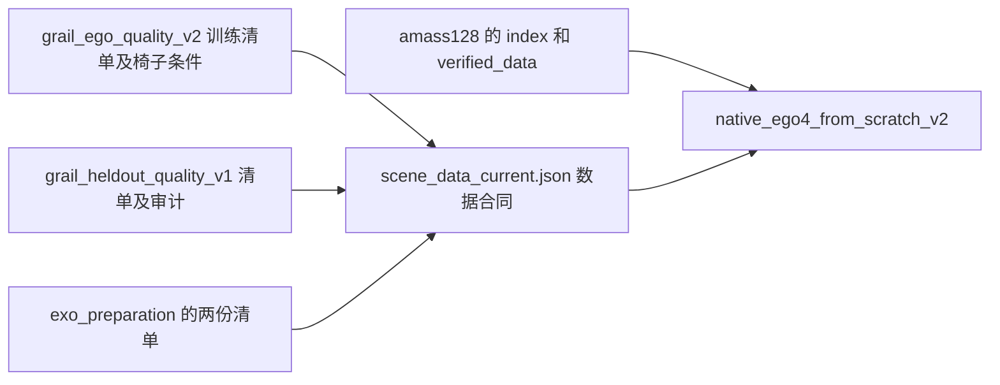
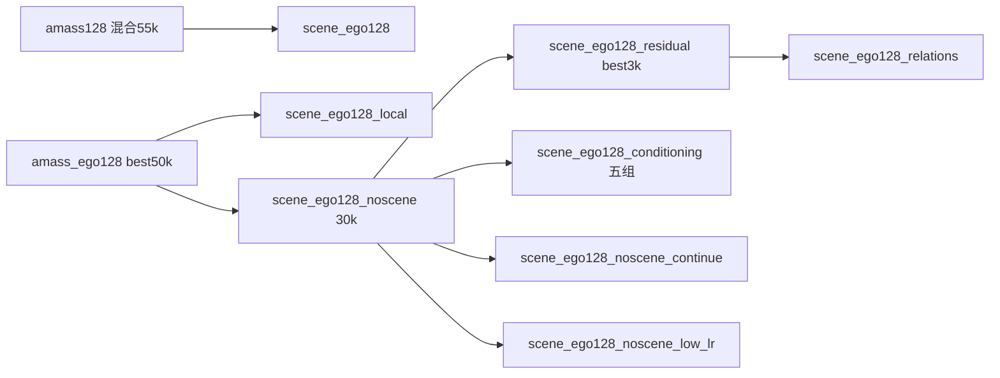
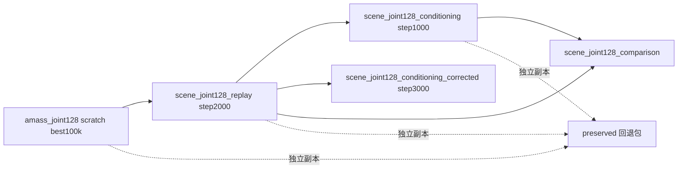

# runs 目录用途、依赖与清理判断

盘点时间：2026-11-02 北京时间约 15:49。范围：`SceneMI/runs` 的全部 **50 个一级目录**及一级服务日志。本次只做盘点和新增本说明，未删除、移动或改写任何实验文件。

实际文件块占用约 **56.4 GiB**（`du -h` 向上显示为 57G），其中只有 `native_ego4_from_scratch_v2` 的训练进程仍在运行。旧场景完整比较已经完成；`scene_joint128_comparison/CURRENT.json` 的 `evaluating` 是历史残留，不能据此判断仍在评测。训练目录会继续增长，以下大小是快照。

表中大小按目录内部 inode 去重计算，跨目录共享的硬链接仍会在各自目录显示，因此各行不能直接相加。机器可读的占用与硬链接数据见同目录 `runs_inventory_20261102.json`。本说明区分“当前运行需要的文件”“重现旧分支需要的文件”和“仅记录历史信息的引用”；文档里提到某目录，不代表当前计算需要读取它。

**当前四源 EGO 从随机初始化训练，不加载下面那些旧 EGO、EXO 或场景模型权重。旧模型多并不代表当前模型依赖它们全部。** 但它共享旧目录内的数据准备结果和筛选清单，不能据此整目录删除数据。

## 当前训练与共用数据：优先保留

| 目录 | 大小 | 实际用途及状态 | 依赖与删除影响 |
|---|---:|---|---|
| `native_ego4_from_scratch_v2` | 8.05 GiB | 当前四源 AMASS/EgoBody/TRUMANS/GRAIL EGO-only，从零训练，14,000 步预算；无场景输入 | 唯一活动训练。保留整个目录到最终验证和选模结束；目前最佳是 12,288 步。 |
| `amass128` | 14.31 GiB | 第一代 AMASS EGO/EXO 混合先验，55k 已完成；**同时存放共享 AMASS 预处理数据和索引** | 当前训练读取 `index/complete.json` 和 `verified_data/`。约 13 GiB 是数据，`training/last.pt` 才是旧模型。不能把整个目录当作旧实验删除。旧 `scene_ego128` 还依赖其 55k 权重。 |
| `grail_ego_quality_v2` | 53 MiB | GRAIL 第二版训练片段质量筛选、400 个椅子条件和支撑异常审计 | 当前数据合同直接读取 `full/train/windows.jsonl`、`chair400/SELECTION.jsonl`、`chair400/conditions/PROTOTYPES.json`。这些不是模型输出缓存。 |
| `grail_heldout_quality_v1` | 20 MiB | GRAIL validation/test 的质量筛选和分割检查 | 当前数据合同校验 validation/test 清单及 `full/STATUS.json`、`full/VALIDATION.json` 的哈希；即使不读取 test 动作数组，也会校验 test 清单文件。不能删除清单。 |
| `exo_preparation` | 9.46 GiB | EXO 数据准备；主要是 TRUMANS 移动相机观测与场景点，另有对齐后的 GRAIL 清单 | **不是 9.46 GiB 的模型试验权重。** 当前 EGO 的通用数据合同仍校验 `trumans_moving/manifest.jsonl` 和 `grail_ego_aligned/train/selection.jsonl`。大部分 `trumans_moving/data/` 数组供 EXO 使用，当前 EGO 不靠这些 EXO 数组训练；若决定彻底放弃旧 EXO/场景复现，可单独重新评估这部分，不能连清单一起整目录删。 |
| `data_inventory` | 5.6 MiB | 当前 EGO/EXO 数据量、抽样覆盖与合同验收记录 | `CURRENT_SELECTION_CHECK.json` 是后续准备/训练的前置验收证据，配置和旧协议会引用。体积很小，建议保留。 |
| `scene_contact_reliability_preparation` | 约 36 KiB | 后续场景阶段的脚接触可靠性组件：四类真实 GRAIL 窗口验收 | 状态为“组件已验收，尚未集成训练”。没有在这里训练新模型，也没有修改当前 EGO 损失。是后续准备记录，建议保留。 |

当前实际的文件关系：



具体证据：`configs/native_ego4_from_scratch_v2.yaml`、`configs/paths.local.yaml`、`configs/scene_paths.local.yaml`、`configs/scene_data_current.json`；`scenemi/data/checked_scene_dataset.py:SceneSelection.__init__` 会校验合同内**全部来源文件**，不是只校验当次使用的 EGO 文件。

数据还依赖 runs 之外的 native manifest、相机安装参数、人体模型和源动作；本清单不把外部数据列为可删除对象。`amass128/verified_data/neutral/Transitions_mocap` 和 `SSM_synced` 是指向 `/mnt/e` 的目录软链接，其目标数据未计入这里的实际文件块占用。

## 较早的 EGO 与场景适配实验

这些都已结束，均不是当前四源从零 EGO 的初始化来源。保留它们的理由是历史对照、旧模型复现或之前明确约定的保留范围，而不是当前训练必须加载它们。

| 目录 | 大小 | 做过什么、结果状态 | 主要信息连接及取舍 |
|---|---:|---|---|
| `amass_ego128` | 2.67 GiB | AMASS-only EGO 从零训练 55k，验证选中 50k；保存 best50k、final55k 和基线评测 | best50k 是 `scene_ego128_local` / `scene_ego128_noscene` 的父模型；final55k 是旧 EXO 适配器的冻结主干。此前约定保留的旧基线。 |
| `scene_ego128` | 2.75 GiB | 最早的三原生数据集 EGO 场景训练：全局/patch 场景条件，30k 完成，选中 25k | 从 `amass128/training/last.pt` 的混合 55k 先验起步。不是后面 local/conditioning 五组的父模型。若不再需要这一代场景结果，可作为整条旧分支评估。 |
| `scene_ego128_local` | 3.12 GiB | 预测人体皮肤的局部场景反馈，30k 完成，选中 27k；包含场景消融/回归评测 | 从 AMASS EGO best50k 起步；与 `scene_ego128_noscene` 配对作有/无场景对照。删它会失去这一代局部反馈模型及可视化，不影响当前从零训练。 |
| `scene_ego128_noscene` | 2.17 GiB | 三原生数据集 EGO 无场景适配对照，30k 完成并选中 30k | **旧 EGO 场景改进系列的核心基座**：residual、五组 conditioning、两种继续训练都要用它。想保留这些适配器可运行，就应保留其 `selection/best.pt` 及合同。 |
| `scene_ego128_residual` | 1.34 GiB | 冻结无场景 30k 基座，只训练残差场景适配器；8k 完成，选中 3k | 依赖 `scene_ego128_noscene/selection/best.pt`。`scene_ego128_relations` 又从其 3k 适配器起步；不是独立完整模型。 |
| `scene_ego128_noscene_low_lr` | 1010 MiB | 无场景 30k 基座的低学习率保守续训，额外 3k 已完成 | 作为 residual 的同预算优化对照；保留约 982 MiB 的 final checkpoint。放弃这组对照即可评估去掉其权重。 |
| `scene_ego128_noscene_continue` | 14 MiB | 较激进的无场景继续训练，计划 8k，约 1188 步停止 | 与 residual_checks 的预算/学习率诊断相连；现在没有 `.pt`，主要是训练与恢复记录。 |
| `scene_ego128_conditioning` | 257 MiB | 冻结同一无场景 30k 基座，五组各 3k：full、motion_only、points_only、late_only、ungated；两套完整评测已完成 | 每组 `last.pt` 仅约 9.2 MiB，**都需要无场景 30k 基座**。末端注入在该旧验证协议上最好；不是当前模型的消融。 |
| `scene_ego128_relations` | 9.2 MiB | 从 residual3k 开始的 500 步观测表面关系小试；快评完成，未提升为正式候选 | 当前无权重，主要保留失败/恢复、几何审计和快评证据。文档引用 residual，不代表当前训练读取它。 |
| `scene_ego128_residual_checks` | 3.6 MiB | residual 的正确/错配场景检查、几何误差分布、后续控制实验汇总 | 不训练一个新基座。关联 residual、relations、两种无场景续训及五组 conditioning；主要是结果记录。 |
| `scene_ego128_rejected_intrinsics` | 684 KiB | 早期相机内参错误的废弃试跑，158 步停止 | 权重已退役，保留 `RETIREMENT.json`、旧合同与源码归档。基本不占空间。 |

这一代权重继承关系：



## EXO 修复系列：多数目录已经很小

EXO 指外部观测条件的人体运动修复；这些主要是 AMASS 合成噪声/遮挡/缺帧实验。不能把其中所有改进直接解释为真实视频效果，也不要把这些目录当成当前 EGO 的模型依赖。

| 目录 | 大小 | 实验用途及状态 | 依赖与取舍 |
|---|---:|---|---|
| `amass_exo128` | 190 MiB | 冻结 EGO55k 的早期 EXO 条件适配器，15k 训练/选模 | 需要 `amass_ego128/training/last.pt`；anchor 诊断引用它。与后来的 denoise 方案不同。 |
| `amass_exo128_anchor` | 15 MiB | 早期 EXO 观测保持/时间锚点诊断；已完成 | 固定 `amass_exo128` 的参考适配器，含 `REFERENCE.pt`；是诊断，不是又一轮长训练。 |
| `amass_exo_repair128` | 68 MiB | 初始化残差修复 2k 小试；改善门槛未全部通过 | checkpoint 已退役；留下逐窗口指标、日志、协议和 `CHECKPOINT_RETIREMENT.json`。 |
| `amass_exo_basis128` | 89 MiB | 时间基函数/初始化修复 2k 对照，完整验证通过当时门槛 | 保留约 8 MiB 适配器；其 `full_validation/metrics.jsonl` 被 denoise 配置作为已训练时间对照读取。 |
| `amass_exo_denoise128` | 90 MiB | 在扩散网络内部注入 EXO 条件，36k 完成并选中 36k | 冻结 EGO55k；比较 `amass_exo_basis128`；又是 completion 两分支的父适配器。 |
| `amass_exo_completion128` | 88 MiB | 从 denoise36k 做两组各 6k 的等预算对照：原方案继续、增加缺帧边界条件 | boundary 分支的 `selection/best.pt` 是 continue 的父模型；control/boundary 结果应成对理解。 |
| `amass_exo_continue128` | 90 MiB | 从选中的 boundary6k 继续 EXO-only 20k，选中额外 15k | 是旧三源 joint 无场景适配的 EXO 初始化；旧 EGO55k 主干仍冻结。 |
| `scene_exo128_noscene_repair` | 空目录 | 三原生数据集 EXO 修复预留输出 | 没有实际训练产物，没有释放空间的意义。 |

权重和对照关系：

```text
amass_ego128/final55k
  ├─ amass_exo128 → amass_exo128_anchor
  ├─ amass_exo_repair128（已退役）
  ├─ amass_exo_basis128（denoise 的已训练时间对照）
  └─ amass_exo_denoise128/best36k
       └─ amass_exo_completion128/boundary/best6k
            └─ amass_exo_continue128/best15k
                 └─ scene_joint128_noscene / multigap 的旧初始化方案
```

旧 EXO checkpoint 很多只保存适配器，保留它并不等于保留了完整人体模型；仍需 EGO55k 主干及相应协议。约 15k、36k 等步数的数字是各自分支内的更新数。

## 联合 EGO/EXO、回放与联合场景系列

| 目录 | 大小 | 实验用途及实际状态 | 依赖与取舍 |
|---|---:|---|---|
| `amass_joint128` | 1.07 GiB；单删仅释放约 101 MiB | `scratch` 从零训练 AMASS EGO/EXO 共享模型，110k 完成，完整验证选中 100k | replay 和几个 pilot 的父模型。scratch 的权重不是继承上面 EXO 适配器；配置中的旧结果还用于基线比较。约 995 MiB 的 best 与其他四处路径共享 inode。 |
| `scene_joint128_noscene` | 84 MiB | 较早的三原生数据集无场景联合适配方案，不含 AMASS 回放；当前记录为失败，已有失败/保留能力诊断 | 旧 EGO55k + EXO continue15k 初始化。当前无 `.pt`，主要是零步评测和失败记录；不要当作正在跑的 joint 模型。 |
| `scene_joint128_noscene_multigap` | 5.9 MiB | 多缺帧条件的联合无场景准备/验收分支 | 使用同样旧初始化，复用前一目录的零步基线；未见完成的正式训练权重。 |
| `scene_joint128_replay` | 2.73 GiB；单删约 1.76 GiB | 四源无场景联合适配，含 AMASS 回放，2k / 256k 抽样窗口已完成 | 从 AMASS joint best100k 起步；step2000 是两代联合场景模型的父权重。已完成训练不等于全部保留能力门槛通过。保留旧场景模型运行能力就需要它的候选权重。 |
| `scene_joint128_conditioning` | 32 MiB | 第一版联合场景适配器，停在 1000 / 3000 步，存在 EXO 内参重复缩放及分支学习率问题 | 依赖 replay step2000。是旧完整比较的 scene 模型；不再活动。此前要求保留的回退版本。 |
| `scene_joint128_conditioning_corrected` | 647 MiB | 修正 EXO 内参和分支学习率，从同一 replay2000 重新训练，3k 已完成；完整验证已完成 | **重新初始化场景适配器，不继承旧 scene1000。** `training/last.pt` 约 31 MiB，需要 replay2000 才能构成可用模型。还混有 GRAIL 源输入审计、官方/重建数据复核、RICH 单独评测、整段导出和预览。 |
| `scene_joint128_comparison` | 2.71 GiB | 旧 scene1000 与 replay2000 的完整对照和 CPU/GPU/内参一致性检查；最终 GPU 完整比较已完成 | 同时依赖上述两个旧权重及 replay 验证清单。约 **2.45 GiB 是 `.npz` 预测数组**；保留汇总和逐例指标可记录结论，删除预测数组后相应可视化和某些复核需重算。它不是新训练。 |
| `scene_joint128_conditioning_optimizer_check` | 空目录 | 联合场景优化器检查的预留目录 | 没有产物。 |
| `preserved` | 1.80 GiB | 2026-10-29 明确要求保留的联合模型回退包 | 含独立 AMASS100k 父模型、replay2000、scene1000、早期适配器、源码/配置/协议快照；与原路径是独立文件，**不是这次发现的硬链接组**。保留依据是用户指定的回退需求；需要你决定放弃该回退时再改变。 |

主要继承关系：



**`preserved` 有副本，不代表原路径可以无条件删除。** 原有 loader、配置、父模型路径和来源哈希仍可能指向原目录；恢复包的作用是可追溯回退，切换为它运行需要对照保存的协议进行恢复。反过来，删一个旧实验目录也不会自动删除这个独立回退包。

## 性能探针、短试和新版前期开发

| 目录 | 大小 | 做过什么 | 依赖与取舍 |
|---|---:|---|---|
| `native_ego4_from_scratch` | 949 MiB | 当前 v2 之前的首次四源 EGO 初始化目录 | 只有零步候选、last、合同和验证清单，没有成功优化更新日志/状态；v2 不从它加载权重。是优先检查的未继续使用产物。 |
| `native_batch_benchmark` | 5.4 MiB | 原生三源联合训练的 microbatch/吞吐与基线复用测试 | 引用旧 joint 无场景初始化和零步基线；性能记录，不是一个新训练模型。 |
| `replay_benchmark` | 420 KiB | 四源回放吞吐、预取张量一致性、批量指标验证 | 测试更新丢弃；留下源码和性能证据。没有大权重。 |
| `replay_benchmark_large` | 344 KiB | replay 更大 batch（256/512）的吞吐探针 | 同上，纯性能测量。 |
| `replay_pilot` | 显示 1006 MiB；单删约 10 MiB | 8k 抽样窗口的 batch/学习率短筛，多组小试已完成 | 父模型是 AMASS joint100k；retention/horizon 复用其固定基线。parent.pt 是共享硬链接，不能当作额外近 1 GiB。 |
| `replay_pilot_retention` | 显示 998 MiB；单删约 2 MiB | 降低主干学习率/增加回放 loss 权重，检查遗忘是否改善 | 复用 pilot 清单/对照及同一个父模型；短筛门槛未全部通过，不能当作正式通过模型。 |
| `replay_pilot_horizon` | 显示 1011 MiB；单删约 16 MiB | 将提高回放权重的一组延长到 16k 抽样窗口，检查训练时长 | 与 retention/pilot 对照相连，门槛仍未全部通过；parent.pt 同样共享。 |
| `method_v2_validation` | 93 MiB | 新方法前期 CPU/CUDA 小试、精确恢复、2k 级开发训练、源读取故障诊断 | 不是当前 EGO 主训练。已完成开发试验的权重此前清掉了；主要保留协议、输入/质量审计和故障证据。 |
| `maintenance` | 约 8 KiB | 2026-10-29 的清理记录 | 不训练模型。说明文件不值得为节省空间优先删除。 |

`runs` 一级另外有六份 `*_SERVICE.log`：replay benchmark 两份、metrics 一份、pilot 三份。它们只是服务日志，共约几十 KiB。

## 旧筛选与人工预览缓存

| 目录 | 大小 | 实际用途 | 依赖与取舍 |
|---|---:|---|---|
| `grail_ego_filter` | 54 MiB | 第一代 EGO 可见性/窗口筛选及统计 | 旧 contact/preview 的来源；当前训练的正式训练清单来自 quality_v2。保留历史筛选解释即可。 |
| `grail_ego_contact` | 36 MiB | 第一版接触筛选、校准和集成检查 | 后来发现漏筛，不能作为最终质量保证；quality_v2 的审计还会引用其案例。当前合同不直接把它当作最终训练清单。 |
| `grail_preview` | 969 MiB | 原始、筛选后、随机类别、支撑 v2 的人工查看页面和几何缓存 | 约 964 MiB 是 `.npz` 预览数组。保留选择清单、复核结论、必要截图后，缓存可重建；清缓存后旧查看器会需要重新准备。当前训练不读取此预览目录。 |
| `trumans_exo_review` | 88 MiB | 早期固定 EXO 相机/遮挡预览 | 人工查看产物，不是正式 EXO 数据源；与 moving_review 共享案例选择。 |
| `trumans_exo_moving_review` | 95 MiB | TRUMANS 移动相机预览与验收 | 对应 `exo_preparation/trumans_moving` 的准备结果；预览本身可以重建，正式观测数据不在这里。 |
| `native30_verified_cache` | 201 MiB | 以哈希命名的 NPY 读取镜像缓存 | 本次未发现当前配置和源码对 **这个 runs 路径**的直接引用。当前配置的 `verified_cache` 实际在 `experiments/offline_camera_retrain_v1/data/native30_verified_read_cache_v1`，是另一个目录。前者可列为重建缓存候选，不要误删后者或源数组。 |

## 实际的文件连接：硬链接与适配器

以下五个路径是**同一个 inode**，实际仅占一份 1,043,792,787 字节（约 995 MiB）的模型文件：

```text
runs/amass_joint128/scratch/selection/best.pt
runs/scene_joint128_replay/parent.pt
runs/replay_pilot/parent.pt
runs/replay_pilot_retention/parent.pt
runs/replay_pilot_horizon/parent.pt
```

删除其中一个名字，其他名字仍能读同一份内容；只有最后一个链接也删掉才会释放文件块。**修改文件内容会影响所有链接；原子替换某一路径是另一种操作。** 本次没有修改它们。删三个 pilot 目录，目前合计主要释放约 28 MiB，而不是约 3 GiB。

还有目录内部的硬链接：local / noscene / residual 的 `best.pt` 与各自被选中的编号 candidate 共享；当前 v2 的 `best.pt` 与 `step_012288.pt` 共享。只删其中一个文件名未必释放空间。

权重依赖和硬链接不是同一件事：`scene_joint128_conditioning_corrected/training/last.pt` 的约 31 MiB 适配器与 replay2000 不是硬链接，但运行需要同时加载它们；`preserved` 的独立副本则会实占额外空间。

## 可以据此决定的精简顺序

下面是选择依据，不是已执行的删除计划；“保留记录”包括配置/合同、来源身份和哈希、逐例指标与汇总、审计、必要的人工复核结论。过去的清理记录仍描述清理前文件状态，不能拿历史“存在/通过”代替现状。

| 选择 | 大致空间 | 对当前 EGO 的影响 |
|---|---:|---|
| 放弃 `native_ego4_from_scratch` 的两份零步权重 | 约 0.93 GiB | 未发现 v2 对这些零步权重的读取依赖；保留它的合同/验证清单就能记住首次准备。 |
| 清理 `grail_preview` 的重建 `.npz` 缓存 | 约 0.94 GiB | 不影响当前训练；影响旧人工查看页面的即开即用。 |
| 清理 `scene_joint128_comparison` 的旧预测 `.npz` | 约 2.45 GiB | 不影响当前训练；逐例可视化和依赖数组的复核需要重算。先保留指标、协议和审计。 |
| 不再使用两套 TRUMANS EXO 预览 | 约 0.18 GiB | 不影响当前训练；保留验收记录和选例清单，保留正式 `exo_preparation` 数据。 |
| 放弃最早的 `scene_ego128` 与 `scene_ego128_local` 模型分支 | 约 5.86 GiB（整个目录上限） | 当前 v2 无权重依赖；会失去两代旧场景模型/对照复现。此前属于旧 EGO 保留范围，应作为主动放弃历史版本的决定。 |
| 放弃旧 noscene→residual→conditioning/续训这一整组 | 约 4.77 GiB（相关目录总量） | 当前 v2 无权重依赖；保留任何一个适配器都应一起保留其 noscene30k 基座，不宜只删基座。 |
| 等当前 v2 最终验证完成，再精简编号候选 | 目前 000000/002048/004096/006144/008192/010240 共约 5.25 GiB | **现在仍在训练，暂不处理。** 最终选模后决定保留哪些权重；4096 的楼梯诊断等记录仍关联相应候选。保留 final 可恢复 checkpoint 与最终选中模型及必要诊断候选。 |

若前面三个缓存/零步候选都决定放弃，可释放约 **4.3 GiB**，同时保留主要指标和协议。真正的大块 `amass128/verified_data` 与 `exo_preparation/trumans_moving/data` 是数据资产，不应用“旧尝试太多”作为整目录删除理由。

`preserved`、旧 55k/50k 基线及当前有用的基座有之前明确的保留约定；这解释了它们为何仍在。是否继续保留旧分支，可以按本说明重新决定。没有必要为了让目录数量变少而删掉几十 KiB 的实验结论记录。

## 盘点依据和范围限制

已检查全部一级目录、文件类型和大小、inode/硬链接、软链接、配置中的父模型路径、主要 STATUS/RESULT/PROTOCOL/PARENT/BEST/保留记录、已有清理账本以及相关 loader。只读进程检查发现当前活动训练命令为 `scenemi.native_ego4_training train --config configs/native_ego4_from_scratch_v2.yaml --resume`。

与模型有关的主要依据还包括：`configs/scene_ego128*.yaml`、`configs/scene_conditioning.yaml`、`configs/amass_exo*.yaml`、`configs/amass_joint.yaml`、`configs/scene_joint128*.yaml`、`runs/preserved/*/PRESERVATION.json` 和 `NOSCENE_PARENT.json`、各实验的保留/退役记录。最近一次历史清理：`docs/maintenance/scene_runs_cleanup_20261031_summary.json` 记录删除 50 个文件并释放约 4.45 GiB，所以现在许多名字虽然还在，权重/数组已经不在。

没有加载所有 checkpoint 的二进制内容或启动任何训练/评测；不能把静态路径检查等同于“删后所有历史入口都已实测可运行”。关于某旧目录“无当前依赖”的判断限于已核对的当前配置、代码和进程；机器可读文件中的原始引用是追溯线索，不能全部解读为强依赖。
