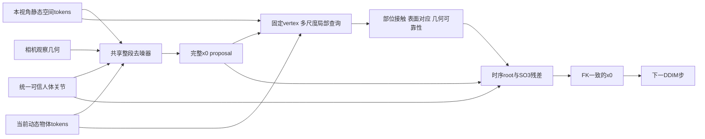

# 重训前方案：30Hz、统一人体观测与场景反馈

2026-10-12。用户重新讨论帧率、头部转换与场景设计后的建议版。**本文件是待实现方案，不是正在执行的训练配置。** 已接入但未训练的 v2 仍为128帧/20Hz、原场景结构；原55k/3k权重、数据和缓存未改。本轮只读代码/论文，并计算冻结安装参数的头部逆变换误差，无网络 forward、无优化器更新。

## 1. 建议新版本采用30Hz，保留20Hz结果作对照

既然准备重新训练，我建议将新数据/新模型统一为30Hz，固定192帧，时间上下文约6.4秒；128帧/30Hz只有约4.27秒。现有原生动作来源是连续30Hz，直接保留原始采样可减少插值，并保留快速转头与手部细节。这是工程取舍，当前没有匹配上下文的实验能证明30Hz必然改善质量。

不能将20Hz动作/可见点云插值成30Hz版本：从原始动作、真实相机时间戳、虚拟相机和动态物体重新建立共同时间轴，重新射线查询可见场景；RICH contact按原时间戳同步。原始PV采样和身体标注未必严格同频，应按时间对齐，不能只匹配数组下标。保留native SMPL/SMPL-X形状和22关节，不以跨模型参数复制替代转换。

必须同步改当前固定`FPS=20`、源帧`1.5*index`、原生pose/scene协议校验、body转向损失的时间间隔、每帧脚滑阈值/短缺失时长和指标。速度与加速度仍使用m/s和m/s²，旋转导数为rad/s。旧base objective的每帧差分项须统一物理单位或明确换算，重新核对监督梯度，不能只改JSON。

192是当前U-Net已支持的帧数，但30Hz训练质量和新结构的显存预算仍待实测。若场景仍按相同数组格式导出，采样数约增50%；实际计算开销不保证恰为1.5倍。本轮磁盘剩余约67GiB，当前TRUMANS temporal、native20 temporal及exo场景缓存约9.8G/2.0G/280M；新缓存、射线记录、checkpoint及临时文件应另做预算，保留旧对照和原始依赖，不能先删除旧数据腾空间。

## 2. 同意将身体观测统一成人体关节；真实头部转换带误差

对当前受控头戴self分支，输入接入层执行：

```text
R_head = R_camera @ R_head_camera.T
p_head = p_camera - R_head @ t_head_camera
```

转换后，ego的头部/可用手腕与exo的全部可信可见关节，都以同一种anatomical关节接口编码：部位ID、位置、可用旋转、分别的有效性/置信度及物理导数。exo没有旋转观测时保持rotation mask=0。ego/exo差异主要由观测集合、置信度与相机—目标关系表达，不需要两套完整身体输出头。

虚拟相机采用明确刚体生成协议，30Hz重导出时保存**实际用于生成该相机的**固定安装旋转/平移及来源，而非使用跨人平均值替代。当前RICH/interactee虚拟安装与各自形状有关，TRUMANS保留自己的来源协议。无需为统一关节接口而改变光学相机或重定义场景坐标。

真实wearer PV的固定head→camera近似仍有身体拟合/追踪/标定残差。之前可视化通过的是相机、身体和场景的坐标/时间对齐，不等于PV中心到anatomical head的转换精确。现有冻结TRAIN标定p90为6.51cm/14.88°，不能将转换后的头部设置成零误差输入。

本轮另选每个来源/划分的第一个合法128帧窗口，使用既有TRAIN安装参数反算头部；GT仅在转换后用于对比，未重新拟合安装。结果如下：

|来源|TRAIN平均头位置误差cm|validation平均头位置误差cm|TRAIN/validation平均头旋转误差°|
|---|---:|---:|---:|
|TRUMANS虚拟|0.021|0.011|约0/约0|
|EgoBody wearer真实PV|7.118|2.929|8.404/10.771|
|EgoBody interactee虚拟|0.383|0.673|约0/约0|
|RICH虚拟|0.337|0.543|约0/约0|

8个窗口的相机→头→相机往返位置误差均<1e-15m，说明逆变换公式和单位一致；上表说明固定安装与native拟合之间仍有残差，不能用往返检查掩盖标定误差。该面板不是全数据集误差估计，也没有用validation调标定或权重。详细记录为[READONLY_HEAD_AUDIT.json](READONLY_HEAD_AUDIT.json)，复现脚本为[audit_head_inverse_readonly.py](../../audit_head_inverse_readonly.py)。

转换不确定性应影响头部position/rotation各自的confidence或误差尺度；不能转换后丢掉原sensor误差。若相机rotation缺失且安装平移非零，头部位置也不能精确反算，不能借GT rotation补齐。导数在转换和有效性处理之后计算，保持噪声/缺失同源。未知网络视频和未知体型扩展按用户要求暂不进入本版。

## 3. 相机分支表达观察几何，身体轨迹分支表达人体运动

exo master相机不提供目标人体运动，其相机位姿仍用于关节/点云的世界变换、可见性及观察几何。固定相机的位姿是常量、速度为零，不能由此推断目标静止。A的PV观察B同样是other；这条移动观察分支仍属于后续数据扩展。

建议相机条件分为明确字段：`self/other`、固定/移动、内参/FOV、共同坐标中的光学旋转、相机与可靠身体位置的相对距离/方向、标定有效性和不确定性。参考身体位置只从可用观测计算，并附有效mask；目标缺失时用观察相机的共同世界位姿及缺失标志，不能引入GT pelvis。相机角度不充当人体rotation。

ego头部已转成关节轨迹后，可以用head-local安装变换和内参表达相机相对头部的视角，人体轨迹分支提供其运动；无需另提供一份被视为独立实测证据的干净ego运动。相机原始位姿仍保留用于几何预处理/重投影。exo则保留独立观察相机的pose和内参，不把它放入目标头关节槽。是否将观察几何加入网络，以及保留多少字段，需作含/不含相机条件的对照，不能仅凭维度多就推断有收益。

相机MLP/时间特征经条件投影接入共享去噪器；关节编码与场景token使用相同米制世界。当前v2是在已有64D控制特征上加相机残差，新版可改为独立条件token/残差投影，但第一版保留共享动作主干/输出定义。零置信度严格屏蔽坐标及导数，需要覆盖旧轨迹通路、相机通路和投影bias；目前v2尚未保证这个完整语义。

## 4. 全局场景已经分patch，下一步保留它们

当前实际路径是：`occupancy [24,48,48] → 16个12×12水平patch + CLS → ViT → CLS经head压成256D → AdaGN`。24个高度层作为输入通道进入patch embedding，并非高度信息全被删除，但没有独立的3D空间token。按当前voxel尺度，每个水平patch约覆盖3.2m×3.2m；最终身体网络只见一个场景汇总向量，难以显式按部位选择不同位置。

建议保留全局summary用于AdaGN，同时把patch tokens及其米制位置提供给动作/身体部位query做cross-attention。第一项对照先返回现有16个patch，验证“保留空间token”的收益；若不足，再改为8×8共64个水平patch（约1.6m尺度）或分层3D/点云token，避免同时换骨干又改变所有空间分辨率。局部表面细节仍由局部查询承担，不能期待粗voxel地图提供厘米级接触。

地图同时记录观测表面和未知mask；若保留原始first-hit射线，可另外记录已观测自由空间。只有点云union无法完整恢复自由/未知状态，不能把无点区域一律当作空闲，也不能将射线自由空间定义成人体禁止进入区。静态union只含声明离线时段里该视角实际看过的表面；ego/exo采用一致的观测时间预算。

静态空间token在一次生成中可以复用，动态场景随帧更新。训练时学习编码的输出不能跨optimizer更新缓存成旧特征。提供静态离线union也不等于实现了recurrent场景Transformer记忆。

## 5. 扩散早晚阶段的局部查询

这里的“前期/后期”先指去噪过程。扩散状态从第一步就包含整段完整身体变量；第一步预测的x0也有全身，只是高噪声阶段姿态与root不可靠。不能直接对随机xt做人体skinning并假设其vertex可靠。当前实现每步先预测完整x0 proposal，再据此做67个固定native vertex查询，并给同xt/t的第二次forward反馈条件；它没有显式噪声阶段门控。

建议高噪声时使用全局patch、可靠观测周围较宽的局部区域和粗全身proposal，精细vertex反馈较弱；中低噪声时逐渐增强生成身体附近的多尺度查询。查询中心来自当前预测姿态，不能来自GT全身；每个部位保留可观测性/几何可靠性、噪声级别、位置/朝向及部位ID。门控由噪声与有效几何决定，参数和开启区间须通过对照选定，不预设“最后两步才有效”。

沿用固定native vertex身份，并优先加强脚跟/脚尖/脚底、手掌附近和臀部支撑区的覆盖。当前67点每区约3点，只是稀疏表面采样，不能称为全身密集vertex接触。8/25/60cm多尺度法向特征已有未训练原型，可用于起始对照，不代表这些半径已最优。保留每区域token而非平均掉67个新增attention特征；局部特征包括位移/距离、可靠法向、mask、当前动态物体身份及可用相对速度。

训练初期的proposal也会不准：可先使用较弱几何分支、随后逐渐增强，但训练/推理始终用预测proposal查询，不能以GT查询训练、预测查询推理。初期是否冻结原主干只是优化策略，与去噪阶段门控分开登记。

## 6. BPS描述几何，contact描述交互；二者共享查询

BPS给出“身体附近有什么、距表面多远”；contact给出“哪个部位与哪块表面形成什么接触”。最近点很近不能自动等于接触；接触既需要表面证据，也受姿态、运动和支撑语义影响。当前BPS是67点局部位移，attention还查询13个probe；接触主要为22区域logit/BCE和上下文sigmoid门控，未形成显式姿态修正闭环。

建议使用一个局部几何模块，保留部位token后同时输出接触概率、可靠表面对应和动作残差。接触不能只是另挂一个分类头；残差必须接回最终x0，再进入下一次DDIM更新。更新root translation和SO(3)关节旋转后重新FK/LBS，避免直接拉动vertex破坏骨长，也避免201D中的旋转和global-joint分支相互矛盾。身体全局关节分支可以保留辅助监督，最终几何需与FK一致。



训练同时约束完整姿态/FK、可靠输入一致性、已有接触标签以及有证据的几何距离/相对滑动；按模式/部位/噪声分桶标定梯度。接触标签只在实际有标签处监督；缺标签不当成negative。几何loss使用可靠已观测表面/法向与TRAIN测得的拟合容差，无可靠邻域时mask。只凭unsigned点云距离不能得到真正场景内外；封闭mesh/SDF可以作声明的训练标签/验收参考，但不能偷偷作为推理时的完整场景输入。当前已观察到强半空间表面惩罚会改善代理却严重破坏姿态，所以不采用一律强制负距离为零的规则。

残差在整段时间上共享上下文并约束变化，局部错误可影响邻帧，但真实起身/迈步应允许接触解除，不能无条件把误差扩散到所有相邻帧。训练早期保留原运动目标，中低噪声时适度加强反馈；可选采样内几何guidance作为独立消融，默认结果不混入生成后的外部优化。

## 7. 动态物体作为条件，使用物体相对接触

当前ego局部窗口把静态观察点union与每帧可见动态物体分开，最近点特征仅有moving标记；尚未提供明确物体对应/速度。另一人的可见身体在目前exo中主要用于遮挡，并未作为动态场景输入。

下一版保持`static memory + current dynamic`，动态点/token保留owner或track ID、时间、可见性、可用速度和标定有效性。不能把动态点积累成静态残影；也不能对不具备对应关系的两个点云作最近点差分，就宣称得到真实物体速度。目标本人从场景交互分支排除，另一人可见表面单独输入，不能把目标GT mesh用作环境条件。

本版先生成身体，物体的已知/观测运动作为条件，暂不增加物体运动输出。若物体有可靠刚体pose序列，可将接触对应放在物体局部坐标中；接触时要求人体点跟随表面，而不是世界速度恒零。表面速度为`v_object + omega_object × (p_contact - centre_object)`。没有可靠速度/pose时保留当前几何并mask运动约束。静态地面接触是物体表面速度为零的特例；柔性物体不直接套刚体公式。

## 8. 朝向属于生成的root pose，相机负责坐标和观测几何

现有201D已经输出root translation及pelvis/root旋转。相机将ego提供的头部方向与exo关节放进共同世界；pelvis朝向仍由身体生成器预测。人可以转头、倒走、侧移、静止转身，头朝向/相机光轴/线速度均不能独自决定pelvis朝向。root角速度监督能约束如何转动，但对整段恒定朝向偏差不敏感；位置速度/加速度也不能单独消除固定180°错误。

建议明确共享root pose预测与核查：使用可靠头旋转及更多可靠肩/髋/躯干位置，保留完整GT root绝对SO(3)监督、符号正确的相对旋转/转向速度和头—躯干协同监督。exo缺失的旋转不借用GT补输入；训练保留足够的正面/侧面/背面、静止转身及侧移/倒退片段，不强制每个人面向相机。世界yaw增强对身体、场景与观察相机共同作用，放在不会被首次光轴锚定抵消的位置，不能使用GT root来统一输入朝向。

第一版仍共享ego/exo输出，可在共享主干中区分global root pose与local body pose的功能分支；不需要先上两套模式输出头或两套扩散器。绝对root角误差、累计转向、可靠输入一致性和脚滑要一起验收。姿态与几何不充分时保留多解，场景（例如方向对称的平地）也不能凭空消除朝向歧义。

## 9. 可借鉴的论文与本任务的区别

|来源|值得借鉴的机制|不能直接等同之处|
|---|---|---|
|[SceneDiffuser，CVPR 2023](https://scenediffuser.github.io/)|动作/轨迹与场景条件交互，并在扩散采样内结合几何优化引导|其场景/优化协议不等于当前仅观察表面的未知空间协议；加cross-attention并不保证接触|
|[UniCon3R，2026 v2](https://arxiv.org/html/2604.19923v2)|预测contact后，通过latent residual反馈人体重建；辅助contact readout不足以替代修正路径|它输入RGB、pointmap与recurrent scene state；局部geometry为人体图像anchor附近ROI，非固定人体vertex多尺度BPS。论文声明代码/模型将于接受后发布，不作为已下载可运行模块|
|[CG-HOI，CVPR 2024](https://arxiv.org/html/2311.16097)|人体/物体/接触关联，接触引导；给定物体轨迹生成身体的应用|主设定联合生成human/object/contact并主要交互单物体；我们先以观测物体运动为条件，不扩成联合输出|
|[RoHM，CVPR 2024](https://arxiv.org/html/2401.08570v2)|区分global trajectory与local pose，并通过迭代条件结合|论文学习两个模型；当前建议只先明确共享生成器内的root职责，不能宣称已经复现RoHM|
|[UniSH，2026](https://arxiv.org/html/2601.01222)|mesh与可见人体点云的几何对应监督，支持“几何需要进入训练目标”的判断|主要是人体表面/场景重建对齐，不应称为vertex接触闭环的方法|

这些机制大多已有先例。本项目需通过统一可信观测、随去噪改变的部位几何反馈以及动态表面相对接触验证实际收益，再评价研究贡献，不能直接宣称模块组合已具备新颖性。

## 10. 实施与验收顺序

|顺序|交付|验收重点|当前状态|
|---|---|---|---|
|A|独立30Hz数据协议、192帧窗口、实际虚拟安装参数和真实PV近似|共同时间/尺度/相机、head反算、动态时间轴与可见场景回放|待实现；20Hz小面板逆变换审计已完成|
|B|统一anatomical观测与明确相机几何条件、完整confidence门控|同源缺失/噪声、无隐藏GT输入、ego/exo/各部位监督标定|待实现；已有v2接口仍保留sensor|
|C|共享root/body生成基线|可靠关节输入与朝向，固定场景模块的独立基线|未训练；先看输入可视化|
|D|保留全局patch/身体部位token、按噪声查询局部几何|对应关系、查询覆盖与早晚阶段稳定性|待实现；原多尺度输入原型未训练|
|E|时序contact/root/SO3反馈与几何监督|接触真正改变动作，同时保持可见输入、局部姿态和脚滑|待实现|
|F|动态owner/表面速度与另一人输入|动态不留残影，接触使用相对表面运动|待实现，基础动态分离进入A/D|

场景是否发挥作用，必须检查实际输出：相同观测/随机种子比较正确场景、去掉场景、局部反馈关掉及contact residual关掉；在受控兼容的地面/椅面变化中检查姿态是否随几何改变。场景变化后没有对应GT的新场景，不能沿用原GT报告“动作准确率”。同时在未用于设计的真实录制holdout上报告隐藏/可见关节、世界/PA、root朝向、脚滑、接触误差和局部几何覆盖；输出敏感不等于输出正确。

全部比较使用同样时长、关节定义、shape条件、观察预算和优化预算，ego/exo分别报告。30Hz+新结构结果不能直接相对20Hz旧模型宣称某一个模块的增益；结构对照应在同一30Hz协议内逐项增加。每阶段先验收可视化再启动其训练；长缺失、任意视频前端及分模式输出头仍后置。
