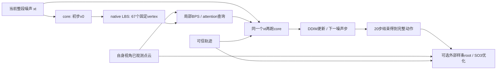

# 当前模型、观测定义、监督与修正：10 月 12 日核对

**按用户要求暂不训练，不修改模型或训练配置。本文件记录已经执行的实现；计划中的设计单独标注。**

实际配置快照：[EFFECTIVE_CONFIG_OCT12.json](EFFECTIVE_CONFIG_OCT12.json)。权重仍是原 55k 和已完成 3000 步的 ego/exo 候选。本轮只读 checkpoint、代码、记录，并在 CPU 上核验差分单位，没有模型优化。

## 1. exo 定义与目前使用的观测

用户所说的 exo 主场景是 EgoBody master Kinect 这种能较完整拍到目标全身和地面的外部相机。当前 exo 导出确实使用它的官方 Color 内参、畸变和 sensor-to-world 标定，绝不是把原 ego 相机改个模式名。原扫描用于射线首交模拟；两个人体会遮挡扫描/对方。人体区域在视野内、可见像素够多时才提供位置，置信度另列；场景只保留这个视角曾实际看见的静态表面。整个可用片段的静态 union 属于声明的离线输入，可能包含当前帧被人遮住、其他时刻已经看过的表面。

**但当前训练人为把 exo 条件裁成了 head + left/right wrist，即 15、20、21。** 导出本来有共享 22 区域的可见性，模型接口也可容纳 22 关节，却没有把其他可信可见关节利用起来。ego 则是约 65% 只用头部相机轨迹，35% 头部相机 + 两腕，继续受实际可用 mask 限制。这是先前接入实验的设置，不等于用户要的全身外部观测任务。

要符合用户定义，后续应登记三种观测：全身视野下使用所有可靠的可见身体关节；由物体/另一人遮挡的真实缺失；自然上半身视野/下半身画外，以及整个人出画再出现。真实 wearer PV 看对方应优先按实际视野模拟，人工裁切仅作额外增广。三种都使用同一逐关节 availability、confidence 和 type 接口，隐藏的身体位置/朝向不作输入。场景也必须匹配同一个相机、视野裁切和时间预算，不能只遮住输入关节却留下来自完整视野的场景；离线历史已经实际观察过的几何是否保留，要明确协议。

目前已经模拟了实际物体/另一人遮挡和画外区域；额外训练扰动只有头/腕的小幅连续漂移与短缺失。**没有系统构造上半身-only 的相机裁切，也没有多种全身可信关节集合训练。** 当前 availability 按皮肤区域像素支持度，不是严格关节点可见性或真实估计器置信度，二者不能混称。

还需区分观察相机佩戴者自身与观察画面里另一个人。当前面板的 interactee/ego 是目标头部的 synthetic ego，不是直接使用真实 wearer PV 看对方的视角。真实 wearer PV 观察 interactee 应保留 PV 相机、interactee 身份和该视角下的遮挡，而不把 PV 相机轨迹填成 interactee 的头轨迹。相机在观察者头上，不代表它与被生成目标之间也是“佩戴者自身”的关系。

用户进一步明确的真实 PV 上半身视野、出画再进入及统一机制见 [OBSERVER_TARGET_UNIFICATION_zh.md](OBSERVER_TARGET_UNIFICATION_zh.md)。该文区分 self/other 与固定/移动相机，提出共享先验、观测适配和离线缺失补全方案，全部为设计，尚未接入训练。

## 2. 输入坐标、相机朝向与人体朝向

前端必须提供**共同米制坐标系、重力方向及同步时间轴**下的场景与可信关节。这个“世界”可以是任意局部世界，原点和全局 yaw 不必有地理意义，也不需要按 GT 人体做对齐。只要人体、场景和相机使用一致的坐标变换即可。当前生成器并不负责从两个互不相关的 scene/body 坐标系估计相对尺度和旋转。

例如前端输出关节在相机坐标中，则 `p_world = R_camera_to_world p_camera + t_camera_to_world`；场景点也必须进入这个共同世界。当前数据模拟已经通过官方标定完成了这些关系。随后模型预处理再做一次**共同**锚定：

```
共享米制世界中的场景 / 轨迹 / 相机
  → 减去观察相机第一帧的位置
  → 仅绕重力轴旋转，使初始相机光轴的水平投影指向 +Z
  → 所有输入使用同一变换
```

对行向量，`p_anchor = (p_world - camera_origin) @ anchor.T`。ego 原点通常是头部相机，exo 原点是固定 master 相机；exo 人体会在距原点数米处。只旋转坐标轴，不把人体根朝向强行与相机朝向对齐。输出可以用逆变换放回前端世界。

**由 ego 换成 exo 会产生明显的学习分布变化。** ego 的相机光轴与佩戴者头朝向通常有关，坐标原点贴近人体；exo 的相机光轴独立于人体，人体可能正面、侧面、背面朝向相机，且距离不同。当前 exo 完全不提供人体 rotation；ego 通常提供头部相机 rotation，并通过 TRAIN 安装标定区分 sensor 与 anatomical head。头/腕位置及线速度、加速度不能总是唯一确定根朝向，平地几何也可能没有有效方向线索。

此外，当前 `offline_camera_condition=False`：没有独立的外相机 pose/FOV token。`batch['camera']` 用于预处理、显示和批尺寸，不直接进入单独 camera encoder；ego 的相机轨迹在 15 号控制槽进入网络。exo 的人体轨迹使用 anatomical type，相机标定主要在预处理里发挥作用。这不是数值坐标错位，但模型没有独立的外相机观测几何条件。

当前是 55k ego 为主的初始化，续训 3000 步中真正 exo 只有 349 个 batch/698 个样本。因此“旧先验尚未适应新视角”是合理假设，**尚不是经因果实验确认的根因**。6 个 exo 的平均根旋转误差为 67.35°，部分例达到 91.73°、123.91°。坐标/时间检查通过不等于人体姿态朝向通过。已有全身 residual6D、rotation-matrix 和 FK 监督会惩罚错误姿态，不能说当前完全没监督根朝向；新增 body_turn_rate 只约束相邻帧旋转变化，也不能独自修复整段固定朝向偏差。

后续最直接的核查是保持同一时段和场景，分别用头/腕、更多可靠肩髋肘膝踝，以及可选可靠人体朝向，比较原 55k 与候选，并按相机相对人体的朝向/距离分桶。相机朝向不替代人体朝向；不能一律给 exo 输出翻转 180°。

## 3. 已执行模型和训练配置

|项目|实际执行值|
|---|---|
|身体|native SMPL/SMPL-X，共享 22 body joints；已知形状/尺度校准，不生成手指姿态|
|motion|201 通道：root translation 3 + identity-residual 6D rotation 132 + global joints 66；位置通道保存为 m/2|
|去噪器|Temporal U-Net，latent 256，通道倍率 1/2/4，AdaGN，主干 temporal attention 关闭|
|全局场景|观察表面 occupancy 24×48×48 → ViT dim1024/depth6/heads16 → 256D → 与时间/形状 embedding 合并，调制 AdaGN|
|场景记忆|输入端静态点云离线 union；不是神经网络 recurrent memory，也不是完整空间 occupancy/SDF|
|局部场景|67 个固定 native vertex，按生成姿态 LBS；每点 13 probes；局部 64D/4-head attention；上下文平均后投影32D，另保留有序 BPS MLP32D|
|可信轨迹|每关节26D，含位置/旋转、分别的可用性/置信度、sensor/anatomical type、线/角导数及有效 mask；MLP输出64D逐帧条件|
|当前训练|原55k初始化，3000步，batch2，固定128帧，20Hz；前500步只用ego|
|采样|TRUMANS约62.1%、EgoBody26.1%、RICH11.7%；混合阶段仅EgoBody内有50%概率选exo；并非总体exo50%|
|优化|全模型可训练，新AdamW/weight_decay .01；旧主干及扩大后的trajectory MLP最高lr2e-5，新增surface模块最高1e-4，50步warmup，cosine衰减到峰值10%|
|噪声|1000训练时间步；25%额外抽t0–99，另外75%抽t0–999，因此期望t<100比例32.5%|
|场景dropout|10%屏蔽全部场景条件|
|生成评估|完整128帧随机噪声，20 DDIM步；有局部场景时40次core forward；没有GT前缀|
|长度|当前只训128；64/192接口可运行，质量未完整验收|

**配置字段存在继承歧义：** `last.pt['config']` 仍有原55k的 `batch_size=4、lr=1e-4、steps=55000、seed=2026`，以及原控制采样概率。这些不代表3000步续训实际参数。实际执行来自 `train_unified_continue.py` 参数/代码、`protocol.json`、trace 和 optimizer state。新快照把 inherited 与 effective 字段明确拆开，未修改旧权重文件。

## 4. 监督尺度：单位正确，但权重平衡未最终确定

位置先由 m/2 还原米，速度 `Δp×20`，加速度 `Δ²p×400`，角速度为相对旋转 log 的 rad/s。旧 base 的 velocity/acceleration 使用每帧差分，原系数10和2保持不变；若换成物理单位平方误差，等价系数分别是 `10/20²=0.025`、`2/20⁴=0.0000125`。它们与新轨迹目标是不同项，不能把单位转换后的导数再按旧系数叠一次。

|新增轨迹目标|残差归一尺度|实际系数|
|---|---:|---:|
|position|5cm|0.010368|
|rotation|10°，内部rad|0.0061724|
|linear velocity|0.15m/s|0.00053891|
|linear acceleration|1m/s²|0.0000080515|
|angular velocity|20°/s，内部rad/s|0.00028308|
|body turn rate|20°/s，内部rad/s|0.00051361|

真实 wearer 相机与 anatomical head 之间存在安装误差，camera 目标尺度放宽至 TRAIN p90：约6.51cm、14.88°；exo anatomical joints 保持5cm，没有提供的rotation不计输入轨迹rotation监督。base仍用全身GT姿态/FK监督，这与输入缺失不同。confidence 衰减梯度，分母不把confidence归一掉；导数 mask 不跨缺失时间段。

本轮CPU用已知解析轨迹检查：最大速度误差约7.2e-7m/s、加速度2.9e-5m/s²、角速度4.8e-5°/s，缺失区间stencil检查通过。因此没有发现这些差分项的20/400或m/2单位错误。

**但不能说所有监督强度已合适。** 新系数只在最初两个TRAIN ego样本/t45和16上按输出梯度范数标定；没有按exo、部位、噪声分桶覆盖，也没有重新检查参数梯度分配。base还是coordination_v1，总loss为 `base + weighted observed tracks + 0.1 contact BCE`。接触标签仅RICH可用，EgoBody/TRUMANS缺标签处masked；真实scene SDF穿模损失没有加进当前生成器训练。后处理prototype的几何系数又是另一套开发设置，不能用生成器单位检查为它背书。

## 5. vertex 场景查询与动作修正，分别在哪里



**模型内已实现的是 vertex 查询与条件反馈。** 每个DDIM步先生成一次整段proposal，在它的67个固定skin点附近查实际输入场景，再给相同xt/t的第二次forward注入BPS和attention上下文。这在续训和正式生成时都运行；第一份proposal detach，不向它回传查询姿态梯度。接触预测只调制上下文并参与RICH BCE。这里没有检测穿模后直接修改一帧，也没有显式root/SO3 residual head，更没有保证接触成立。

**播放器紫色是生成结束后的外部动作修正。** 网络冻结，在128帧整体上优化4帧间隔的root/SO3样条；native vertex参与观测小平面的几何目标，真正更新的是根位置和关节旋转，人体vertex随后由native skinning重新计算，不是单独拉动几个vertex。黄色轨迹用于约束可用头/腕位置；小平面符号只具有局部代理意义，不是封闭场景SDF。关闭紫色候选时，绿色就是未经这种后处理的3k生成。

**模型内显式接触→有界姿态残差是计划，还未接入/训练。** 新多尺度法向特征原型也不是现有绿色模型的组成部分。当前是“模型内条件查询 + 可选生成后优化”两种机制并存，不能说vertex姿态修正已经同时在模型内外实现。

下一步先明确目标视角/目标人、共同坐标、全身可信关节与遮挡预算，再冻结有效配置和评价协议。按用户本轮要求，暂不启动上述结构或监督的训练修改。
