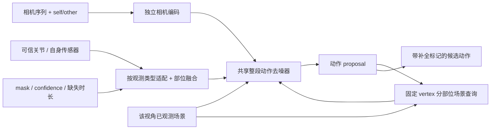

# 10 月 12 日：观测者与目标分离、ego/exo 统一及出画补全方案

**状态：设计记录，未改生成模型、数据缓存或训练配置，未启动训练。** 原 55k 和已完成 3000 步候选继续保留；当前实现和实际参数见 [CURRENT_MODEL_AND_CONFIG_zh.md](CURRENT_MODEL_AND_CONFIG_zh.md)。

## 用户澄清后的任务

同一台头戴 PV 相机可以服务两个目标：恢复佩戴者 A 自身，或恢复它拍摄到的 B。后一种自然包含只见上半身、物体/人体遮挡、整个人出画再出现。应优先使用实际 PV 轨迹、内参和视野产生这些缺失，再用人工缺失扩充训练，不能用人工裁切代替这条真实观测分支。

|相机|生成目标|相机与目标的关系|可用身体证据|
|---|---|---|---|
|A 佩戴的 PV|A|self，存在头部安装关系|相机轨迹及可获得的自身关节|
|A 佩戴的 PV|B|other，相机随 A 运动，不属于 B|B 的可信可见关节，可整段连续缺失|
|master Kinect|A 或 B|other，固定外部相机|目标的可信可见全身/局部关节|

相机类型（头戴/固定）和目标关系（self/other）是两个独立属性。PV 看 B 属于移动外部观察，不能把它按“头戴相机”归为 B 的自身 ego。当前 `interactee/ego` 是 B 的合成头部相机，不能充当真实 PV 看 B 的验证结果。

EgoBody 官方提供逐帧 PV 内外参、PV 与 Kinect/扫描标定以及双方身体拟合，具备构造这条观测分支的条件。其 `valid_frame=True` 仅表示检测到至少 6 个 OpenPose 身体关节；不是严格的画内/遮挡真值。不能仅保留 EgoSet_interactee 的可见帧，否则会删除要学习的出画区间并压缩时间轴。[官方数据说明](https://github.com/sanweiliti/EgoBody)

## 能补什么，当前能否保证

目标离开画面后，模型可以利用共同米制世界中的前后可靠关节、已观测静态表面及动作先验，采样一段满足证据的自然动作。离线时可以使用再入画的观测作为后端约束。没有目标观测的区间通常存在多个解，例如停留、转身后回来、绕行；场景和观察者运动不能唯一确定目标动作。

输出应区分观测支持段与生成补全段；长缺失保留多个候选及候选间差异。采样差异只是经验不确定性，需评估校准，不能直接当作可信区间。不能平均多个不同动作得到一个可能滑脚的姿态序列，也不能依赖 GT 从多个随机种子中挑一个“产品结果”。

当前整窗联合 DDIM 能访问窗口两端；它不是逐帧自回归。但当前固定 128 帧/20Hz 只有 6.4 秒，额外缺失扰动仅随机屏蔽一个选中关节 12 帧（0.6 秒），未系统训练整个人连续缺失和再入画。原 master exo 也以较完整视野为主。因此不能把现有候选在该任务上的效果当作已验证。64/192 帧接口通过只说明可运行。

## 建议的最小统一机制

先保留一个共享的整段动作去噪主干和当前 201 通道输出，用明确语义的条件适配器解决不同观测的差异。先验证下面三项，不先引入两套完整 ego/exo 模型或大型 MoE。

1. **独立相机条件与目标关系。** 编码逐帧相机位姿/运动、内参或视锥、相机有效性和 self/other。所有输入处于同一个重力对齐的米制世界。只有 self 才允许通过已标定安装关系，把生成头部运动映射到预测相机运动；other 的观察者相机运动不能进入目标的头关节槽或头部轨迹损失。
2. **按观测类型适配，按关节可信度融合。** 自身安装传感器轨迹与外部 anatomical 关节分别经小适配器进入共享条件空间。关节 token 保留部位身份、位置/旋转各自 mask 和 confidence、可用导数；使用全部可靠可见关节，不固定只用头/腕。缺失数据在编码前清零并屏蔽，保留 null 条件。没有可靠肩髋方向时，不能拿相机光轴或平移速度强行代替人体朝向。
3. **显式表达缺失时间结构。** 增加目标是否有任何观测、各部位距前一次/后一次可靠观测的时间及前后端点是否存在。后向时间由离线输入计算，不读取隐藏 GT。训练既保留自然 PV 缺失，也登记整个人连续 dropout、只见上半身、进入/离开窗口的模式。出画前后关节位置是约束，缺失期间的动作由先验及场景支撑；导数不跨缺失区间计算。

安装传感器和 anatomical 关节的观察算子分别为“生成头部位姿 × 固定安装变换”和 native FK 关节；监督比较各自对应的物理量。对缺失段跳过观测一致性项，训练时仍可用完整身体 GT 学动作补全。目标全部缺失时条件编码和 loss 分母都应有确定的空输入行为。

共享的是人体运动规律；不同证据对应的条件分布可以有不同不确定性，不要求 ego/exo 样本输出完全相同。配对训练应使用同一目标、同一时段的 self/master 或 PV-other/master；两路各用自己视角的场景，不互借完整点云。可在同噪声步共同监督完整动作，但暂不对不同信息量的两个输出强加一致性损失，以免压掉合理多解。

## 第二阶段：轨迹/姿态协同及部位接触反馈

若最小机制仍存在持续的根朝向、世界路径或脚部退化，再设计共享先验内的全局 root 轨迹/朝向分支和 root-relative 姿态分支，交换条件并联合约束。身体局部框架来自生成的 root，不能由隐藏 GT 骨盆或朝向建立。当前 201 通道同时预测 root、旋转和 global joints，仍需 FK 一致性监督；更改表示和分支应另立版本。

[RoHM](https://arxiv.org/abs/2401.08570) 已研究噪声/遮挡下的空间及时间补全，使用全局轨迹与局部姿态两个扩散模型并迭代交互，支持“分开处理、互相约束”的依据；它不是已经解决本项目 ego/exo 统一的证明。[EgoAllo](https://arxiv.org/abs/2410.03665) 的头部运动条件表示可参考自身分支，但其佩戴者头部关系不能照搬到 PV 观察对方。

场景沿用共同世界坐标、该观测流实际看过的静态表面离线记忆，以及当前可见动态几何。在 proposal 的固定脚/膝/髋/手等 vertex 周围查询分部位多尺度几何，保留已知/未知、法向可靠性、距离与动态属性；接触预测与受限时序 root/SO3 修正可作为后续结构。它应让缺失下肢获得地面/椅面等证据，而不是仅平均成一个全局场景向量。观测不到的空间不能被强判为空闲或实体，局部点云平面也不是全局 signed SDF；前轮强表面后处理的退化必须保留为回归案例。

## 数据接入时必须处理的具体错误

- `export_native20_training_scenes.py` 已能读取实际 PV 标定，但 `role=interactee` 会切到目标自己的合成头部相机。新增 PV-other 应有独立的 `camera_subject_id` 和 `target_subject_id`，保持原缓存语义，另用版本化观测协议。
- 旧导出对 `people[0]` 使用 `wearer_faces` 去除部分自身头部遮挡。PV 看 B 时，B 必须保留完整目标表面；若需要处理相机附近的自身头部，应作用于 A。不能只删掉切换 synthetic 的代码就认为分支接好了。
- 场景 first-hit、人体遮挡和身体可见性都使用实际 PV 的相机。不能给关节用 PV mask，场景却使用 master 或目标自身 ego 缓存。动态人体不写入静态 union。
- 保留合法 PV 时间范围内完整连续时间轴及其双方拟合；缺身体标签、缺相机标定、目标没有观测是三种不同缺失。不能外推缺相机标定，也不能用目标无观测作删除该帧的理由。
- 出画再出现须由前端关联目标身份。track ID 不可靠时标记关联不确定，不能直接连接两个人的轨迹；生成器仅凭稀疏 3D 条件不能保证完成 re-identification。前端可以使用图像证据，不要求生成器新增 RGB 输入。
- 没检测到关节不一定是目标在视野外，也可能是遮挡或检测失败。不能因 availability=0 就强迫预测身体位于相机视锥之外。
- 全局 yaw 数据增强须作用在锚定之后，或改变锚定策略；在“首相机光轴归一”之前共同旋转，可能被该归一完全抵消。改变相机相对身体/场景的视角须重新算可见性，不能只旋转相机 token。
- 真实前端的米制尺度、body joint 定义、左右身份、相机/人体相关漂移及 shape 校准另行核验。目标已知 native shape 仍是当前受控假设，不可包装成无标定真实系统。

## 暂不训练时先冻结的验收方案

在官方 recording split 内按 recording/目标登记窗口，先统计自然 PV 的可见部位、连续全缺失长度和再进入事件；使用理想几何输入和真实前端输入两个独立协议。人工缺失是增广，不替代自然分布。对应 master 视角可作同目标对照，但只进入该分支，不能用作 PV 输入。

开发缺失长度暂按 0.5/1/2/4 秒分桶，并区分两端可见、只有前端、只有后端、整个窗口无目标观测。两端补全窗口必须真的包含两端可靠观测；长缺失若超过 128 帧窗口容量，应另评更长训练或离线重叠窗口的桥接推理，不能宣称任意长缺失已支持。

同报可见轨迹一致性、隐藏关节 world/PA 误差、root 朝向、再进入处的位置/旋转及速度跳变、native 足部滑动、已观测表面的几何违例和查询覆盖率。按缺失长度/视角/可见部位分桶，以 recording 为统计单位，保留旧 ego 回放结果。长缺失报告固定种子的所有候选、分布及多样性；若附 best-of-K，只列为标注了 GT 选取的研究指标。

将“混合条件基线 → 分离相机/目标关系 → 观测适配与连续缺失 → 轨迹/姿态协同 → 部位接触反馈”作为逐项对照。先要求输入、时间轴和相机可视化正确，再以隐藏部位/根朝向/脚部改善且自身分支不显著退化为进阶依据。单位检查继续使用米、秒、弧度；监督强度要覆盖观测类型、部位、缺失模式和噪声步，不能沿用两个 ego 样本的梯度标定来宣称全域已平衡。

本轮只形成上述任务和方案，任何质量结论仍需后续登记实验。训练继续暂停。
