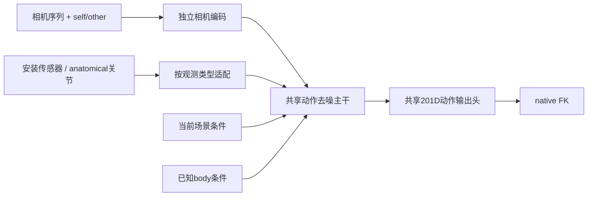

> 历史方案存档，不再更新。当前模型、实验设置与全部待办只看 [唯一总清单](../exo_occlusion_review_oct12/EXPERIMENT_AND_ARCHITECTURE_zh.md)。

# 10 月 12 日：ego/exo 统一模型任务表与输出头选择

## 1. 合成 interactee ego 是训练增广，继续保留

用户澄清：interactee B 本身没有佩戴 PV 相机。当前从 B 的完整身体标注生成 B 的合成头部相机，是把已有 exo 身体数据转成 ego 条件辅助训练的有意设计，不是导出错误，也不应删除。它模拟“如果 B 佩戴相机”的受控观测，仍须使用相应合成视角的可见场景，不能把完整扫描直接作为 ego 输入。

另一条任务是用 A 实际佩戴的 PV 观察 B。相机属于 A，动作目标是 B，是移动的外部观察；上半身视野和画外缺失来自 A 的实际视野。这条分支可后续补充，不能以它尚未接入为理由否定现有合成 ego 增广。

|数据分支|相机来源|生成目标|相机—目标关系|当前状态|
|---|---|---|---|---|
|wearer 自身 ego|A 的真实 PV|A|self，有头部安装关系|已有|
|interactee 合成 ego|根据 B 的身体构造虚拟头戴相机|B|self，合成安装关系|已有，保留用于增广|
|master exo|真实 master Kinect|A 或 B|other，固定观察相机|已有，当前只选头/腕条件|
|PV 观察对方|A 的真实 PV|B|other，移动观察相机|后续数据扩展|

相机来源 real/synthetic、固定/移动及 self/other 分开记录。真实与合成来源用于数据协议、安装标定和分桶评估；第一版不按数据集名称分输出头。

## 2. 第一版使用共享动作输出头

**建议先共用去噪主干和现有 201 通道动作输出头，将差异放在相机条件和观测适配器中。** 两种模式都预测完整身体在共同米制世界经一致锚定后的 root、关节旋转和 global joints；单位、关节定义、FK 关系和扩散 x0 目标相同。观测来源与条件不确定性不同，不构成必须分动作输出头的理由。这是本项目的设计判断，尚未由对照实验验证。

共享输出头接收到的特征已经依赖观测类型，允许 ego/exo 给出不同的条件预测和不确定性。self 的相机安装轨迹和 other 的 anatomical 关节分别用相应观察算子计算一致性损失；观测监督不同，不等于动作输出定义不同。不能强制信息量不同的两种输入给出完全相同输出。已知 SMPL/SMPL-X body 条件继续按当前接口处理，不与 ego/exo 混为一种分类。

直接拆成两套完整动作输出头有两个待验证代价：exo 数据少时每个头得到的有效训练减少；若冲突发生在条件语义或共享主干，只拆最后一层未必解决。当前采样和监督强度尚未完整平衡，不能先把朝向错误归因于共用输出头。

### 什么时候再考虑分头

完成相机与观测适配后，在匹配优化预算、数据身份/采样和种子的对照中，若一种模式持续改善而另一种明显退化，且已排查输入坐标、关节集合和监督失衡，再比较输出适配。梯度冲突诊断可作为线索，不能仅凭一次梯度夹角就认定必须分头。

优先比较“共享输出 + 按 self/other 的小型残差适配器”，再考虑两套完整输出头。设共享主干特征为 h：

`x0_pred = H_shared(h) + g(observation) * DeltaH_relation(h)`

残差出口零初始化，保留原共享输出；路由由明确的相机—目标关系决定，不因某帧关节缺失而切换关系。零初始化只保证初始残差为零，不保证训练后的旧模式性能不变。所有头仍输出相同201D表示并接受同样的FK检查，不引入两套坐标系。

将来若按功能拆 root 轨迹/朝向与局部姿态分支，ego/exo 都应共用这些分支。[RoHM](https://arxiv.org/abs/2401.08570) 的分解依据是全局轨迹与局部运动两种空间，并不是 ego/exo 两种摄像机；这里只作后续参考，不进入当前阶段。

## 3. 逐步任务表

前3项已完成代码接入、配置和零步核验；“后续”项尚未执行。每阶段保持场景结构、身体表示和评估窗口一致；输入预览已生成，训练与新模型动作质量验收尚未开始。

|顺序|任务|交付和验收依据|状态|
|---|---|---|---|
|0|明确真实/合成相机、相机人和目标人；锁定对照|保留 interactee 合成 ego；原55k/3k、有效参数和固定窗口身份可追溯；self/other及real/synthetic已进入条件|语义与来源已接入；跨人track身份关联仍留给PV扩展|
|1|独立相机编码|48D相机/安装/语义条件→64D零初始化残差；同世界/时间轴；旧3k输出初始差0；隐藏无效值被屏蔽|已接入并通过检查，未训练|
|2|可信观测适配与部位融合|sensor/anatomical小适配器、22部位ID、mask/confidence和导数；exo全部可信可见关节；self相机与sensor噪声/缺失同步|已接入并通过检查，未训练|
|3|统一训练配置及分桶监督核对|固定128帧/20Hz；总体ego70%/exo30%；6分支×3噪声档初始TRAIN梯度标定，头/腕/下肢/躯干另列；完整GT/FK目标保持同定义|配置与18档初始核查已完成，完整分布/训练后平衡待验证|
|4|可视化验收与共享输出基线|先看相机/目标/场景对齐；再登记比较当前模型、加相机、再加观测适配；同报朝向、世界/隐藏关节误差、观测一致性和脚滑|待做，依赖1–3；训练仍暂停|
|5|是否添加输出残差适配器|只在持续模式冲突时，对照共享头、小残差适配与完整双头；保留各模式回放及参数/优化预算记录|条件性任务，默认跳过|
|6|真实 PV 观察 interactee 的数据扩展|独立 camera_subject/target_subject；完整目标表面、实际PV可见性及该视角场景；验收自然上半身视野；复用现有场景编码/查询|后续，可与5独立安排|
|7|整个人长缺失—补全与再入画|连续缺失训练、前后离线约束、身份关联、候选差异和衔接评估；不跨缺失算输入导数|最后处理|

**场景当前不改：** 保留全局 occupancy→ViT、67个生成姿态 vertex 的局部 BPS/attention、现有 contact 和两次 core forward 的查询反馈。不接新多尺度法向模块、root/SO3 场景残差或新表面惩罚，不把前轮外部优化混入基线输出。“结构保持现状”不等于冻结全部场景参数；未来是否冻结原参数属于任务3，须明确登记。

PV-other 以后若新增缓存，只按正确视角复用既有观测协议，关节与场景来自同一观察相机，不借用 master 场景作为 PV 输入。场景改进参考继续保存在 [SCENE_PLAN_OCT12_zh.md](SCENE_PLAN_OCT12_zh.md)，当前移出执行顺序，不阻塞上述任务。

## 4. 相机和观测模块的接入细节

旧3k的 `OfflineSceneMI` 设置 `offline_camera_condition=False`，没有独立的外部相机条件。底层 `MDM_Scene_UNET` 已有可选9D camera MLP，但只打开该开关还不能表达 self/other、视锥及有效性，而且会改变 U-Net 输入通道和旧权重形状。新增v2已通过兼容旧权重的48D→64D条件残差完成相机编码接入；这里区分旧模型与已接入但未训练的v2。

相机编码并不是安装标定或相机→头部逆变换：当前保留typed sensor输入，监督正向将生成头部映射到相机。置信度是观测适配的核心，仍须保留部位ID和sensor/anatomical语义；相机与旧共享条件通路尚未保证零置信度严格归零。20Hz来自现有训练/缓存协议，并非任务硬要求。完整接口、30Hz迁移要求和ego前端方法见 [FRONTEND_CAMERA_FPS_zh.md](../ego_exo_camera_config_oct12/FRONTEND_CAMERA_FPS_zh.md)。

位置/rotation 的有效性和 confidence 继续独立；相机和身体导数按20Hz使用米/秒/弧度。self 比较生成头部经安装变换后的相机位姿；other 比较可信关节与 native FK。没有可靠肩髋方向时，不能用相机光轴或平移速度强行给人体根朝向。已有完整身体GT旋转/FK监督继续约束根朝向。

global yaw/平移增强须对相机、关节、场景共同作用。首相机光轴锚定可能抵消锚定前的 yaw 增强，须核验实际效果；改变相机相对目标的视角须重新计算可见性。这属于输入协议核查，不需要改场景网络。

自身分支可参考 [EgoAllo](https://arxiv.org/abs/2410.03665) 的头部运动条件表示；其目标是设备佩戴者，不能把头部安装关系用于观察别人。相机编码和双头选择仍需本项目对照，论文引用不是性能保证。

## 5. 暂缓任务的要求，供最后阶段使用

PV-other 复用旧导出时，要保留 B 的完整目标表面。旧 `export_native20_training_scenes.py` 对 `people[0]` 使用 `wearer_faces` 去除部分自身头部遮挡；这在原合成 ego 分支符合用途，不能直接移植到 A 看 B 的分支。需处理相机附近的自身头部时，作用对象应是 A。

长缺失阶段保留完整连续时间轴及有标签的身体，目标无观测与相机标定缺失分开处理。EgoBody 的 `valid_frame=True` 仅表示检测到至少6个OpenPose身体关节，不是严格可见性真值；仅保留可见帧会丢失所需出画区间。[官方数据说明](https://github.com/sanweiliti/EgoBody)

目标出画再出现须处理身份关联；没检测到关节可能是遮挡或前端失败，不能一律强制预测身体在视锥外。生成器不要求新增RGB，真实前端可用图像完成关联。

离线补全可使用前后可靠观测，长缺失通常存在多解。输出标记补全段并报告固定种子的候选差异；不平均不同动作或依赖GT挑产品结果。当前额外dropout只有单关节12帧，整个人长缺失未验证。固定128帧只有6.4秒，两端证据须确实落在上下文；64/192接口可运行不代表任意长补全质量。

最后再按缺失长度/端点条件登记评估，报告隐藏部位误差、root朝向、再进入位置/旋转及速度跳变、脚滑和观测表面的几何违例。未知空间不等于空闲或实体。当前不引入缺失时长编码、长gap训练或桥接推理。
