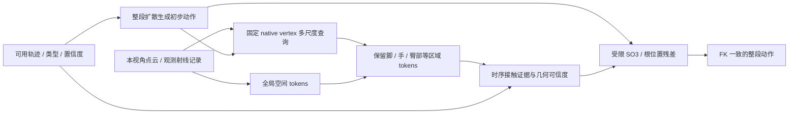

# 10 月 12 日：exo 可视化验收与场景改进方案

**本轮没有续训。正式模型仍保留原 55k；3000 步 ego/exo 候选权重未改变。先验收输入和生成动作，再决定结构训练。**

当前模型/配置及用户关于exo定义、世界坐标、朝向、尺度和vertex修正的逐项核对，见[CURRENT_MODEL_AND_CONFIG_zh.md](CURRENT_MODEL_AND_CONFIG_zh.md)。实际执行参数与checkpoint继承字段已在[EFFECTIVE_CONFIG_OCT12.json](EFFECTIVE_CONFIG_OCT12.json)分开，不把原55k的batch/lr当续训配置。

最新用户澄清：interactee 的合成 ego 是利用 exo 身体数据辅助 ego 训练的有意增广，继续保留。当前优先加独立相机编码和可信观测适配，第一版共享动作输出头；场景结构暂不改，长缺失补全排最后。逐步任务和是否分输出头的依据见 [OBSERVER_TARGET_UNIFICATION_zh.md](OBSERVER_TARGET_UNIFICATION_zh.md)。以下场景新设计保留为参考，暂不进入执行顺序，仍暂停训练。

前3项现已接入独立v2并完成零步检查，见[实现记录](../ego_exo_camera_config_oct12/IMPLEMENTATION_zh.md)。已有不同native体型的已知标定，但未知视频体型/身高估计未实现；head→camera安装参数显式提供，按来源保留固定近似与不确定性，不使用一个全来源通用偏置。原权重与场景模块/缓存保留，未开始新训练。

结论：6 个登记 exo 窗口的坐标、相机和时间处理通过检查，生成动作尚未通过。冻结模型的轨迹与姿态修正改善世界误差，但局部姿态和脚部指标仍有退化。直接加强表面惩罚会把动作改坏；更合适的下一步是保留身体区域的几何证据，让接触参与受限姿态修正，并单独处理未知空间和输入不确定性。

## 先看什么

播放器：**http://127.0.0.1:8781**。默认案例 03/exo、同坐标叠加；蓝色 GT、绿色 3k 生成、黄色实际位置输入，粉色为输入到生成关节的误差线。原 55k 灰色可单独打开。

- 选择 04/camera_wearer/exo，查看第 0 帧及播放过程：GT 开始处于较低姿态，绿色身体位置和下肢姿态明显不符，后段 GT 起身。不能把整段概括成静止坐姿。
- 点击“切换到 exo 相机视角”。已使用官方 Kinect 光学标定：+x 向右、+y 向下、+z 向前。中心针孔画面没有浏览器畸变；紫色边界线含标定畸变。
- “完整扫描验收参考”只用于显示；模型及本轮优化均未读取完整扫描。默认静态点云是实际 exo 输入。
- “冻结模型推理对照”可以显示紫色候选：仅根位置、轨迹与姿态、强表面惩罚、拟合后受限表面修正。候选仅在同坐标模式显示，失败结果也保留。
- 05、08 的强表面候选是必须检查的退化例；不要只看 03、07 的改善例。

截图：[起始低姿态对照](visual_review/preview_seated_track_pose.png)、[受限修正末帧](visual_review/preview_seated_staged_last.png)。浏览器已实际检查相机视角、扫描开关、候选选择及末帧，无 JavaScript 错误。

## 输入对齐结果

所有 6 个 exo 窗口均检查官方相机 → 世界 → 模型锚定坐标的往返变换、原生身体 FK、20 Hz 与原 30 Hz 帧索引及镜头畸变重投影：

|检查|结果|
|---|---|
|可用输入关节与重锚定 native GT|最大误差小于 0.001 mm|
|输入点云转回世界坐标|最大误差小于 0.001 mm|
|输入点到原始扫描表面|最大误差小于 0.003 mm|
|源时间戳|完全一致，每个 20 Hz 步对应 1.5 个源帧|
|四个标定边界角重投影|最大误差小于 0.001 像素|
|点云在近裁剪面背后|0|

这排除了当前面板中明显的变换、单位和时间偏移，不代表真实视频前端已验证。输入是理想几何模拟，可见位置由 GT native joints 产生；现实估计误差、joint 定义、米制尺度和身份错误需要另测。

## 今晚实际做的冻结模型对照

第一轮在生成前登记 6 个 exo 和 3 个对应 wearer/ego 窗口，固定缓存生成、种子和参数；共生成 21 个优化候选。随后因强表面策略失败，另登记 6 个受限表面候选。后续是开发集上的设计迭代，不能作为独立 holdout 证明。没有 GT 身体前缀、骨盆初始化或接触标签输入。

所有优化基于原生 SO(3) 姿态和 4 帧间隔的连续三次样条。优化整段时间上的修正量，保留原脚部速度先验；不是逐帧单独 IK。新表面修正固定对应表面点，防止通过移出查询半径、减少有效点来降低目标。根位置每轴最多修正 2 cm、旋转向量每分量最多 0.1 rad；这些是开发原型的信任范围，不是物理保证。

|6 个 exo 的平均值|世界未对齐 MPJPE mm ↓|PA MPJPE mm ↓|输入轨迹误差 mm ↓|native 脚点支撑期速度 mm/s ↓|
|---|---:|---:|---:|---:|
|3k 原生成|230.9|72.3|248.5|169.3|
|只改根位置|184.0|72.3|174.1|308.0|
|轨迹与姿态联合修正|145.9|83.8|7.5|172.3|
|联合修正 + 强表面惩罚|240.2|113.9|9.3|220.4|
|轨迹拟合后受限表面修正|145.0|83.5|5.3|173.1|

轨迹与姿态、受限表面两个候选均在 6/6 窗口降低世界误差，但只有 1/6 改善 PA，2/6 改善脚部速度，**均未通过最终动作验收**。强表面策略的 05、08 世界误差分别达到 350.8、445.7 mm，不能选取改善样本掩盖失败。3 个 ego 控制窗口世界误差 132.9→129.2 mm，但 PA 71.5→74.4 mm；该优化也没有证明 ego 质量改善。

表面指标是 264 个固定 native skin 点在可观测小平面附近的半空间代理。联合修正→受限修正，平均局部深度 6.21→5.02 mm，但它不等于封闭网格的穿模深度。强表面策略可把这个代理降到 0.86 mm，同时严重破坏动作，说明单看代理会误判。查询覆盖率必须同时报告。

GT 参考身体也存在 0–3.60 mm 的平均半空间深度，部分例的有效点中约 16% 超过 1 cm。这里混合了拟合、扫描、局部平面近似误差，不能把所有负距离硬压到零。GT 参考只用于验收，没有进入优化。

## 下一版建议：场景区域证据直接修正动作

建议把研究主线定为**相同观测接口下，利用有置信度的局部几何与接触，补全 ego/exo 未观测身体并保持动作连续**。不把“又加一个 cross-attention”作为充分贡献，也不宣称下述组合已具备论文层面的新颖性。

1. **地图区分已观测表面、已知自由空间、未知空间。** 当前 48×24×48 occupancy 的 0 同时代表未观察和无点，并不是完整空间记忆。保留射线、首交深度、owner、观测相机及置信度，才能建立三类状态；仅有点云 union 无法补齐所有观测历史。人可以处在场景的自由空间，射线自由空间不是禁止人体进入的区域。未见墙后侧、遮挡洞和动态物体历史位置不设硬碰撞标签。无需加入 RGB 作为本阶段必要条件。

2. **身体区域对应的多尺度几何，而非把 67 点 attention 上下文直接平均。** 已实现未训练的特征原型：67 个固定 native vertex，半径 8/25/60 cm，每尺度选 8 个覆盖整个局部 patch 的点；输出身体局部位移、米制距离、朝向观察者的法向、局部有符号距离及法向可靠性、动态标识，另带有效 mask。三个半径实际查询不同范围，不是重复最近八点。脚的 25 cm 查询覆盖为 100%，但手/臀部覆盖因视角和动作差异很大；“有点可查询”不代表正在接触。下一版 query 加入当前生成姿态、区域 ID、扩散噪声级别和可观测性，保留 22 区域或明确的脚/手/臀/躯干分组。原 BPS 的有序 67 点仍保留身份；被平均的是新增 attention 上下文。

3. **接触用于产生姿态残差，且有几何可信度和时序范围。** 区域 token 预测接触及其表面对应，随后输出有界 root/SO(3) 残差，更新完整窗口的 x0 并重新 FK；不只是接触 BCE 或条件向量乘一个 sigmoid。先考虑在低噪声阶段启用，保留原生成的步态速度与局部姿态先验。短时错误通过时间样条/区域时序 attention 影响邻帧，真实姿态转变要允许解锁接触，动态接触需要当前物体速度。错误接触不可把一只脚长时间钉死。高噪声阶段的 query 位置和开销另做消融。

这样的反馈方向与 [UniCon3R](https://arxiv.org/html/2604.19923v1) 的“接触参与人体 latent 修正”一致；它的局部几何是人中心的图像 pointmap ROI，不是这里的固定人体 vertex 查询。它依赖图像与 recurrent scene state，我们采用已有点云和离线轨迹，任务与输入不同。[CG-HOI](https://openaccess.thecvf.com/content/CVPR2024/html/Diller_CG-HOI_Contact-Guided_3D_Human-Object_Interaction_Generation_CVPR_2024_paper.html)提供动作、物体与接触联合建模及推理接触引导的参考。[Multi-level Diffusion](https://openaccess.thecvf.com/content/CVPR2026/papers/Wu_Unifying_Precise_Keyframes_and_Semantic_Control_via_Multi-level_Diffusion_CVPR_2026_paper.pdf)参考的是关键帧误差的时序轨迹调整，不是场景碰撞求解器；不能套上后宣称保证接触。

## 下一轮训练前要落实的项目

- **监督重新分桶标定。** 当前系数只在第一个 step 的两个 ego/TRAIN 样本上初始化。日志里后 2500 step 的 exo 仅 349 个优化 batch，其中两个样本均为 t≤50 的 batch 只有 10 个。新一轮应在 TRAIN 按 ego/exo、头/腕等轨迹、噪声级别覆盖样本，核对输出梯度和新增参数梯度，不能只对比不同单位的 loss 数值。相机位置与 anatomical head 保留不同目标；缺失区间不跨越差分，confidence 和噪声权重不在有效数量分母中抵消。
- **限制视觉可见性的表述。** 当前 region pixel-support 是身体区域可见性代理，不是严格关节点可见性，也不是真实估计器成功概率。下一导出同时保留关键点投影附近的区域证据与外部遮挡者，避免把区域的一点可见当整条轨迹可靠；不能用内部骨骼 joint 落在皮肤后方这一事实，把所有关节误判为自遮挡。真实前端另做同源噪声/漂移、漏检、身份切换和长遮挡实验。
- **他人和动态物体。** 当前 exo 导出用另一人遮挡静态扫描，但没有把另一人当前可见表面送入场景条件。需要独立 owner 的当前动态输入，不能累计成人体历史残影；身体之间接触/避碰不能由静态房间点云解决。
- **统一观测预算。** 当前 ego 静态 memory 与 exo segment union 的时间范围不完全一致；扩大 exo、跨角色、跨模式比较前固定相同可用时段。固定 128 帧训练、整段 DDIM 是当前基线；64/192 仅通过接口检查，不宣称质量或任意长度通过。
- **源标签与手部范围。** 在 TRAIN 上审计身体/扫描误差后设置几何容差，不用验证 GT 决定每例修正幅度。当前共享 22 关节并没有手指动作；不能将腕部或平均手型的接触扩展成精确抓握贡献。
- **公平指标。** 可见输入一致性、相机不可用区域、世界/PA、朝向、native 足部与局部几何分别报告。已知形状、理想 GT 派生轨迹和扫描坐标条件不能直接与 Human3R 的真实视频论文表格比；需要同一个前端、身体定义、时间段和对齐协议。ego/exo 两个模式都要验收，不能以 exo 改善抵消 ego 退化。

## 可审查的下一步顺序

用户看完当前 exo 叠加、04 的起身过程与 05/08 的强表面失败例后，再决定训练。若继续实现新结构，先接区域几何 residual adapter，冻结原主干，采用固定 128 帧和明确的 ego/exo 平衡采样；随后逐项比较：原 55k、原 3k、轨迹 adapter、区域几何、接触反馈、时序接触。每次只改变一个机制，使用相同登记窗口与至少两个种子，增加未用于设计的录制 holdout。完整地图、RGB、多外相机和 ego+exo 同时融合另列，不同时扩大变量。

拟定门槛：可见输入、隐藏区域和世界误差改善，同时 PA/脚滑不明显退化，关键低姿态和转向案例通过用户动作验收；局部半空间代理下降不能单独通过。新特征原型仅通过输入、坐标、mask 和原生几何验证，**尚未训练，没有质量提升结论**。

复现记录位于 `scene_diagnostics_oct12/`：alignment、refinement/staged protocol、逐例与汇总、scene token 诊断、prototype checks、checkpoint/storage audit。模型 SHA256 仍为 `344011ff6192382c8bad4982ba9abad10ab301d2700247806bf7f76dae5fd0b2`。未创建新 checkpoint，原 55k 和可续训 3k 的 optimizer/RNG 保留。
