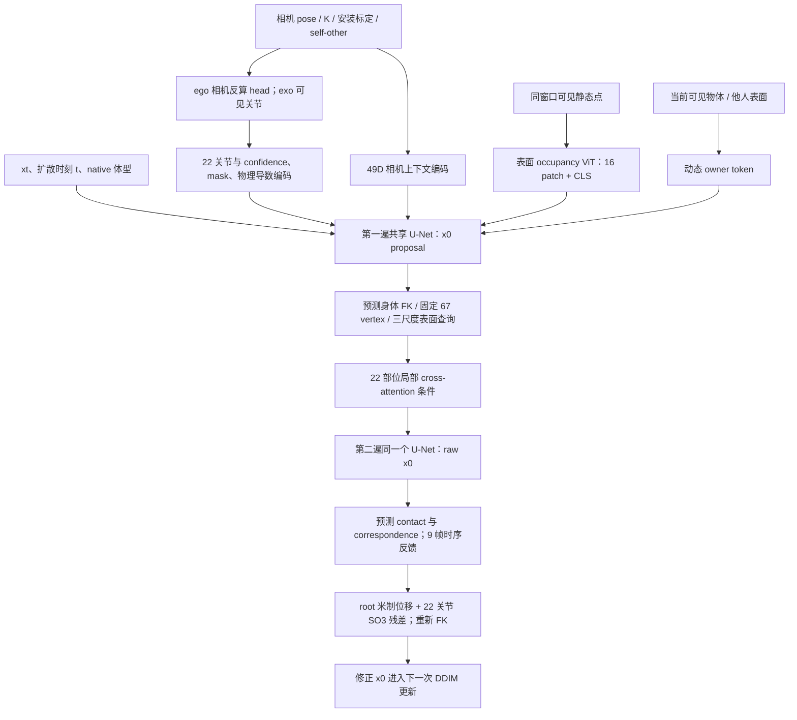

# Exo 遮挡检查、实验设置与统一模型架构

2026-10-12。**训练暂停，本轮优化器步数为 0。** 当前工作包括三套数据各两个 exo 输入片段的 viser 检查，以及 native30 新模型的设置整理。这里的可视化是输入和 GT 几何参考，不是生成质量评估。

后续复核见 [遮挡恢复定位、手臂源拟合异常及 TRUMANS 外参恢复](FOLLOWUP_DESIGN_AND_AUDIT_zh.md)：保留 confidence 降权；viser 默认当前策略且末尾停止；两套 TRUMANS SMPL-X 已恢复并验证逐帧外参，内参仍待确认。下面六例的 TRUMANS 输入仍来自合成固定相机。

最新训练协议核对见 [输入扰动、GT质量、窗口与重训建议](TRAINING_PROTOCOL_RECOMMENDATION_zh.md)。当前随机192帧允许重叠，静态记忆仅限当前窗口。另已确认EgoBody是内部场景划分，TRAIN含12个官方test recording；正式论文比较前应另建官方benchmark版本，不能把内部验证结果当官方test结果。本轮未改旧划分或启动训练。

## 1. 查看六个例子

打开 [viser：exo 遮挡与可信轨迹](http://127.0.0.1:8783)，在「片段」下拉框选择例子。每段为原始 30 Hz 的连续 192 帧，时间跨度 191/30≈6.37 秒；按采样窗口预算称为 6.4 秒。源帧、当前有效关节数、高置信度关节数和逐关节遮挡像素均随时间更新。

建议先播放，再按「跳到外部遮挡最强帧」，随后「切到 exo 光学视角」。右侧几何 first-hit 图提供准确的有畸变像素归属；viser 三维光学视角是普通透视显示，不精确复现镜头畸变或偏心主点，应以右侧图核查可见性。可以选择某个关节查看近 3 秒可信轨迹；轨迹不会连接中间缺失的帧。

默认播放到末尾停止；循环需主动开启，非周期片段末尾→开头会有跳变。第一个 EgoBody 片段开头右臂源拟合有明显跳变，已直接复算验证并在视图提示，不能据此判断生成质量。

|显示|含义与输入边界|
|---|---|
|绿点／绿线|当前策略选中的关节位置输入／相邻帧轨迹|
|红点|未输入的 GT 参考关节，只帮助检查缺失的位置|
|蓝色目标网格|完整 GT 参考人体，模拟器用于遮挡判断；不是生成模型的输入|
|紫红色网格|另一人的完整参考几何；模型只得到当前视角看到的该人皮肤点|
|黄色网格|TRUMANS 中带源姿态的刚体参考；模型只看到 first-hit 表面|
|当前帧可见环境点|512 个采样槽位，排除目标皮肤，保留静态、物体、另一人的可见表面|
|本窗口观察静态记忆|同一 192 帧窗口的静态可见点并集，2.5 cm 去重；可含其他帧看到、本帧被挡的表面|
|扫描点云与近人网格|只用于对照，默认关闭；源扫描网格按GT窗口范围裁剪以便显示，这个裁剪只用于显示，不会成为模型的环境条件|

两种关节输入策略分开展示：

- **当前配置**：区域可见像素至少 2 个，且可见比例至少 0.15；所有有效关节继续按 confidence 降权，没有 0.7 硬阈值。
- **高置信度筛选**：在当前有效性基础上只保留 `confidence≥0.7`。这是本轮诊断策略，尚未写入训练配置。默认显示当前降权策略，可主动切换来检查阈值影响。

六例身份、相机、源帧、逐关节统计和数组 SHA256 见 [manifest.json](manifest.json)；选择设置见 [selection.json](selection.json)。逐例数值结论见 [OCCLUSION_FINDINGS_zh.md](OCCLUSION_FINDINGS_zh.md)。

## 2. 相机来源与坐标

**EgoBody** 用真实 Kinect master 的官方 RGB 光学标定，内参／有理畸变来自 `kinect_cam_params/kinect_master/Color.json`，外参来自对应 recording 的 `kinect12_to_world/<scene>.json`。原图范围 1920×1080，诊断射线网格 192×108。两个人都使用完整 SMPL 网格参与最近交点判断；target 随所选角色改变。master 是独立外部观察者，不转换为 target 的头部相机。

**RICH** 用所选场景的真实 `calibration/000.xml`，包含 camera-0 坐标到该观察相机的 `R,t,K`。同时对人体、扫描和相机应用同一个 `multicam2world` 相似变换，再转成 SceneMI y-up。相机中心用 `-Rᵀt`；相似变换的 scale 作用于位置／深度，不缩放旋转。诊断射线网格 256×192。使用的图像边界为 4112×3008，已核实 [官方 toolkit 示例原图](https://raw.githubusercontent.com/paulchhuang/rich_toolkit/main/samples/tmp.jpg) 的尺寸；本地没有这两个片段的原始 RGB，尚未逐片段核对原图边界及真实像素重投影。外参、K 和几何处理来自本地实际标定，并非虚构相机。[官方坐标说明](https://github.com/paulchhuang/rich_toolkit)、[官方投影实现](https://github.com/paulchhuang/rich_toolkit/blob/main/utils.py)。

**TRUMANS** 本地有配对 world／camera-coordinate SMPL-X，本次后续复核已恢复并验证两条逐帧相机外参，K／图像边界与像素轴约定仍需确认，见[复核记录](FOLLOWUP_DESIGN_AND_AUDIT_zh.md)。此前六例缓存使用**合成固定 exo**，本轮没有替换：观察位置由片段 pelvis 中位位置、半径 3.2 m、相机高度 1.65 m、朝向设定确定，注视目标高度 1 m；水平视角 66.56°，192×108，近／远裁剪 0.1／12 m。最终相机位置和完整矩阵保存于 manifest。不能把这两例称为真实 exo 视频测试。[官方数据说明](https://github.com/jnnan/trumans_utils#trumans-dataset)。

三个数据集的可见关节与环境表面在各自同一米制世界坐标中模拟。visor 直接展示这个坐标，避免把“显示时朝向错”与“模型生成朝向错”混为一谈。正式模型输入则由首光学相机位置／水平朝向锚定，再共同做 world-yaw 增广；人体、场景、相机一起变换，不用 GT pelvis 朝向决定输入坐标。

## 3. 遮挡和置信度到底如何计算

每帧用标定射线分别查询完整目标、其他完整人体、静态扫描和有效动态刚体，保留每条射线的**最近交点**。owner 为 `0=静态场景`、`1…99=刚体`、`100=目标`、`101+=其他人`、`-1=未知`。有物体在前面时，后方的人／场景表面不会成为该帧可见输入；目标皮肤始终从环境点中排除。

SMPL／SMPL-X 的三角面通过 skinning 权重映射到 22 个解剖部位，手指／脸部附属关节归并到 body22 祖先。对关节 j：

```text
reference[j] = 只渲染目标时，该部位首先命中的像素数
visible[j]   = 加入所有遮挡物后，仍首先命中目标该部位的像素数
fraction[j]  = visible[j] / max(reference[j], 1)
available[j] = visible[j]≥2 且 fraction[j]≥0.15 且源帧有效
confidence[j] = available[j] × fraction[j] × min(visible[j]/12, 1)
```

本轮分别统计 reference 像素最终被另一人、静态场景／物体、动态刚体取代的数量，逐帧检查 `reference = visible + person + static + rigid`。完整外部遮挡的部位 confidence 为 0；输入位置置零并附失效 mask。部分区域仍可见时允许输入，因而“高置信度”也可以有少量被遮挡皮肤。

**这是理想关节跟踪器的几何模拟。** 有效位置直接取数据集拟合的 anatomical joint，confidence 不是 Human3R 等前端的实际预测；可见区域不等于内部关节中心直接可见。目标单独 first-hit 已处理自身表面的前后关系，但 reference 不计目标自身遮住的区域面积；reference=0 也可能来自出画或分辨率不足，当前不能独立区分这些原因。因此不能宣称已经标定了所有自遮挡情况下的关节估计误差。

像素支撑项还依赖分辨率和距离。RICH 与 EgoBody／TRUMANS 的诊断网格不同，不能直接把平均 confidence 或高置信度关节数解释成数据集难度排名。0.7 目前用于检查，不是已经验证的通用前端阈值。正式接真实前端时需要置信度校准、目标身份关联以及重投影／时序一致性检查。

## 4. 当前实验状态和数据设置

|项目|native30 新模型当前设置|
|---|---|
|实现与配置|[native30_model.py](../../native30_model.py)、[native30_config.json](../../native30_config.json)|
|模型状态|从头初始化；尚未训练；当前只有零优化器步接口／梯度验收|
|既有模型|55k 原模型与续训 3k 权重均属于旧 20 Hz 路线，保持可恢复；本轮没有覆盖它们|
|时间轴|直接读 raw30 整数源帧；固定 192 帧训练窗口；不从旧 20 Hz 缓存插值场景或 contact|
|划分|延用既有 source-scoped TRAIN／validation 边界，不跨段边界；没有新增 test 性能结论|
|源库存|904 段：TRAIN 744、validation 160；全量 raw30 导出尚未开始|
|已有新模型输入面板|8 段×192 帧，12 种来源／模式组合；这是诊断面板，不能作为全量训练替代|
|本轮六例|单独诊断缓存，192×6 帧；用于遮挡查看，不进入训练 sampler|
|正式 exo 采样覆盖|目前仅 EgoBody master 的 wearer／interactee；RICH、TRUMANS 本轮诊断尚未接入正式 sampler|
|模式比例|ego 70%，exo 30%；exo 两角色按有效窗口时长分配|
|ego 观测组合|65% 仅 head；35% head 与两 wrist（15／20／21）；后者仍为数据集模拟的可信观测|
|语料平衡|ego 语料按可用时长平方根平衡，EgoBody 内角色按时长；序列与窗口按有效窗口数采样|
|体型|已知 native SMPL／SMPL-X、gender、betas、scale；未知视频中的形态／身高推断未接入|
|离线场景预算|同一完整 192 帧的观察静态并集，加当前帧动态表面；不是全 recording 的完整扫描|
|增广|共同 world yaw；位置初始漂移 σ=1 cm，加窗口内线性漂移 σ=2 cm；30% 概率单关节缺失 18 帧；无新的旋转噪声增广|
|噪声|1000 步 cosine 扩散；另以 25% 概率改抽 t∈[0,99]，增强低噪声学习|
|优化器|AdamW；batch=2；lr=1e-4；weight decay=0.01；clip norm=1；warmup=200 步；cosine schedule，最低倍率 0.2|
|训练预算|未确定，不自动启动；入口要求显式正 steps、全量数据及匹配的零步验收|
|采样|默认 DDIM 20 步，整段生成；每步两次共享 core forward，约 40 次；2 步只做过接口 smoke|
|长度|主训练固定 192；接口允许 64／128／192，其他长度动作质量尚未验证；不是逐帧自回归|
|随机与存储|seed=2026101267；未来仅一个原子可恢复 last.pt，包含 optimizer、RNG、sampler 状态|

本轮诊断脚本独立于训练代码，没有改变正式输入策略／loss／采样比例。新文件也会改变训练入口检查的全目录代码指纹；正式训练前仍需重新做 full-data preparation，不能拿旧审计记录绕过 guard。

配置还存在两个需要在训练前补齐的接口边界：`train_native30.py` 当前会建立validation数据对象，但训练循环只写TRAIN trace与checkpoint，尚没有正式validation采样／指标循环；观测尺度和joint importance目前由loss代码导入的固定常量提供，数值与当前JSON一致，但修改JSON尺度不会自动修改loss。1000步noise schedule也有固定代码约束。正式开展新配置实验时应先接通这些参数与native30评估，不能把配置文件中存在字段等同于该字段任意修改已受支持。本轮没有改变这些训练实现。

## 5. 统一模型架构



### 5.1 统一输出和人体条件

共享动作表示为 201D：root translation 3D＋22×6D local rotation 132D＋22×3D world joints 66D。位置通道按 `m/2` 传输，计算距离、速度、反馈时还原米；旋转用 identity-centered residual 6D。root 包含 native rest-root 补偿，最终 global-joint 通道由 FK 重写，保持骨长。

ego/exo 使用**同一个 U-Net 和同一个输出头**。差异在观测可用性与相机上下文表达，不按相机模式改变动作定义。native relative rest 66D、body type 2D、scale 1D 经 `69→128→256` 身体编码加入条件；betas 另外决定 native skinning 资产。主干 latent=256、dim_mults=(1,2,4)、AdaGN 条件注入；新模型约 122.4M 参数。

共享输出小随机初始化 `std=0.001,bias=0`，确保首步身体 loss 能传到观测与场景编码器；位置／旋转反馈出口零初始化，让起始反馈为零。退化 6D 使用 proper SO(3) 兜底，原始 6D 保留直接监督。

### 5.2 观测和相机编码

统一人体输入为 `[B,T,22,9]`：位置3＋旋转6；meta 的 position／rotation availability、两类 confidence 和类型字段分开保存，还有每关节 position／rotation uncertainty。缺失值不会借 GT 填补；confidence 为零／NaN／退化旋转会屏蔽对应通路。

每关节使用 pose、meta、v/a/角速度、导数 stencil mask、uncertainty 和 joint ID，合计 43D；MLP `43→64→32` 后保留有序 22 槽，再投影到 64D 条件。v/a/角速度为 m/s、m/s²、rad/s，只在连续有效帧计算，缺失处不会跨 gap。导数和编码同时受置信度门控。

ego optical camera 根据 `R_head=R_camera R_mountᵀ`、`p_head=p_camera−R_head t_mount` 转成 anatomical head 输入；旋转缺失且安装偏移非零时 head position 也失效。虚拟相机用实际固定安装参数；真实 PV 用冻结 TRAIN 近似，并保留安装 p90 不确定性。self camera 编码器只提供安装／K 等几何上下文，不重复走一条未屏蔽的干净 head 运动通路。

other/exo camera 保留独立观察相机 pose／K、相对可信身体的位移、固定／移动与真实／合成来源等上下文。静态 master 的相机导数自然为零，但它仍描述视点、观察方向和可见性；移动 observer 可以有独立相机轨迹。49D 特征经 `49→128→64` 条件编码。exo 目前只有可信位置，没有直接喂 GT joint rotation。

### 5.3 全局静态和当前动态场景

静态并集先按 2.5 cm 去重，再建立 `[24,48,48]` **观察表面占据**。x/z 范围约 ±6.4 m、步长约 26.67 cm；y 范围 −3.1…1.7 m、步长 20 cm，均在相机锚定坐标下。点云不需要 RGB，也不需要先制造 depth 文件；几何渲染的深度／first-hit 只是用于截取该相机可见表面的中间结果。

ViT 将高度作为 channels、水平面分成 4×4 patch；每个 patch 覆盖 3.2×3.2 m，hidden=1024、6 层、16 heads、MLP=2048。**不只一个 token**：CLS 变成 256D AdaGN summary；16 patch 加米制位置后投影到64D，22 个部位 query 做 4-head cross-attention，保留有序 22×64，再汇总为64D条件。没有观察点的 patch 视为 unknown，null token 防止全 mask 导致 NaN；但非空 patch 内仍只有粗糙二值表面编码，不能当完整 free-space／SDF。

当前动态表面按 owner 形成11D可见摘要：中心、范围、可用速度、支撑数量、速度有效性，加8D owner embedding 后 `19→64→64`，逐帧进入部位 cross-attention。动态不累积成静态并集。刚体点速度为 `v_obj+ω×(p−center)`，目前来自已知源轨迹；另一人的皮肤速度没有可信估计，mask=0。

### 5.4 固定 vertex、局部 BPS 与接触反馈

局部查询使用固定 67 个 native vertex，约每部位3点、head额外1点；选 body22 dominant 区域，避开生成器不输出的细手指／jaw／eye，脚／踝偏向低支撑面。ID 随 betas 不变，位置跟随预测身体 skinning。

每个扩散步第一遍预测 x0 proposal，做 SO(3) 与 FK 一致化，然后查询该预测的皮肤；不拿随机 xt 或 GT 身体作查询。高噪声时查询中心按可信关节位置混合，权重约 `(1−alpha_bar)×confidence`；低噪声时逐渐回到预测皮肤。三半径为 8／25／60 cm，每尺度取8个覆盖邻点，加 null token；位置差、距离、局部法向／可靠性、局部平面距离、moving、速度／mask、owner 等22D编码到64D，与 vertex query cross-attention。67点再按22部位保留有序局部 token，形成32D局部主干条件；宽半径最近点差也保留原 BPS 通路。

BPS 表达邻近空间关系；contact 表达某部位应否接触以及对应表面是否可靠，功能不同。contact 由局部 context 与第二遍预测身体的13D位置／速度／旋转／噪声状态共同预测；correspondence 从局部 context 预测。门控为 contact probability × correspondence probability × 有效几何 × `alpha_bar²`。

两层 kernel=5 时序卷积，直接感受野9帧，生成 root 位移3D和22×3D axis-angle旋转残差。root 向量限幅8 cm；关节旋转向量限幅0.12 rad，之后再乘门控。位置通过 root 平移和局部 SO(3)／FK 改变，不给各 vertex 独立位移；无邻域时反馈严格为零。修正发生在生成器内部的 x0、下一次 DDIM 更新之前，当前没有生成后的独立场景优化器。

## 6. 监督、单位和实际系数

### 6.1 完整动作监督

|项|系数／单位|
|---|---|
|最终201D x0直接误差|1；root三个通道权重2，位置通道仍为m/2|
|第二遍原始201D x0|0.5；保留原始6D纠错梯度，避免纯归一化旋转在恰好180°处驻点|
|FK关节位置／head位置|2／1；m²|
|global rotation matrix|0.2；旋转矩阵元素平方误差|
|物理速度／加速度|0.025／0.0000125；m²/s²、m²/s⁴，乘 alpha_bar²|
|绝对root／head／neck朝向|0.25／0.5／0.25；SO(3) chordal|
|head相对root方向协调|0.1；相对旋转矩阵误差|
|相对转向|0.02；lag=1／6／12帧，乘(30/lag)²及alpha_bar²|
|脚速度／planting|0.075／0.1；stance 阈值0.2m/s；不是每帧静止脚的假设|
|原始global joints与自身FK一致性|0.5；m²|

朝向不能交给相机编码“自动解决”。相机处理观察坐标与安装关系；人体绝对朝向、head-root协调和转向由生成器学习及上述监督处理。速度／加速度无法单独消除恒定180°朝向错误。严重遮挡时，位置观测本身可能不足以唯一确定面向方向。

### 6.2 每条可信观测轨迹

位置、旋转、v/a/角速度分别用标准尺度归一化，再计算 SmoothL1；按 availability、confidence、stencil 和 joint importance 加权。位置尺度5 cm、旋转10°、速度0.15m/s、加速度1m/s²、角速度20°/s；真实PV安装p90更大时提高位置／旋转尺度。归一化分母不包含 confidence，避免把降权抵消。

joint importance 为 pelvis/head=2，ankle/foot/wrist=1.5，其余=1。当前小面板标定的真实系数为：position **0.0966844**，rotation **0.025**，velocity **0.00171691**，acceleration **0.0000312168**，angular_velocity **0.00198077**，body_turn_rate **0.0025**。最后的 body_turn_rate 实际使用 GT root 角速度，是训练辅助监督，不是前端提供的可见 pelvis 轨迹；不要把它当可部署输入约束。

这些系数由6类TRAIN输入×t=25／300／800共18桶的共享输出梯度比例上限确定；位置／旋转／v/a/角速度／body-turn比例目标依次0.1／0.04／0.03／0.005／0.015／0.015。[原始标定记录](../ego_exo_native30_oct12/TRAIN_gradient_scales.json)。这是初始小面板标定，尚未证明全量或重遮挡情况下各轨迹梯度同样平衡。

### 6.3 几何与接触

contact BCE系数0.1；contact surface distance0.2 m²；relative slip0.01 m²/s²；观察平面弱代理0.02 m²；correspondence0.01；feedback smoothness0.0001。距离／弱半空间容差2 cm，relative slip容差0.2m/s。

RICH 原始顶点接触标签按原帧聚合到22部位；缺失标签 mask，不作为negative。有标接触且邻域可靠才施加距离／相对滑动；没有可信表面速度就不监督相对滑动。局部法向是朝观察相机定向的PCA平面代理，**不是完整场景SDF，不能保证无穿模**。当前没有人体-人体物理接触标签或密集自碰撞约束。

## 7. 验证结果与后续需补的部分

本轮 first-hit 的人／静态／刚体遮挡、远处物体不覆盖近处目标、失效源帧屏蔽、目标皮肤排除、当前与高置信度策略区分、缺失轨迹不连接均有单元检查；结果见 [UNIT_TESTS.log](UNIT_TESTS.log)。六例检查了原始整数时间轴、遮挡计数分区、失效位置置零、米制相机往返与输入／GT对应。浏览器实际交互证据见 [BROWSER_CHECKS.json](BROWSER_CHECKS.json)，截图留本地。

新模型之前通过9项物理／接口检查、batch=2×192完整目标反向传播及2步DDIM有限性检查；未分配Adam状态时峰值显存约2.60GiB。场景／相机／观测条件有梯度并能影响输出，位置反馈改变动作且保持骨长。**这些证据不代表学会使用场景或朝向已修复**；未训练exo proposal还可能完全错位，导致局部覆盖率为0，反馈会关闭。[此前零步记录](../ego_exo_native30_oct12/IMPLEMENTATION_zh.md)。

正式训练前建议依次落实：

1. 用户查看六例并确认相机／人体／场景关系；核对RICH真实RGB边界及重投影，合成TRUMANS相机先检查可用位置，排除墙外视点。
2. 决定正式输入是否加入硬confidence阈值；校准不同分辨率／距离／来源的可靠性，保留soft confidence和连续缺失mask，不把几何可见当实际关节精度保证。
3. 将已验收的RICH/TRUMANS exo协议接到正式raw30导出与sampler，再重算模式／语料比例；本轮仅做diagnostic，尚未执行此项。
4. 全量raw30导出与零步验收；接通配置尺度／noise schedule及正式native30 validation循环，重算30Hz相关指标，重新标定重遮挡／各部位监督梯度。开始训练的具体步数和质量验收另定，不自动续训旧权重。
5. 训练后的同噪声scene移除／错配对照、局部／contact反馈消融、朝向／FK／观察误差与contact/slip统计，证明场景影响正确；与前端比较时使用同相机、坐标、尺度和可见／遮挡关节划分，分开报告整体与遮挡部位结果。
6. 长出画／再入画、多假设自然补全、未知形态、真实前端误差和动态物体估计继续后置。六例中已有完全无高置信度关节的时刻，应保留unknown，而不是用GT补输入。跟踪身份交换、物体漏重建、反光／透明材质等真实视频问题，本轮几何模拟没有覆盖。

## 8. 复现与资源

在SceneMI根目录，用 `/home/wenxin/miniconda3/envs/scenemi/bin/python`：

```bash
python -m experiments.offline_camera_retrain_v1.exo_occlusion_review
python -m unittest experiments.offline_camera_retrain_v1.test_exo_occlusion_review -v
python -m experiments.offline_camera_retrain_v1.view_exo_occlusion_review --port 8783
```

导出器独立写 `data/exo_occlusion_review_oct12`，不打开训练器或权重。已存在的本轮缓存校验身份、协议和数组SHA256后复用，过期导出拒绝静默覆盖。大网格数组和浏览器截图留本地；代码、配置、manifest及紧凑检查记录备份到授权user-backup。磁盘库存与未选候选处理见 [VALIDATION.json](VALIDATION.json)。
