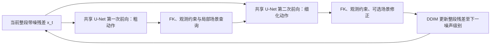

# EGO 场景通路与主干 cross-attention 对照

本轮继承新版 native30_gait_v2_ego55k_oct15 长训中的 best41k，先处理 EGO 和场景，EXO 排在后面。这里的 41k 属于新版长训，不是历史 20 Hz 旧 55k。

**本轮取舍：保留原 41k 的学习式场景通路，主线推理关闭解析物理修正；不推广本次新增 attention 的 500 步候选。** 场景条件有明确面板收益，但新增 attention 未胜过匹配续训对照；单纯收紧或删除反馈也没有解决脚步问题。EXO 参考跳变修复仍排在 EGO/场景之后。

## 当前生成过程

模型一次处理 192 帧（30 Hz，6.4 秒）的整段动作。观测先构造参考动作 R，扩散变量是相对 R 的动作残差。采样初始残差是高斯噪声，每个 DDIM 步都更新整段带噪残差，不是按帧逐个生成。

同一 DDIM 步内，第一次 U-Net 前向给出粗动作，用它查询人体附近场景；第二次 U-Net 前向读取查询结果，估计整段干净动作。外层 DDIM 根据该估计更新到下一个噪声级别。当前采样共 20 步。FK（正向运动学）沿骨架，根据固定骨长和关节旋转计算各关节位置；它本身不提供重力或碰撞保证。

图中省略参考动作和全局场景输入；两次 U-Net 使用同一个 x_t，场景查询不会在中途另做一次 DDIM 更新。20 个外层 DDIM 步完成后得到整段 192 帧动作。

现有模型在主干外已有 global/local 场景 cross-attention。主干是时间卷积 U-Net，其内置 attention 开关对应 self-attention，不能直接当作场景 cross-attention。新版本在第二次前向的 U-Net 瓶颈加入 cross-attention：每个瓶颈时刻的全身特征作为 Q，已有 16 个全局场景 token、22 个局部身体区域 token 和空 token 作为 K/V。局部特征按有效性汇聚到瓶颈时间轴。它不是新增的逐关节时空 Transformer。

新增 148,800 个参数，输出投影零初始化；不增加 ViT 编码或几何查询次数。真实 TRAIN 输入上的开/关场景初始化等价检查见 PREFLIGHT.json。

新增 local K/V 使用原始 region context，没有旧 region_condition 的显式 alpha_bar² 幅度门控；Q 已包含 U-Net 的时刻条件，local 特征构造也含时刻信息。这是条件通路强度/调度的差异，因此本次比较不只涉及融合位置，不能外推为所有 cross-attention 方案的结论。设计与初始化独立复核见 [架构审计](ARCHITECTURE_AUDIT_zh.md)。训练后 scene-off 仍绕过新分支，但两臂的原主干均已更新，不要求两臂输出继续逐值相同。

## 受控实验

- 统一继承原 EGO-only best41k；不修改或覆盖正式 41k/55k。
- 原架构 control 与新增 attention 两组都全参数训练，使用相同原始参考、监督、六次观测 IK、样本顺序、扩散时刻、噪声和场景 dropout。
- 两组都关闭解析物理引导，重置 AdamW，FP32、batch=2、学习率 2e-5、warmup=25、固定调度终点 1500 更新；先在 500 更新做短程比较。500 更新不能用于宣称收敛或否定整个架构方向。
- 每一步保存输入、监督、几何、噪声及 RNG 指纹；MATCHED_AUDIT.json 要求两组逐项一致。训练准备与计算耗时分开记录，避免先后缓存命中差异影响吞吐比较。
- 验证固定采用既有身份清单中每数据集前 4 个不同录制，共 12 窗；clean/noisy 各算一次。每数据集前 2 个录制为开发面板，后 2 个为确认面板，均属于 VAL。无 TEST、无结果择样、无自动替换正式 checkpoint。

原 41k 场景拆分在 ../native30_ego_scene_review：none 关闭全部场景路径；learned_only 保留学习式场景条件和反馈、关闭解析物理引导；full 保留两者。三者都保留原观测锚点与 IK。

指标先在数据集内等录制平均，再对三个数据集等权平均。同时保留各数据集、开发/确认面板、头部与非观测关节、根相对误差和脚部时间诊断。脚部低速指标依据 GT 脚速选帧，不等同于真实接触、穿模或悬空率。

查询诊断的 near 表示实际查询中心最大 0.6 m 范围有表面证据；早期中心会混合可靠观测，并非始终在皮肤位置。far_only 表示仅宽关系分支覆盖，不代表所有关系点距离均大于 0.6 m，也不能直接判定反馈错误。

为直接检验反馈权限，另用同一 41k、同一 12 窗运行两种冻结权重策略：near_only 保留全部场景条件，但只有原局部查询覆盖的身体部位可触发学习式反馈；feedback_off 保留场景条件并关闭学习式反馈。两者均关闭解析物理引导，共 48 个输出，与原 learned_only 的保存输入逐值配对。实现复用 ops/scene_feedback_policy.py，数据和结果位于 ../native30_ego_scene_feedback_review；不改已封印的原评估文件。

## 已完成：原 41k 的场景拆分

72/72 个输出于 2026-10-18 21:53 完成，并通过重读原始验证数据的独立 CPU 复核，最大指标差 2.59e-5 mm。以下均为 World MPJPE（mm，越低越好）；clean/noisy 是同一窗口的两种观测条件，不是 24 个独立录制。

| 数据集（各 4 录制） | 输入 | 无场景 | 学习式场景，物理关 | 学习式场景，物理开 |
|---|---|---:|---:|---:|
| RICH | clean | 155.84 | 119.09 | 119.04 |
| RICH | noisy | 181.73 | 129.86 | 129.50 |
| TRUMANS | clean | 215.67 | 112.38 | 113.73 |
| TRUMANS | noisy | 226.64 | 128.39 | 127.78 |
| EgoBody | clean | 170.13 | 156.53 | 156.53 |
| EgoBody | noisy | 186.83 | 170.41 | 170.41 |
| 三数据集等权 | clean | 180.55 | 129.33 | 129.76 |
| 三数据集等权 | noisy | 198.40 | 142.88 | 142.57 |

学习式场景相对无场景的全身宏平均误差下降 28.4% / 28.0%。PA-MPJPE 同时由 121.73→91.05 / 130.15→95.86 mm，说明收益包括平移之外的姿态改善，不能只归为对地面高度的平移修正。RICH 的 PA 为 120.90→95.16 / 127.34→99.74 mm。

物理引导没有带来稳定的额外全身收益，且足部时间指标变差：宏平均 GT 低速脚帧上的水平脚速由学习式场景的 0.158/0.177 升至物理开启的 0.181/0.208 m/s；加速度误差由 4551/4945 升至 5535/5900 mm/s²。低速脚帧的足高绝对误差略改善，42.92/44.37→42.18/42.74 mm。该局部目标下降不代表全局动作更平滑。

独立差分审计确认部分输出存在逐帧交替，例如 case0 clean 的右脚 x 差在相邻帧约 -25/+21/-25/+21 mm；这是 full 与 learned_only 最终 DDIM20 输出之差，包含整个采样轨迹的分化，不能当成单次求解器修正量。代码接受门控没有最终加速度指标，滑步项也只在受限接触条件下生效。代码证据、逐窗口数据与机制假说分别记录在 [物理时序审计](../native30_ego_scene_review/PHYSICAL_TEMPORAL_AUDIT_zh.md)。

同一套带诊断的 DDIM20 采样平均耗时：无场景 3.26 s、学习式场景 6.27 s、物理开启 10.69 s，均不含共享的数据准备；这是本面板的采样时间，不是长训的每步耗时。当前结果支持优先保留学习式场景通路，谨慎处理物理引导；主干 cross-attention 是否值得采用仍以同预算训练对照为准。

这些是 12 个验证录制的受控消融，不是全 RICH TEST 或与其他方法的正式排名。原始逐窗口指标、分母、阶段诊断及 CPU 核验位于 [场景评估目录](../native30_ego_scene_review)。

## 已完成：反馈权限检验

同一 41k 的 48 个新输出已通过独立 CPU 复算，并与上表 learned_only 的 24 个输出逐项核对源数据、观测、参考、种子和输入指纹。限制反馈只能作用于原局部查询命中的区域，宏平均 World 变化为 clean +0.005 / noisy -0.023 mm，基本不影响结果。本面板不支持“宽关系扩大反馈权限是主要故障来源”的假设。

保留场景条件、关闭学习式反馈后的宏平均 World 为 128.35 / 142.84 mm，仍明显优于全部场景关闭的 180.55 / 198.40 mm。因此，场景收益大部分并不依赖末端反馈头，场景条件影响生成器这条路径确实发挥作用；这里尚未区分 global、local 和 relation 各自的贡献。

关闭反馈相对原 learned_only 的宏平均 World 变化为 -0.983 / -0.046 mm，但 RICH 的低速脚帧足高误差增加 1.96 / 2.87 mm，足速只微幅变化。两种策略都没有呈现可用于解决飘起、滑步的一致收益，当前不直接替换原策略。详细指标、开发/确认面板与配对胜负见 [反馈策略审计](../native30_ego_scene_feedback_review/AUDIT_FINDINGS_zh.md)。这些是冻结模型的推理策略消融，未检验重新训练后移除反馈的结果。

“保留场景条件”指在同一个输入 x_t 上不改其计算路径或数值；反馈改变后，后续 DDIM 状态与查询中心仍会随之变化，不能假定整个采样过程中所有条件 token 逐值相同。

两种反馈策略均未采用；完成 CPU 审计后，48 份可重建预测数组按记录保留策略删除，原 41k 权重未动。逐窗指标、种子、输入/源码身份与审计完整保留，CPU_RECHECK/AUDIT_FINDINGS 是清理前的验证证据，详见 [清理记录](../native30_ego_scene_feedback_review/CLEANUP.json)。后续重新验证数组须在新目录按原计划重新生成。

## 已完成：500 步配对训练

两组于 22:27 完成预定的 500 更新。[逐步审计](MATCHED_AUDIT.json) 确认全部样本、参考、监督、几何、扩散时刻/噪声、场景 dropout 以及 CPU/CUDA/数据采样 RNG 精确一致。每组均有 444 次 scene-on、56 次 scene-off。

[独立参数审计](UPDATE_SANITY_500.json) 确认两组 315 个原参数张量均实际更新，attention 新增 8 个张量、148,800 参数全部相对同 seed 初始化发生变化，参数及 Adam 状态均有限。Adam 更新次数按分支为 500 或 444，与实际场景使用相符；不是只挂上一个没有参与训练的分支。

训练末 100 步平均 loss 为原结构 0.139059、attention 0.139026，接近，不能据此判断生成质量。去除前 25 更新后，计算部分平均 0.9375 / 0.9406 s，增加约 0.3%；数据准备受先后缓存影响，不能把整个 update 的时间差宣称为加速。[耗时记录](TRAINING_TIMING.json) 分开保存准备/计算/更新时间。

正式 best41k / last55k 文件均重新计算 SHA256，与此前封印一致，见 [保护模型校验](PROTECTED_MODELS.json)。新阶段没有替换这两份模型。

## 已完成：500 步候选整段生成评估

96/96 个新 DDIM20 输出于 22:36 完成，并通过独立 CPU 复核，最大指标差 2.17e-5。另有两位独立审计核对输入、模型身份及核心指标公式；96 新输出与原 41k 的 48 个 none/learned_only 对照使用完全相同的观测、参考、源窗口、分母、seed 与输入指纹。所有候选物理引导调用均为 0；scene-off 三项保护计数均为 0。完整记录见 [候选审计](../native30_ego_scene_attention_review/AUDIT_FINDINGS_zh.md)。

下表均开启学习式场景、关闭解析物理修正，World MPJPE（mm，越低越好）：

| 数据集 | 输入 | 原 41k | 原结构再训 500 | 新 attention 再训 500 |
|---|---|---:|---:|---:|
| RICH | clean | 119.09 | 128.64 | 128.76 |
| RICH | noisy | 129.86 | 151.16 | 151.29 |
| TRUMANS | clean | 112.38 | 101.27 | 101.39 |
| TRUMANS | noisy | 128.39 | 120.44 | 120.49 |
| EgoBody | clean | 156.53 | 156.10 | 156.24 |
| EgoBody | noisy | 170.41 | 170.61 | 170.61 |
| 三数据集等权 | clean | 129.33 | 128.67 | 128.80 |
| 三数据集等权 | noisy | 142.88 | 147.40 | 147.46 |

attention 相对匹配 control 的宏平均 World 为 +0.130 / +0.060 mm，PA 为 +0.020 / +0.007 mm，根相对误差为 +0.131 / +0.093 mm；低速脚帧水平脚速也微升 0.000290 / 0.000131 m/s。World 仅在 clean 3/12、noisy 4/12 个录制窗口改善，开发和确认面板的宏平均 World 也都未改善。这些差异很小，当前没有实际收益证据。

两种续训相对原 41k 都呈现数据集取舍：TRUMANS 改善，RICH World 回退，不能把共同回退归因于 attention。control 的宏平均低速足速由 0.158/0.177 降至 0.149/0.166 m/s，足高误差由 42.92/44.37 降至 33.12/35.26 mm，但 RICH 足高误差由 26.26/26.27 增至 30.82/30.07 mm，RICH World 同时回退 9.54/21.30 mm。因此，两种候选都不替换原 41k，control 仅作为本次配对训练的可恢复对照保留。

本次结果不支持“必须给扩散主干补 cross-attention 才能使用场景”。原场景条件关闭末端反馈后仍有明显收益；当前更值得保留已验证条件通路，避免用局部能量下降替代最终动作指标。500 更新只检验这一具体改法的短期收益，不是收敛比较；新增 local 通路的时刻调度、融合位置、逐关节 query 等仍是未检验设计。验证只有 12 个独立录制、每窗固定一个 DDIM seed，clean/noisy 不是独立录制，也不是完整 RICH 或正式 TEST 结论。

按未采用实验仅保留记录的约定，审计完成后已删除 attention500 的完整优化器 checkpoint（训练路径与评估 hardlink）及 48 份预测，保留 control500 的完整恢复状态与 48 份预测、原 41k 的 72 份场景对照。所有指标、输入/模型/源码身份与审计仍保留；CPU_RECHECK、AUDIT_FINDINGS 和封印 PLAN/MODELS 是清理前证据，attention 路径现已退役，不能直接再次运行完整文件复核。清理约释放 1.40 GiB 独立 inode 数据，详见 [候选清理记录](../native30_ego_scene_attention_review/CLEANUP.json) 和 [退役记录](attention/RETIREMENT.json)。未排队后续长训。

## 实现预检记录

首轮两步预检发现 CUDA 的 adaptive_avg_pool1d 反向不支持确定性算法，attention 未完成更新；该轮已撤销，失败权重和预测已清理，仅保留 rejected_preflight_v1 中的源代码、输入记录和清理证据。修复为有效性加权的确定性时间区间求和；9 项测试通过，包含 CUDA 下重复输出及输入/参数梯度逐值一致。修复后重新封印并从同一 41k 重启两组，不关闭确定性检查。
