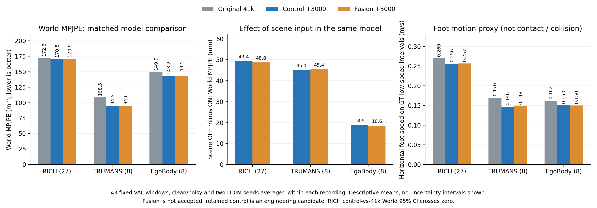
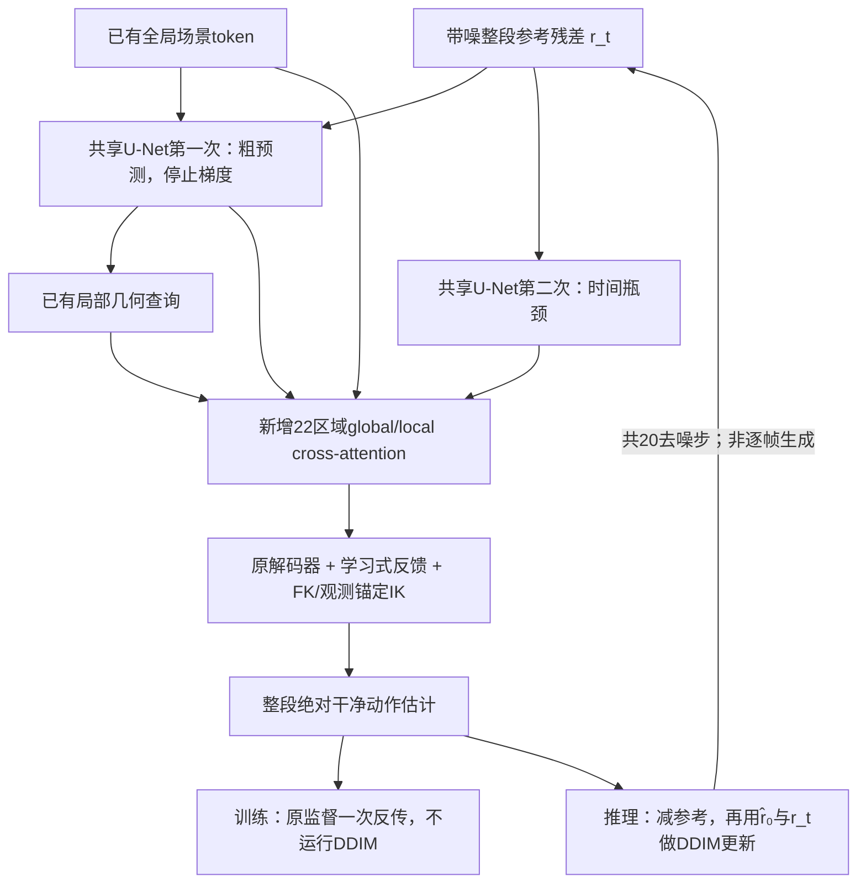

# 场景融合实验：最终结果与可用候选

**保留原架构control3000作为后续工程/实验候选，不替换正式41k/55k；本轮不采纳新增fusion模块。** 两臂各3000更新、43个录制、clean/noisy、双DDIM采样种子，共860次预测，CPU复核和独立NumPy审计均通过。

control相对原41k的三数据集等权宏平均World误差下降 **5.16%**，GT低速期水平脚速代理下降 **7.97%**。但主要目标RICH的World只下降 **0.88%（1.520 mm）**，95% CI跨过零，**不能称为RICH World显著提升**。脚部仍有明显非零运动，飘脚和穿模尚未被证明已解决。fusion与匹配control基本持平，未满足注册增益要求。

图为录制内平均clean/noisy及双采样种子后的描述性均值，未绘制置信区间。数据与来源SHA见 [RESULTS_SOURCE.json](RESULTS_SOURCE.json)。

## 固定训练与验证范围

- 两臂从相同best41k出发，原架构control与新增区域融合fusion均训练全部参数、fresh AdamW、解析物理修正OFF；主干LR2e-6、新分支LR1e-4，warmup100、固定3000更新日程。输入、噪声、监督dropout与RNG配对。
- TRAIN采样RICH/TRUMANS/EgoBody=0.5/0.25/0.25，EGO head-only、30fps、L192、batch2、FP32；每臂一个原子可恢复last.pt。
- VAL每录制一窗：RICH27、TRUMANS8、EgoBody8。RICH另有一条165帧录制不满足L192而排除；TRAIN/VAL按录制无重合。**不是全部验证窗口，也不是官方TEST。**
- dev12用于1000步门槛；confirmation31（RICH23/T4/E4）仅在最终阶段评估。all43含dev，不能全称未触碰留出集；确认部分也可能出现在历史基础模型报告中。两个DDIM种子保持同观测并取均值，不是独立训练重复。
- 516次为三模型scene-on主比较，344次为control/fusion的scene-off消融；原41k本轮无scene-off臂。全部860次`guide_motion`调用为0，原观测锚定/IK及学习式场景反馈保留。

## all43主结果

World MPJPE单位mm，越低越好。每集录制等权，macro对三集等权；C为control，F为fusion，负差值更好。

| 数据集 | 条件 | 原41k | control3000 | fusion3000 | ΔC−41k | ΔF−C |
|---|---|---|---|---|---|---|
| RICH | clean | 164.424 | 161.826 | 161.888 | -2.598 | +0.062 |
| RICH | noisy | 180.156 | 179.713 | 179.953 | -0.442 | +0.240 |
| TRUMANS | clean | 97.576 | 84.180 | 84.206 | -13.396 | +0.025 |
| TRUMANS | noisy | 119.449 | 104.785 | 104.932 | -14.664 | +0.147 |
| EgoBody | clean | 145.120 | 140.709 | 141.087 | -4.411 | +0.378 |
| EgoBody | noisy | 154.638 | 145.686 | 145.979 | -8.952 | +0.293 |
| macro | clean | 135.707 | 128.905 | 129.060 | -6.802 | +0.155 |
| macro | noisy | 151.414 | 143.395 | 143.621 | -8.019 | +0.226 |

## RICH不确定性与采纳判定

| 范围 | 比较 | World差值 mm | 相对改善 | 配对95% CI mm |
|---|---|---|---|---|
| RICH27 | C−41k | -1.520 | 0.88% | [-5.849, 2.648] |
| RICH27 | F−C | +0.151 | -0.09% | [-0.127, 0.454] |
| RICH27 | F−41k | -1.369 | 0.79% | [-5.673, 2.784] |
| 确认RICH23 | C−41k | -1.634 | 0.91% | [-6.635, 3.020] |

先在每个录制内平均clean/noisy和两个采样种子，再对录制做10,000次配对bootstrap；独立单位仍是27或23个录制。confirmation单列也未支持control相对41k的RICH World显著提升。

[ACCEPTANCE.json](ACCEPTANCE.json)要求fusion相对**匹配control与原41k两者**均满足RICH至少1%改善、clean/noisy各自改善、95% CI上界＜0及全部副指标守卫。[正式判定](final_combined/DECISION_zh.md)为 **reject**：相对control均值略差且区间跨零；相对41k改善不足1%且区间跨零。其余PA、其他数据集World、足部、加速度及头部守卫通过，不能替代主目标。该fusion判定不自动采纳control；后者仅按完整复核保留为后续候选。

## 脚部与其边界

水平足速是在GT脚关节**三维速度＜0.2 m/s的相邻帧间隔**上统计预测水平速度，单位m/s。最后一列是control全帧脚关节Y误差，单位mm。

| 数据集 | 条件 | 41k水平足速 | control水平足速 | fusion水平足速 | control脚部Y误差 |
|---|---|---|---|---|---|
| RICH | clean | 0.2543 | 0.2402 | 0.2409 | 59.778 |
| RICH | noisy | 0.2847 | 0.2718 | 0.2724 | 70.203 |
| TRUMANS | clean | 0.1569 | 0.1333 | 0.1345 | 32.217 |
| TRUMANS | noisy | 0.1821 | 0.1596 | 0.1616 | 38.068 |
| EgoBody | clean | 0.1511 | 0.1415 | 0.1411 | 59.265 |
| EgoBody | noisy | 0.1722 | 0.1591 | 0.1588 | 67.351 |
| macro | clean | 0.1874 | 0.1717 | 0.1722 | 50.420 |
| macro | noisy | 0.2130 | 0.1968 | 0.1976 | 58.541 |

RICH仍有0.2402/0.2718 m/s的低速期水平脚速，不能说已消除滑动。该掩码不是人工接触标签，足部Y也不是足底对地面的距离；当前没有全mesh场景穿模率、自碰撞率或重力验证。观测头误差比较提供的输入观测，noisy观测不等于干净GT；加速度误差也不等于单纯平滑程度。

有效足速录制为RICH27/27、TRUMANS8/8、EgoBody8/8，GT低速脚关节间隔分别为 **7404 / 2482 / 2501**；confirmation对应23/23、4/4、4/4及6365/1118/1137。机会数不因双种子翻倍，不用作macro权重；缺失不填0。**完整all/confirmation分层、dev结果、PA/root-relative、脚高/加速度/头部、分母及逐录制对比**见 [FINAL_REVIEW_zh.md](final_combined/FINAL_REVIEW_zh.md)、[机器可读记录](final_combined/FINAL_REVIEW.json)及[SUMMARY](final_combined/SUMMARY.json)。

## 同一个已训模型的场景开关

以下关闭/开启场景使用**同一权重**及相同观测、参考、IK、采样种子，两者解析物理修正均OFF。没有另训无场景模型；关闭的是全部学习式场景条件/反馈，新fusion也随之关闭，不能把它当作只测新增attention。

| 数据集 | 条件 | control OFF → ON | ΔON−OFF mm | fusion OFF → ON | ΔON−OFF mm |
|---|---|---|---|---|---|
| RICH | clean | 205.073 → 161.826 | -43.248 | 204.610 → 161.888 | -42.722 |
| RICH | noisy | 235.173 → 179.713 | -55.460 | 234.735 → 179.953 | -54.782 |
| TRUMANS | clean | 120.213 → 84.180 | -36.033 | 120.305 → 84.206 | -36.099 |
| TRUMANS | noisy | 159.001 → 104.785 | -54.216 | 159.655 → 104.932 | -54.723 |
| EgoBody | clean | 158.369 → 140.709 | -17.660 | 158.697 → 141.087 | -17.610 |
| EgoBody | noisy | 165.807 → 145.686 | -20.122 | 165.555 → 145.979 | -19.576 |
| macro | clean | 161.219 → 128.905 | -32.314 | 161.204 → 129.060 | -32.144 |
| macro | noisy | 186.661 → 143.395 | -43.266 | 186.648 → 143.621 | -43.027 |

两模型在三个数据集、两种条件的World/PA/root-relative组均值均受益，支持已有模型使用场景信息，**不证明新fusion优于原通路**或每个窗口都改善。场景会改变整个DDIM轨迹及后续查询位置，不能把最终差值当成单次层输出修正。

control的RICH场景ON−OFF合并差值为 **−49.354 mm，配对95% CI [−72.163, −29.828]，25/27录制改善**；confirmation的RICH23为−53.629 mm，区间[−80.165, −31.877]，21/23改善。该证据支持现有场景通路在本固定面板的作用。

副作用也保留：RICH noisy下control的观测头误差从7.575增至9.287 mm，同时World与足速改善；不能称所有指标无条件变好。confirmation、逐录制胜率、场景足速/加速度及其它指标见完整[最终复核](final_combined/FINAL_REVIEW_zh.md)。

## 模型交付与训练耗时

[SELECTED_MODEL.json](SELECTED_MODEL.json)状态为`selected_for_next_stage_useful_control_fixed_VAL`，权威权重指向固定的 **[final_seed0/checkpoints/control.pt](final_seed0/checkpoints/control.pt)**，`control/training/last.pt`是恢复来源/硬链接别名。包含完整optimizer/data/RNG；阶段step3000、parent41000，不冒充连续原44k。后续原子覆盖last不会改变固定选型pin。

[INFERENCE_CONFIG.json](INFERENCE_CONFIG.json)仅将原配置的`physical_guidance.enabled`改为false。[CPU部署检查](DEPLOYMENT_CHECK.json)已实际用该配置构模并严格加载固定control：317个state张量无缺失/多余key，tensor SHA一致，guidance为false，其余锚定/IK及场景合同保持一致；没有额外GPU或DDIM测试。现有身份校验loader仍需传原配置后明确设置guidance；旧`ops.rich_test`会强制guidance为true，不能直接称同协议复测。

保留路线是原架构+既有场景学习+physicsOFF+平衡低LR续训；没有分别隔离这些共同recipe因素的贡献，也未证明收敛或EXO/tracker性能。统一`ops.motion_viewer`直接读取保留的NPZ，可同一EGO板块叠加41k/control；显式指定clean/noisy archives与相同窗口/采样种子，无须加载模型权重。

[RUNTIME_3000.json](RUNTIME_3000.json)在每臂去掉前100更新后，control/fusion的计算均值为 **0.864/0.868 s/更新**，准备均值0.333/0.300，总更新均值1.201/1.173；B2 FP32，计算含前向/反向/Adam及周期审计。准备受缓存顺序影响，不是网络加速。没有本轮physicsON或旧55k匹配计时，不能量化关闭物理修正的提速，也不能据loss平稳称物理质量已收敛。

## 流程与架构

新增413,504参数在第二次共享U-Net的时间瓶颈中，用每bin的22个身体区域查询已有global/local token；两套cross-attention分开，局部hidden更新乘alpha_bar²，零初始化末端投影残差回注。复用proposal及现有场景查询，不增加FK/几何查询次数；完整模型仍保留原FK/查询工作。

当前为`reference_residual`扩散：训练对GT−观测参考加噪，网络返回绝对动作；推理减参考后更新残差状态，最后加回参考。确定性DDIM仅初始采样噪声，后续不额外注入新随机噪声。详见[实现审计](ARCHITECTURE_AUDIT_zh.md)、[训练配置](PLAN.json)。

## 审计与存储

[独立审计](final_combined/INDEPENDENT_AUDIT.json)覆盖全部860预测、43录制、420封印依赖及输入/参考/分母/模型身份；独立29指标最大差约5.68e-14，CPU新构造参考差3.58e-7，不声称新鲜CPU/GPU输入逐字节相同。保存输入跨模型/开关/种子一致，344个scene-off预测场景/几何/solver守卫均为0。

按[RETENTION](RETENTION.json)/[CLEANUP](CLEANUP.json)，记录完毕后已退休1k、旧control500及未采用fusion权重/预测，共471项，释放约5.67GiB；正式41k/55k、完整control3000、全部516个final base/control预测、所有封印代码和原始数据/场景/身体资产保留。**原gate/fusion相关审计为清理前证据**，原PLAN/rows/审计SHA保持不变。

1000步仅dev12单种子的阶段结果未证明fusion收益（RICH F−C为+1.312mm），原记录保存在[开发验证](gate1000/GATE_REVIEW_zh.md)；最终结论以本次双种子完整验证为准。
