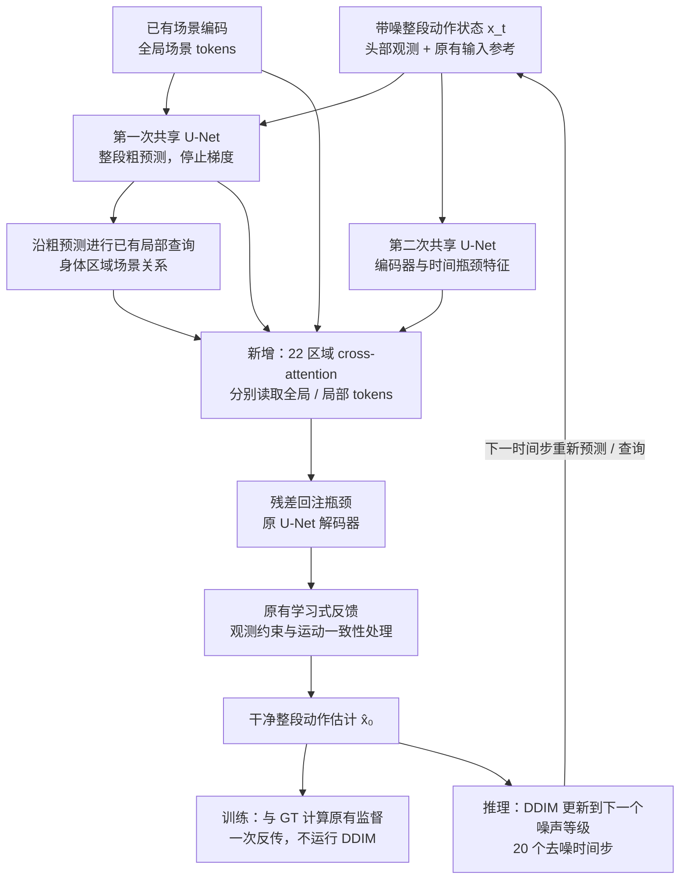

# 身体区域与场景的主干融合实验

当前状态：两臂 1000 更新及开发验证已完成，正在按原定日程续训至 3000。**1000 步尚未证明新增 attention 的收益**：两臂相对原 41k 均有改善，但 fusion 的 World 误差整体仍高于同预算 control。最终 3000 步、43 个录制和双采样种子的结论待验证后填写；正式 41k/55k 未被替换。

## 模型改了哪里

在第二次共享 U-Net 的瓶颈中，让 22 个身体区域分别查询已有全局场景 token 和局部场景关系。查询结合瓶颈时间特征、身体区域身份和已有粗预测的位置/旋转；全局与局部使用两套 cross-attention，局部更新乘 alpha_bar²。区域信息融合后以残差形式回注瓶颈，再由原解码器生成动作。输出投影零初始化，共新增 **413,504 参数**。

图中两次 U-Net 是一次去噪前向里的粗预测与细化，共享原有网络参数；不是逐帧生成。模型每次估计整段干净动作，推理时 DDIM 利用该估计与当前带噪状态更新下一噪声等级。当前确定性 DDIM 只在初始状态采样噪声，后续更新不额外注入随机噪声；全局场景 token 可在同一次采样内复用。

新模块复用已有 proposal、全局 token 和 region context，**不增加场景编码、FK 或几何查询次数**。原场景编码器、已有场景条件、学习式接触/脚步反馈、监督和观测约束均保留。两臂训练及本轮 `learned_only` 验证关闭预测后的迭代解析场景物理修正（`guide_motion`）；原观测锚定 / IK 保持原 recipe。因此“物理修正关闭”不表示移除了全部场景学习或观测求解。

真实 TRAIN GPU 预检中，新模块初始化时的场景 on/off 输出均与原模型 `torch.equal`，新增输出投影收到非零梯度；两步及1000步输入 / 参数更新审计均通过。这些检查证明初始化、反传和配对训练可运行，不能替代生成质量验证。

代码复用 [scene_fusion.py](../../ops/scene_fusion.py)、[ego_scene_trial.py](../../ops/ego_scene_trial.py)、[ego_scene_evaluation.py](../../ops/ego_scene_evaluation.py)，不另建单次实验脚本。

## 两臂训练与固定验证

- 起点是新版 native30 长训的 best41k；正式 best41k 与 last55k 的字节身份保持不变。control 使用原架构，fusion 增加上述模块，两臂均训练所有参数并重新初始化 AdamW。
- 两臂实际数据、观测误差、扩散噪声、监督、dropout 和 RNG 配对。主干 LR 2e-6、新融合 LR 1e-4，warmup100，固定 3000 更新日程；1000 步暂停和恢复不重启学习率时钟。
- TRAIN 权重 RICH/TRUMANS/EgoBody=0.5/0.25/0.25，EgoBody 内部角色比率保留，EGO head-only、L192、batch2、FP32。每臂只原子覆盖一个可恢复 last.pt；阶段评估通过硬链接固定当时的权重。
- VAL 固定 43 个不同录制，各取一个合法窗口：RICH27、TRUMANS8、EgoBody8。RICH28条VAL中一条仅165帧，无法按L192评估，明确排除。TRAIN/VAL 按录制（包括 EgoBody 跨角色）无重合。这不是全部 RICH 验证窗口，也不是官方 TEST 指标。
- dev12 为每集4个录制；confirmation31 为 RICH23/TRUMANS4/EgoBody4，留给最终阶段。all43 包含 dev，不能全部称为未触碰留出集。最终两个预注册 DDIM 采样种子使用相同观测，取指标均值，不选择最佳样本；它们不是独立训练重复。

## 1000 步阶段结果：尚不能归因于新增融合

仅 dev12 × clean/noisy × 三模型 × DDIM seed0，共 **72/72** 次预测。两路独立 CPU 复核通过，未评估 confirmation 或 TEST。以下为录制等权 World MPJPE，单位 mm；macro 为三个数据集等权。差值为 fusion 减对照，负值更好，表内按显示精度计算。

| 数据集 | 条件 | 原41k | control1000 | fusion1000 | ΔF−control | ΔF−41k |
|---|---|---:|---:|---:|---:|---:|
| RICH | clean | 117.100 | 114.174 | 115.052 | +0.878 | −2.048 |
| RICH | noisy | 136.374 | 131.778 | 133.524 | +1.746 | −2.850 |
| TRUMANS | clean | 108.593 | 90.169 | 89.591 | −0.578 | −19.002 |
| TRUMANS | noisy | 125.452 | 108.501 | 108.569 | +0.068 | −16.883 |
| EgoBody | clean | 148.096 | 141.985 | 142.841 | +0.856 | −5.255 |
| EgoBody | noisy | 161.752 | 153.518 | 154.287 | +0.769 | −7.465 |
| macro | clean | 124.597 | 115.443 | 115.828 | +0.385 | −8.769 |
| macro | noisy | 141.193 | 131.266 | 132.127 | +0.861 | −9.066 |

同录制内平均 clean/noisy 后，fusion 相对 control 的 RICH 差值为 **+1.312 mm**，三数据集宏平均为 **+0.623 mm**。这轮结果支持“共同续训 recipe 有改善”，尚不支持“新增 attention 优于原结构”。没有数值或审计故障，继续既定 3000 步是完成预定比较，不代表已采纳新架构，也不更改学习率、样本或门槛。

脚步方面，macro 的 GT 低速期水平脚速由原41k的 clean/noisy **0.1603/0.1886 m/s** 降为 control 的 **0.1467/0.1720**、fusion 的 **0.1470/0.1725**；fusion 暂未优于 control。EgoBody noisy 观测头误差为 fusion **7.491 mm**、control **7.343 mm**、原41k **5.807 mm**，需继续监测；正式头误差守卫的注册范围为 RICH 和 macro，不能擅自改成单独 EgoBody 的采纳门槛。

每种条件的有效脚速录制数均为每集4/4；GT 低速脚关节相邻帧间隔分母为 **RICH1039/TRUMANS1364/EgoBody1364**，三模型相同。该掩码为 GT 脚关节三维速度＜0.2 m/s，不是人工接触标注；全帧脚高是对 GT 关节 Y 的误差，不是足底对地面距离或穿模率。两个采样种子不会增加这些 GT 机会数。

完整 PA、脚高、加速度、观测头误差、分母及逐录制对比见 [1000步开发验证](gate1000/GATE_REVIEW_zh.md)。[独立审计](gate1000/INDEPENDENT_AUDIT.json)确认保存输入指纹、参考及计数跨模型精确一致；新鲜源 GT/rest/观测和完整身份精确一致。CPU 重建参考最大差 3.58e-7、独立指标最大差 2.84e-14；不声称 CPU 与 GPU 构建的全部输入张量字节完全相同。

## 已测训练耗时

[RUNTIME_1000.json](RUNTIME_1000.json)统计两臂1000更新中去掉前100更新后的900次。一次更新处理 batch2，均为 physics OFF；计算时间含前向、反向、Adam及周期性梯度审计，数据准备时间另计。

| 训练臂 | 计算均值 s/更新 | 数据准备均值 s/更新 | 更新均值 s/更新 |
|---|---:|---:|---:|
| control | 0.873 | 0.366 | 1.243 |
| fusion | 0.871 | 0.320 | 1.196 |

两臂配对计算均约 **0.87 s/更新**，当前测量未显示新融合带来明显计算开销。准备时间受缓存和执行顺序影响，不能归因于网络结构。上述时间不含进程 / 模型加载和 checkpoint 发布，也不是推理速度或旧55k训练速度对比；**不能据此宣称比旧55k加速**。

## 3000 步最终结果：待填

本节在两臂同预算训练、独立 CPU 核查及双采样种子验证完成后填写。当前所有空项均为待测，不沿用1000步数字作为最终结果。

| 数据集 | 条件 | 41k World mm | control3000 | fusion3000 | ΔF−control | ΔF−41k |
|---|---|---|---|---|---|---|
| RICH27 | clean / noisy 分列 | 待测 | 待测 | 待测 | 待测 | 待测 |
| TRUMANS8 | clean / noisy 分列 | 待测 | 待测 | 待测 | 待测 | 待测 |
| EgoBody8 | clean / noisy 分列 | 待测 | 待测 | 待测 | 待测 | 待测 |
| 三数据集等权宏平均 | clean / noisy 分列 | 待测 | 待测 | 待测 | 待测 | 待测 |

最终副表待填：dev / confirmation 分别结果、各模型 PA / root-relative / 观测头误差、脚速有效录制数与 GT 机会分母、水平脚速、全帧脚高误差及加速度误差。存在无效机会时保留缺失值，不以0补齐。

| RICH 最终配对比较 | World差值 mm | 相对改善 | 95% CI | 改善录制数 | 全部注册守卫 |
|---|---|---|---|---|---|
| fusion3000 − control3000 | 待测 | 待测 | 待测 | 待测 / 27 | 待核查 |
| fusion3000 − 原41k | 待测 | 待测 | 待测 | 待测 / 27 | 待核查 |

主统计先在每个录制内平均 clean/noisy 与两个 DDIM 种子，再对27个RICH录制做配对 bootstrap；不把重复采样当独立录制。最终按预注册 [ACCEPTANCE.json](ACCEPTANCE.json)，同时比较匹配 control 和原41k，要求 RICH 改善及不确定性支持，并通过其他数据集、脚步、加速度及头部保护门槛。若另补同模型场景 on/off，只作为场景条件消融单独报告，不能替代 fusion 与 control 的架构比较。

**最终结论：待3000步验证与注册判定完成后填写。** 通过也仅支持本固定 VAL cohort，不等同于全部窗口、官方 TEST 或跨训练种子的普遍收益，不自动替换保留模型。

入口：[后台流水线](PIPELINE.json) · [训练配置](PLAN.json) · [TensorBoard](http://localhost:6006/) · [真实输入预检](PREFLIGHT.json) · [实现审计](ARCHITECTURE_AUDIT_zh.md) · [1000步参数 / 输入配对审计](UPDATE_SANITY_1000.json) · [固定案例](../native30_ego_scene_fusion_cohort/COHORT.json)。
